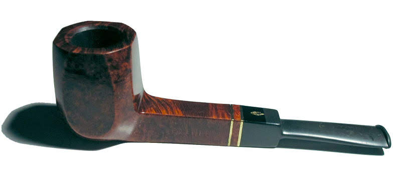

# Daten umformen



<!-- <style> -->
<!-- q { -->
<!--   quotes: '„' '“'; -->
<!-- } -->
<!-- </style> -->


```{r}
#| echo: false
#| message: false
library(ggpubr)
library(png)
library(grid)
library(patchwork)
library(gt)
library(tidyverse)
library(easystats)
library(exams2forms)
```


```{r}
#| echo: false

source("_common.R")
```




::: {.content-visible when-format="html"}
```{webr}
#| edit: false
#| echo: false
#| output: false
# Unsichtbare Vorbereitung für die interaktiven R-Zellen (WebR):
# Paket laden und Daten so einlesen wie im Buch (ohne Zeilennummer und Titel)
library(dplyr)
mariokart <- read.csv("data/mariokart.csv") |> 
  tibble::as_tibble() |> 
  select(-V1, -title)
mariokart_roh <- read.csv("data/mariokart_roh.csv", colClasses = c(id = "character")) |>
  tibble::as_tibble()
```
:::


## Einstieg


### Lernziele


- Sie können typische Probleme in Rohdaten benennen (Dubletten, fehlende Werte, unplausible Werte und Extremwerte, uneinheitliche Kodierung) und in einem Datensatz erkennen.
- Sie können für jedes dieser Probleme eine begründete Entscheidung treffen und diese festhalten.
- Sie können folgende Verben des Datenjudo einer Aufgabe zuordnen und R-Code mit ihnen lesen und anwenden: `arrange`, `filter`,  `select`, `summarise`, `group_by`, `mutate`.
- Sie können R-Befehle mit der "Pfeife" verketten.


### Lernhilfen

[Die YouTube-Sammlung "Datenjudo"](https://www.youtube.com/playlist?list=PLRR4REmBgpIGet_lcNf2wOd0W8j4c9hYN) gibt einen Überblick über typische Tätigkeiten des Datenjudo mit R.


:::{#exr-los}
### Mariokart importieren

Importieren Sie den Datensatz `mariokart`, s. @sec-import-mariokart. 
Probieren Sie alle in diesem Kapitel vorgestellten Verben des Datenjudos aus,
zunächst, indem Sie einfach den R-Code kopieren und selber ausführen. Danach überlegen Sie sich Varianten. $\square$
:::


::: {.content-visible when-format="html"}
### R-Code zum Copy-Pasten

Sie finden den R-Code für jedes Kapitel [hier](https://github.com/sebastiansauer/statistik1/tree/main/R-code-for-all-chapters). $\square$
:::


### Frag den Bot


>   [🧑‍🎓]{.content-visible when-format="html"}[\emoji{student}]{.content-visible when-format="pdf"} Erkläre einem Fünfjährigen, warum Statistik nützlich ist.

>   [🤖]{.content-visible when-format="html"}[\emoji{robot}]{.content-visible when-format="pdf"}  Okay, hör zu. Stell dir vor, du hast viele Spielzeugautos und du willst herausfinden, welches Auto am meisten bespielt wird. Du kannst jeden Tag zählen, wie oft du jedes Auto benutzt hast. Aber das wäre sehr mühsam und könnte schnell durcheinander gebracht werden. Stattdessen kannst du mit Statistik eine einfachere Methode finden. Du kannst zum Beispiel eine Liste machen und jedes Auto mit einer bestimmten Farbe markieren. Dann kannst du jeden Tag einfach zählen, wie oft du jede Farbe verwendet hast. Am Ende kannst du herausfinden, welches Auto am meisten bespielt wurde, indem du siehst, welche Farbe am meisten verwendet wurde. Das ist ein Beispiel dafür, wie Statistik uns dabei helfen kann, Muster in großen Datensätzen zu finden und Entscheidungen zu treffen, ohne alles einzeln zu zählen.^[Quelle: ChatGPT 3.5, 2023-02-09]


<!-- ::::: {.content-visible when-format="html" unless-format="epub"} -->

<!-- ### Quiz zum Einstieg

:::: {layout="[ 80, 20 ]"}
::: {#first-column}
Vielleicht fordert Sie die Lehrkraft zu einem Einstiegsquiz auf, 
etwa mittels der Plattform [partici.fy](https://partici.fi/30134458).
Alternativ überlegen Sie sich selber 10 Quiz-Aufgaben zum Stoff des letzten Kapitels.
:::

::: {#second-column}

```{r}
#| echo: false
#| out-width: "75%"
#| fig-align: center
qr <- qrcode::qr_code("https://partici.fi/30134458")
plot(qr)
```
:::
::::

-->


:::{#def-datenjudo}
### Datenjudo
Mit *Datenjudo* meint man den Prozess der Aufbereitens, Umformens oder Zusammenfassen von Daten, sowohl für einzelne Beobachtungen (Zeilen einer Datentabelle) oder Variablen (Spalten einer Datentabelle) oder einer ganzen Datentabelle. $\square$
:::


:::{.exm-datenjudo1}

### Praxisbezug: Aus dem Alltag des Datenwissenschaftlers

Denkt man an Data Science, stellt man sich coole Leute vor 
(in San Francisco oder Berlin), 
die an abgefahrenen Berechnungen mit hoch komplexen statistischen Modellen 
für gigantische Datenmengen basteln.
Laut dem *Harvard Business Review*,
verbringen Data Scientisten allerdings "80$\,$%" ihrer Zeit mit dem *Aufbereiten* von Daten [@bowne-anderson_what_2018].
Ja: mit uncoolen Tätigkeiten wie Tippfehler aus Datensätzen entfernen 
oder die Daten überhaupt nutzbar und verständlich zu machen.

Das zeigt zumindest, dass das Aufbereiten von Daten a) wichtig ist und b) dass man allein damit schon weit kommen kann. 
Eine gute Nachricht ist (vielleicht),
dass das Aufbereiten von Daten keine aufwändige Mathematik verlangt,
stattdessen muss man ein paar Handgriffe und Kniffe kennen.
Daher passt der Begriff *Datenjudo* vielleicht ganz gut. 
Kümmern wir uns also um das Aufbereiten bzw. Umformen von Daten, um das Datenjudo. [🔢🤹]{.content-visible when-format="html"} $\square$

:::


:::{#exm-datenjudo}
### Beispiel für Datenjudo

Beispiele für typische Tätigkeiten des Datenjudos sind:

- Zeilen *filtern* (z.$\,$B. nur Studierenden des Studiengangs X)
- Zeilen *sortieren* (z.$\,$B. Studierenden mit guten Noten in den oberen Zeilen)
- Spalten *wählen* (z.$\,$B. 100 langweilige Spalten ausblenden) 
- Spalten in eine Zahl *zusammenfassen* (z.$\,$B. Notenschnitt der 1. Klausur)
- Tabelle *gruppieren* (z.$\,$B. Analyse getrennt nach Standorten)
- Werte aus einer Spalte *verändern* oder *neue Spalte* bilden (z.$\,$B. Punkte in Prozent-Richtige umrechnen).
- … $\square$
:::


### Mach's einfach

::: {.content-visible when-format="html"}
Klingt fast zu schön, um wahr zu sein (s. @fig-that-would-be-great).

![Mach's einfach [@imgflip_simply] ](img/thatwouldbegreat.jpg){#fig-that-would-be-great width="50%"}
:::

Es gibt einen (einfachen) Trick, wie man umfangreiche Datenaufbereitung elegant geregelt kriegt.
Der Trick besteht darin, komplexe Operationen in mehrere einfache Teilschritte zu zergliedern.
(In gewisser Weise besteht das Wesen einer Analyse eben darin: 
die Zerlegung eines Gegenstands in seine Bestandteile.)
Man könnte vom "Lego-Prinzip" sprechen, s. @fig-lego.
Im linken Teil von @fig-lego sieht man ein (recht) komplexes Gebilde.
Zerlegt man es aber in seine Einzelteile, so sind es deutlich einfachere geometrische Objekte wie Dreiecke oder Kreise (rechter Teil des Diagramms).
Damit Sie es selber einfach machen können, 
müssen Sie selber Hand anlegen.
Importieren Sie daher den Datensatz `mariokart`, s. @sec-import-mariokart.


![Das Lego-Prinzip [@sauer_moderne_2019]](img/Bausteine_dplyr_crop){#fig-lego width="75%"}


::: {.content-visible when-format="html"}

Werfen wir einen Blick hinein (to glimpse):

```{r}
#| eval: false
glimpse(mariokart)
```
:::


```{r}
#| echo: false
mariokart <- tibble::as_tibble(mariokart)
```


:::{#exm-datenjudo}
### Der Datenguru in Aktion
Sie arbeiten immer noch bei dem großen Online-Auktionshaus.
Mittlerweile haben Sie sich den Ruf des "Datenguru" erworben.
Vielleicht, weil Sie behauptet haben, Data Science sei zu 80% Datenjudo,
das hat irgendwie Eindruck geschunden …
Naja, jedenfalls müssen Sie jetzt mal zeigen, dass Sie nicht nur schlaue Sprüche draufhaben, 
sondern auch die Daten ordentlich abbürsten können.
Sie analysieren dafür im Folgenden den Datensatz `mariokart`. Na, dann los. $\square$
:::


### Folienskript

::: {.callout-note}
Die Folien zu diesem Kapitel finden Sie [hier](slides/030-aufbereiten.html) (oder als [PDF](slides/030-aufbereiten.pdf)).
:::


## Was Rohdaten typischerweise falsch machen {#sec-rohdaten-probleme}


```{r}
#| echo: false
#| message: false
mariokart_roh <- readr::read_csv("data/mariokart_roh.csv", col_types = readr::cols(id = "c"))

n_roh <- nrow(mariokart_roh)
n_dubletten <- sum(duplicated(mariokart_roh))
n_na_preis <- sum(is.na(mariokart_roh$total_pr))
n_na_gesamt <- sum(!complete.cases(mariokart_roh))
n_kategorien_cond <- dplyr::n_distinct(mariokart_roh$cond)

mariokart_bereinigt <-
  mariokart_roh |>
  distinct() |>
  mutate(cond = str_to_lower(cond),
         cond = if_else(cond == "gebraucht", "used", cond),
         duration = if_else(duration > 10, NA, duration)) |>
  filter(total_pr < 100)

n_bereinigt <- nrow(mariokart_bereinigt)
mw_roh <- formatC(mean(mariokart_roh$total_pr, na.rm = TRUE), format = "f", digits = 1, decimal.mark = ",")
mw_bereinigt <- formatC(mean(mariokart_bereinigt$total_pr), format = "f", digits = 1, decimal.mark = ",")
```


Bevor wir uns mit R-Befehlen beschäftigen,
klären wir eine wichtigere Frage:
*Was* muss man mit Daten eigentlich tun, bevor man ihnen trauen kann?
Die Antwort darauf kann Ihnen kein R-Paket und keine KI abnehmen.
Eine KI schreibt Ihnen auf Zuruf den Code, um Ausreißer zu entfernen.
Ob es aber *richtig* ist, einen bestimmten Fall zu entfernen,
hängt von Ihrer Forschungsfrage ab, und die kennen nur Sie.


:::{#exm-datenguru-roh}
### Der Datenguru bekommt Rohdaten
Ihre Chefin im Online-Auktionshaus schickt Ihnen einen frischen Export aus der Datenbank:
den Datensatz `mariokart_roh`.
"Rechnen Sie mal schnell den mittleren Verkaufspreis aus", schreibt sie dazu.
Schnell?
Als Datenguru wissen Sie: Ein Export direkt aus der Datenbank ist selten sauber.
Bevor Sie irgendetwas ausrechnen, schauen Sie sich die Daten an. $\square$
:::


Sie können den Datensatz so importieren:

```{r}
#| eval: false
mariokart_roh_path <- "https://raw.githubusercontent.com/sebastiansauer/statistik1/main/data/mariokart_roh.csv"
# Auktionsnummer (id) als Text einlesen, sonst zeigt R sie als 1.1e+11 an
mariokart_roh <- read_csv(mariokart_roh_path, col_types = cols(id = "c"))
```

Den R-Code in diesem Abschnitt müssen Sie noch nicht im Detail verstehen;
die Verben, die darin vorkommen, lernen Sie in @sec-verben-datenjudo kennen.
Hier geht es um die *Probleme* und die *Entscheidungen*, nicht um die Syntax.


### Erst schauen, dann rechnen

Der erste Schritt ist immer derselbe: ein Blick in die Daten.
Wie viele Zeilen und Spalten gibt es?
Welchen Typ hat jede Spalte?
Passen die Werte zu dem, was die Spalte bedeuten soll?

```{r}
glimpse(mariokart_roh)
```

Zwei Dinge fallen auf, wenn man genau hinsieht.
Erstens: Der Datensatz hat `r n_roh` Zeilen,
der Ihnen bekannte Mariokart-Datensatz aber nur 143.
Zweitens: Die naive Rechnung geht schief.

```{r}
mean(mariokart_roh$total_pr)
```

`NA` heißt "not available", also "fehlt".
Der Mittelwert ist nicht berechenbar, weil in der Spalte Werte fehlen.
Es gibt also offenbar einiges zu tun.


### Dubletten

:::{#def-dublette}
### Dublette
Eine *Dublette* ist ein Fall (eine Zeile), der versehentlich mehrfach im Datensatz steht. $\square$
:::

**Woran erkennt man es?**
Am sichersten an einer Spalte, die jeden Fall eindeutig kennzeichnen sollte,
etwa eine Auktionsnummer (`id`), Kundennummer oder Matrikelnummer.
Taucht dieselbe Nummer mehrfach auf, stimmt etwas nicht.
Alternativ kann man nach Zeilen suchen, die in *allen* Spalten identisch sind:

```{r}
mariokart_roh |>
  count(id) |>
  filter(n > 1)
```

Drei Auktionen stehen doppelt im Datensatz.

**Welche Entscheidung muss ich treffen?**
Nicht jede doppelte Zeile ist eine Dublette.
Wenn zwei Studierende zufällig gleich alt sind, dasselbe studieren und dieselbe Note haben,
sind das zwei echte Fälle, die nur gleich aussehen.
Ohne eindeutige Kennung kann man das nicht unterscheiden.
Hier ist es einfach: Dieselbe Auktionsnummer zweimal ist ein Fehler beim Export.
Wir behalten von jeder Auktion genau eine Zeile.

**Was passiert, wenn man es ignoriert?**
Doppelte Fälle zählen doppelt.
Die Stichprobe wirkt größer, als sie ist,
und Kennwerte wie der Mittelwert werden zugunsten der doppelten Fälle verzerrt.


### Fehlende Werte

**Woran erkennt man es?**
Fehlende Werte heißen in R `NA`.
Man zählt sie am besten pro Spalte:

```{r}
mariokart_roh |>
  summarise(across(everything(), \(x) sum(is.na(x))))
```

**Welche Entscheidung muss ich treffen?**
Zuerst lohnt sich die Frage, *warum* ein Wert fehlt.
Wurde er vergessen?
Gibt es ihn gar nicht (z.$\,$B. Versandkosten bei Abholung)?
Hat jemand die Antwort verweigert?
Für ein Einführungsbuch reicht meist die pragmatische Entscheidung:
Wir lassen die fehlenden Werte *bei der jeweiligen Berechnung* weg.
In R heißt das Argument dafür `na.rm = TRUE` ("NA remove"):

```{r}
mean(mariokart_roh$total_pr, na.rm = TRUE)
```

Vorsicht bei der Holzhammer-Methode, *alle* Zeilen mit irgendeinem fehlenden Wert zu löschen
(in R z.$\,$B. mit `drop_na()`).
Im Rohdatensatz haben `r n_na_gesamt` Zeilen mindestens einen fehlenden Wert,
aber nur `r n_na_preis` davon fehlt der Verkaufspreis.
Wer sich für den Preis interessiert,
würde also Fälle wegwerfen, deren Preis vollständig vorliegt.

**Was passiert, wenn man es ignoriert?**
Im harmlosen Fall gibt R `NA` zurück und Sie merken es.
Im unangenehmen Fall werden Fälle stillschweigend weggelassen,
und Ihre Stichprobe schrumpft, ohne dass Sie es bemerken.
Fehlen die Werte nicht zufällig (z.$\,$B. weil gerade teure Auktionen schlecht dokumentiert sind),
verzerrt das die Ergebnisse.


### Unplausible Werte und Extremwerte

Hier lohnt es sich, zwei Arten von auffälligen Werten zu unterscheiden.

:::{#def-unplausibel}
### Unplausibler Wert und Extremwert
Ein *unplausibler Wert* ist ein Wert, der nicht stimmen *kann*, etwa ein negatives Alter.
Ein *Extremwert* (auch *Ausreißer*) ist ein Wert, der stark von den übrigen Werten abweicht,
aber durchaus möglich ist. $\square$
:::

**Woran erkennt man es?**
Am einfachsten am kleinsten und größten Wert jeder Spalte,
oder indem man die Daten sortiert und sich die Ränder anschaut.
Mit dem Boxplot (@def-boxplot) lernen Sie im nächsten Kapitel ein Diagramm kennen,
das Extremwerte auf einen Blick zeigt.

```{r}
mariokart_roh |>
  summarise(dauer_min = min(duration), dauer_max = max(duration),
            preis_min = min(total_pr, na.rm = TRUE), preis_max = max(total_pr, na.rm = TRUE))
```

Eine Auktion soll 70 Tage gedauert haben.
Bei eBay dauert eine Auktion aber höchstens 10 Tage.
Dieser Wert ist *unplausibel*, vermutlich ein Tippfehler für 7.

Der höchste Preis liegt bei 327 Dollar, der zweithöchste bei 118 Dollar.
Die anderen Auktionen liegen alle unter 80 Dollar.
Diese Werte sind *extrem*, aber nicht unmöglich.
Ein Blick in die Titel der beiden Auktionen klärt die Sache:
Bei der einen wurde eine ganze Wii-Konsole samt weiterer Spiele verkauft,
bei der anderen ein Paket mit zehn Spielen.

**Welche Entscheidung muss ich treffen?**
Bei unplausiblen Werten: korrigieren, wenn man *sicher* weiß, was gemeint war,
sonst den Wert auf `NA` setzen.
Wir wissen nicht sicher, ob 7 gemeint war, also setzen wir die Dauer auf `NA`.

Bei Extremwerten ist die Entscheidung heikler.
Die Leitfrage lautet: *Gehört dieser Fall zu dem, worüber ich eine Aussage treffen will?*
Unsere Forschungsfrage betrifft den Preis *eines* Mariokart-Spiels.
Eine Konsole mit mehreren Spielen ist ein anderes Produkt,
der Fall gehört also nicht zu unserer Frage.
Wir schließen daher Auktionen mit einem Preis ab 100 Dollar aus.
Diese Entscheidung gilt für den Rest des Buches:
Wenn Sie in späteren Kapiteln `filter(total_pr < 100)` oder `mariokart_no_extreme` sehen,
dann aus genau diesem Grund.

:::{.callout-important}
Extremwerte werden *nicht* entfernt, weil sie stören.
Sie werden entfernt, wenn es einen inhaltlichen Grund gibt, warum sie nicht zur Fragestellung gehören.
Und diese Entscheidung wird offengelegt.
Wer Daten entfernt, nur weil das Ergebnis dann schöner aussieht, betrügt (s. @sec-statistik-luegen). $\square$
:::

**Was passiert, wenn man es ignoriert?**
Ein einziger Extremwert kann den Mittelwert deutlich verschieben.
In @sec-median lernen Sie mit dem Median einen Kennwert kennen,
der gegenüber Extremwerten weniger empfindlich ist.


### Uneinheitliche Kodierung

**Woran erkennt man es?**
Bei kategorialen Variablen hilft es, die Kategorien auszuzählen:

```{r}
mariokart_roh |>
  count(cond)
```

Die Variable `cond` (Zustand) sollte nur zwei Kategorien haben, `new` und `used`.
Im Rohdatensatz sind es aber `r n_kategorien_cond`:
Groß- und Kleinschreibung variiert,
und einmal wurde der Zustand auf Deutsch eingetragen.
Für R sind `"used"`, `"USED"` und `"gebraucht"` drei verschiedene Dinge.

**Welche Entscheidung muss ich treffen?**
Meist ist die Entscheidung klar: vereinheitlichen.
Man legt fest, welche Schreibweise gilt, und ordnet alle Varianten dieser Schreibweise zu.
Ähnliche Probleme sind Zahlen, die als Text gespeichert sind (`"4,99"` statt `4.99`),
oder uneinheitliche Einheiten (Euro und Cent, Meter und Zentimeter) in derselben Spalte.

**Was passiert, wenn man es ignoriert?**
Gruppenvergleiche werden falsch.
Wer die Preise neuer und gebrauchter Spiele vergleicht,
lässt die falsch geschriebenen Fälle unbemerkt unter den Tisch fallen
oder bekommt unsinnige Extra-Gruppen.


### Aufbereitung dokumentieren

Alle bisherigen Entscheidungen haben eines gemeinsam:
Jemand anderes könnte sie anders treffen.
Darum gilt:

1. **Die Rohdaten bleiben unangetastet.** Sie ändern nie die Originaldatei, sondern erzeugen einen neuen, bereinigten Datensatz.
2. **Jeder Schritt steht im Skript.** Wer Ihr Skript liest, sieht, was Sie getan haben und kann es wiederholen.
3. **Jede Entscheidung bekommt eine Begründung,** am besten als Kommentar direkt am Code.

So sieht das für unser Beispiel aus.
Die einzelnen Verben lernen Sie im nächsten Abschnitt kennen;
lesen Sie zunächst nur die Kommentare.

```{r}
#| eval: false
mariokart_bereinigt <-
  mariokart_roh |>
  # Dubletten: drei Auktionen wurden doppelt exportiert
  distinct() |>
  # Kodierung vereinheitlichen: nur "new" und "used"
  mutate(cond = str_to_lower(cond),
         cond = if_else(cond == "gebraucht", "used", cond)) |>
  # Unplausibel: Auktionen dauern höchstens 10 Tage, wahrer Wert unbekannt
  mutate(duration = if_else(duration > 10, NA, duration)) |>
  # Extremwerte: Bundles mit Konsole bzw. mehreren Spielen gehören
  # nicht zur Forschungsfrage (Preis eines Mariokart-Spiels)
  filter(total_pr < 100)
```

Der bereinigte Datensatz hat `r n_bereinigt` Zeilen.
Der mittlere Verkaufspreis liegt jetzt bei `r mw_bereinigt` Dollar,
statt bei `r mw_roh` Dollar in den Rohdaten (mit `na.rm = TRUE`).
Das ist die Antwort, die Sie Ihrer Chefin schicken, zusammen mit einem Satz,
welche Fälle Sie warum ausgeschlossen haben.


### Überblick

@tbl-rohdaten-probleme fasst die typischen Probleme zusammen.

| Problem | Erkennungszeichen | typische Entscheidung | R-Werkzeug |
|:--------|:------------------|:----------------------|:-----------|
| Dubletten | eine Kennung (ID) kommt mehrfach vor | doppelte Zeilen entfernen | `count()`, `distinct()` |
| fehlende Werte | `NA` in einer Spalte | bei der jeweiligen Berechnung weglassen | `is.na()`, `na.rm = TRUE` |
| unplausible Werte | Wert ist unmöglich (z.$\,$B. negatives Alter) | korrigieren, wenn sicher, sonst `NA` | `summarise()`, `mutate()` |
| Extremwerte | Wert weicht stark ab, ist aber möglich | prüfen, ob der Fall zur Fragestellung gehört | `arrange()`, `filter()` |
| uneinheitliche Kodierung | zu viele Kategorien, Tippfehler | auf eine Schreibweise vereinheitlichen | `count()`, `mutate()` |

: Typische Probleme in Rohdaten und wie man ihnen begegnet {#tbl-rohdaten-probleme}


:::{#exr-rohdaten-entscheidung}
### Welches Problem steckt dahinter?
Ordnen Sie jedem Befund ein Problem aus @tbl-rohdaten-probleme zu und nennen Sie eine sinnvolle Entscheidung.

a) In einer Umfrage unter Studierenden gibt eine Person ihr Alter mit 3 Jahren an.
b) In der Spalte `geschlecht` stehen die Werte `w`, `m`, `weiblich` und `W`.
c) Eine Matrikelnummer taucht zweimal auf, beide Zeilen sind identisch.
d) In einer Studie zum Pendelweg gibt eine Person 180 Minuten an. $\square$
:::

:::{.callout-tip collapse="true"}
### Lösung zu @exr-rohdaten-entscheidung

a) Unplausibler Wert: Das Alter auf `NA` setzen (oder korrigieren, falls man den wahren Wert sicher kennt).
b) Uneinheitliche Kodierung: auf eine Schreibweise vereinheitlichen, z.$\,$B. `w` und `m`.
c) Dublette: eine der beiden Zeilen entfernen.
d) Extremwert: möglich (z.$\,$B. Fernpendler), also nicht einfach löschen. Prüfen, ob die Person zur Fragestellung gehört, und die Entscheidung offenlegen. $\square$
:::


::: {.content-visible when-format="html"}

:::{#exr-rohdaten-na}
Wie viele fehlende Werte hat die Spalte `seller_rate` (Bewertung des Verkäufers) im Datensatz `mariokart_roh`? $\square$
:::

Lösen Sie @exr-rohdaten-na hier im Browser.

```{webr}
#| exercise: ex_rohdaten_na
sum(is.na(______))
```

::: {.hint exercise="ex_rohdaten_na"}
Eine Spalte eines Datensatzes sprechen Sie mit dem Dollarzeichen an: `datensatz$spalte`.
:::

::: {.solution exercise="ex_rohdaten_na"}
```{webr}
#| exercise: ex_rohdaten_na
#| solution: true
sum(is.na(mariokart_roh$seller_rate))
```
:::

:::


## Die Verben des Datenjudos {#sec-verben-datenjudo}

In @sec-rohdaten-probleme ging es darum, *was* man mit Daten tun muss.
Jetzt geht es darum, *wie* man es R sagt.
Dafür gibt es im R-Paket `dplyr` (Teil des `tidyverse`) eine Handvoll Befehle,
die man die *Verben des Datenjudos* nennt.
Jedes Verb erledigt genau eine typische Aufgabe, s. @tbl-verben-aufgaben.

| Aufgabe | Verb | Beispiel |
|:--------|:-----|:---------|
| Zeilen (Fälle) auswählen | `filter` | nur die neuen Spiele |
| Spalten (Variablen) auswählen | `select` | nur Zustand und Preis |
| Zeilen sortieren | `arrange` | die teuersten Spiele zuerst |
| Spalte neu berechnen | `mutate` | Preis in Yen umrechnen |
| Zeilen zählen | `count` | Wie viele Spiele sind neu? |
| aufteilen und zusammenfassen | `group_by` + `summarise` | mittlerer Preis je Zustand |

: Die Verben des Datenjudos und ihre Aufgaben {#tbl-verben-aufgaben}

Wenn Sie wissen, welche Aufgabe Sie erledigen wollen,
wissen Sie also auch, welches Verb Sie brauchen,
und können es einer KI präzise sagen oder in deren Code wiedererkennen.

Die Verben wohnen im Paket `dplyr`,
das gestartet wird, wenn Sie `library(tidyverse)` eingeben.
Falls Sie vergessen, das Paket `tidyverse` zu starten,
dann funktionieren diese Befehle nicht.
Wir stellen jedes Verb zuerst an einem Spielzeug-Datensatz vor, s. @tbl-datenjudo,
und dann an den Mariokart-Daten.

```{r}
#| echo: false
d <-
tibble(id = c(1, 2, 3),
       name = c("Anni", "Berti", "Charli"),
       gruppe = c("A", "A", "B"),
       note = c(2.7, 2.7, 1.7))

ra <- png::readPNG("img/rightarrow.png", native = TRUE)

p_d1 <- ggtexttable(d, rows=NULL)
p_ra <- ggplot() + inset_element(ra, 0, 0, 1, 1) + theme_void()
```

```{r}
#| echo: false
#| tbl-cap: "Ein einfacher Datensatz von schlichtem Gemüt"
#| label: tbl-datenjudo
d |> knitr::kable()
```

```{r}
#| echo: false
mariokart <-
  mariokart |>
  select(-title)  # braucht zu viel Platz
```


::: {.content-visible when-format="html"}

:::{.callout-tip}
#### R direkt im Browser ausprobieren 🧪

In diesem Kapitel finden Sie Code-Felder, deren R-Code direkt in Ihrem Browser läuft -- ohne Installation.
Ändern Sie den Code und klicken Sie auf *Run Code*.
Bei Übungen hilft Ihnen *Show Hint* weiter; danach können Sie sich die Lösung zeigen lassen.
Beim ersten Start dauert es einige Sekunden, bis R im Hintergrund geladen ist.
:::

:::


### Zeilen filtern: `filter`

Zeilen *filtern* bedeutet, nur *bestimmte* Zeilen (Fälle) zu *behalten*;
die restlichen Zeilen fallen weg.
Man braucht also ein Filterkriterium, s. @fig-filter.


```{r}
#| echo: false
#| label: fig-filter
#| fig-cap: "Sinnbild für das Filtern einer Tabelle mit `filter`: Gruppe *B* wurde entfernt, also wurde nach Gruppe *A* gefiltert."
d_filter <-
  d |>
  filter(note > 2)


p_d1 <- ggtexttable(d, rows=NULL)
p_ra <- ggplot() + inset_element(ra, 0, 0, 1, 1) + theme_void()
p_d_filter <- ggtexttable(d_filter, rows=NULL)

p_d_filter <-
  p_d_filter |>
  table_cell_bg(column = 1:4, fill = okabeito_colors()[1], row = 2:tab_nrow(p_d_filter))

p_text_filter <- grid::textGrob("filter")

design <-
  "
A#D
ABD
ACD
A#D
"

p_filter <- wrap_plots(A= p_d1,
                       B = p_text_filter ,
                       C = p_ra,
                       D = p_d_filter,
                       widths = c(4,1,4),
                       design = design)
p_filter
```


:::{#exm-filter}

### Nur Auktionen mit Foto

Sie möchten sich nur die Auktionen anschauen, bei denen ein Foto der Ware dabei war:

```{r}
mariokart_foto <- filter(mariokart, stock_photo == "yes")
```

Auf Deutsch: "Hey R, filtere aus `mariokart` die Zeilen, bei denen `stock_photo` gleich `"yes"` ist."
Beachten Sie das doppelte Gleichheitszeichen `==`: Es *prüft*, ob zwei Dinge gleich sind. $\square$
:::

Mehrere Kriterien verknüpft man mit den logischen Operatoren `&` (UND) und `|` (ODER), s. @sec-logic:

```{r}
#| eval: false
filter(mariokart, stock_photo == "yes" & cond == "new")  # Foto UND neu
filter(mariokart, stock_photo == "yes" | cond == "new")  # Foto ODER neu (oder beides)
```

In @sec-rohdaten-probleme haben Sie `filter` schon gesehen:
`filter(total_pr < 100)` schließt die Bundle-Auktionen aus.


:::{#exr-filter2}
Filtern Sie die Spiele mit nur einem Lenkrad und ohne Versandkosten. $\square$
:::


::: {.content-visible when-format="html"}

Lösen Sie @exr-filter2 hier im Browser. Ersetzen Sie die Unterstriche `______` durch die passenden Filterbedingungen.

```{webr}
#| exercise: ex_filter2
filter(mariokart, ______ & ______)
```

::: {.hint exercise="ex_filter2"}
Die Anzahl der Lenkräder steht in `wheels`, die Versandkosten in `ship_pr`.
:::

::: {.solution exercise="ex_filter2"}
```{webr}
#| exercise: ex_filter2
#| solution: true
filter(mariokart, wheels == 1 & ship_pr == 0)
```
:::

:::


### Spalten auswählen: `select`

Eine Tabelle mit vielen Spalten wird schnell unübersichtlich.
Mit `select` behalten Sie *nur* die Spalten, die Sie interessieren, s. @fig-select.

```{r}
#| echo: false
#| label: fig-select
#| fig-asp: 0.5
#| fig-cap: "Sinnbild für das Auswählen von Spalten mit `select`"
d_select <-
  d |>
  select(id, note)

p_d1 <- ggtexttable(d, rows=NULL)
p_ra <- ggplot() + inset_element(ra, 0, 0, 1, 1) + theme_void()
p_d_select <- ggtexttable(d_select, rows=NULL)

p_d_select2 <-
  p_d1 |>
  table_cell_bg(column = 2, fill = okabeito_colors()[1], row = 2:tab_nrow(p_d_select))

p_text_select <- grid::textGrob("select")

design <-
  "
A#D
ABD
ACD
A#D
"

p_select <- wrap_plots(A= p_d_select2,
                       B = p_text_select,
                       C = p_ra,
                       D = p_d_select,
                       widths = c(4,1,4),
                       design = design)
p_select
```

:::{#exm-select}

### Fokus auf zwei Spalten

Sie interessieren sich für den Zusammenhang von Zustand und Preis.
Also wählen Sie genau diese beiden Spalten aus:

```{r}
#| eval: false
select(mariokart, cond, total_pr)
```

Mit einem Minus *entfernen* Sie eine Spalte: `select(mariokart, -id)` behält alle Spalten außer `id`. $\square$
:::

Wie die meisten Verben des Datenjudos bekommt `select` eine Tabelle und gibt eine Tabelle zurück,
auch wenn Sie nur eine einzige Spalte auswählen.


:::{#exr-select}
Wählen Sie die Spalten `total_pr`, `cond` sowie die zweite Spalte der Tabelle `mariokart` aus!^[`select(mariokart, total_pr, cond, 2)`] $\square$
:::

::: {.content-visible when-format="html"}

Lösen Sie @exr-select hier im Browser.

```{webr}
#| exercise: ex_select
select(mariokart, ______)
```

::: {.hint exercise="ex_select"}
Spalten können Sie über ihren Namen oder ihre Position (Nummer) auswählen; trennen Sie sie mit Kommas.
:::

::: {.solution exercise="ex_select"}
```{webr}
#| exercise: ex_select
#| solution: true
select(mariokart, total_pr, cond, 2)
```
:::

:::


### Zeilen sortieren: `arrange`

*Sortieren* ist eine einfache, aber häufige Tätigkeit, s. @fig-arrange.
Sie ist auch der schnellste Weg, sich die Ränder einer Verteilung anzuschauen,
also etwa Extremwerte zu finden (s. @sec-rohdaten-probleme).

```{r}
#| echo: false
#| label: fig-arrange
#| fig-asp: .5
#| fig-cap: "Sinnbild für das Sortieren einer Tabelle mit `arrange`: Hier wurden die Noten aufsteigend sortiert."
d_arranged <-
  d |>
  arrange(note)

p_d_arranged <- ggtexttable(d_arranged, rows=NULL)

p_d_arranged <-
  p_d_arranged |>
  table_cell_bg(column = 4, fill = okabeito_colors()[1],
                row = 2:tab_nrow(p_d_arranged))

p_text <- grid::textGrob("arrange")

design <-
  "
A#D
ABD
ACD
A#D
"

p_arrange <- wrap_plots(A = p_d1,
                        B = p_text ,
                        C = p_ra,
                        D = p_d_arranged,
           widths = c(4,1,4),
           design = design)
p_arrange +
  theme(plot.margin = margin(t = 5, r = 5, b = 5, l = 5, unit = "pt")) # Adjust top, right, bottom, and left margins
```


:::{#exm-arrange1}

### Was sind die höchsten Preise?

`arrange` sortiert per Voreinstellung *aufsteigend*.
Setzt man ein Minus vor die Spalte, wird *absteigend* sortiert,
die teuersten Auktionen stehen dann oben, s. @tbl-arrange.

```{r}
#| eval: false
arrange(mariokart, -total_pr)
```

```{r}
#| echo: false
#| tbl-cap: "Die Datentabelle, absteigend sortiert nach `total_pr` (die ersten drei Zeilen, nur einige Spalten)"
#| label: tbl-arrange
mariokart |>
  arrange(-total_pr) |>
  select(total_pr, cond, stock_photo, wheels) |>
  head(3)
```

Da sind sie wieder, die beiden Bundle-Auktionen. $\square$
:::


:::{#exr-arrange2}
Sortieren Sie die Mariokart-Daten absteigend nach der Anzahl der beigelegten Lenkräder. $\square$
:::

::: {.content-visible when-format="html"}

Lösen Sie @exr-arrange2 hier im Browser.

```{webr}
#| exercise: ex_arrange2
arrange(mariokart, ______)
```

::: {.hint exercise="ex_arrange2"}
Die Anzahl der Lenkräder steht in der Spalte `wheels`. Für absteigendes Sortieren setzen Sie ein Minus davor.
:::

::: {.solution exercise="ex_arrange2"}
```{webr}
#| exercise: ex_arrange2
#| solution: true
arrange(mariokart, -wheels)
```
:::

:::


### Spalten neu berechnen: `mutate`

Immer mal wieder möchte man eine Spalte *umrechnen* oder aus vorhandenen Spalten eine *neue* berechnen, s. @fig-mutate.

```{r}
#| echo: false
#| label: fig-mutate
#| fig-asp: 0.5
#| fig-cap: "Spalten verändern/neu berechnen mit `mutate`"
d_mutate <-
  d |>
  mutate(punkte = c(73, 72, 89))

p_d_mutate <- ggtexttable(d_mutate, rows=NULL)

p_d_mutate <-
  p_d_mutate |>
  table_cell_bg(column = 5, fill = okabeito_colors()[1], row = 2:tab_nrow(p_d_select))

p_text_mutate <- grid::textGrob("mutate",
                              gp=grid::gpar(fontsize=7))

design <-
  "
A#D
ABD
ACD
A#D
"

p_mutate <- wrap_plots(A= p_d1,
                       B = p_text_mutate,
                       C = p_ra,
                       D = p_d_mutate,
                       widths = c(3,1,4),
                       design = design)
p_mutate
```

:::{#exm-mutate}

### Preise in Yen

Der Hersteller von *Mariokart* kommt aus Japan;
für ein Meeting möchten Sie die Verkaufspreise von Dollar in Yen umrechnen.
Nach etwas Googeln finden Sie einen Umrechnungskurs von 1:133.

```{r}
mariokart_yen <- mutate(mariokart, total_pr_yen = total_pr * 133)
```

`mutate` hängt die neue Spalte `total_pr_yen` hinten an die Tabelle an.
Die Rechnung wird für jede Zeile einzeln ausgeführt. $\square$
:::

Mit `mutate` kann man Spalten addieren, multiplizieren, runden oder sonst wie umrechnen.
In @sec-rohdaten-probleme haben Sie es auch zum Korrigieren benutzt,
etwa um die Schreibweise von `cond` zu vereinheitlichen.
Gibt man der neuen Spalte den Namen einer *vorhandenen* Spalte, wird diese überschrieben.


:::{#exr-mutate}
Rechnen Sie die Dauer der Auktionen von Tagen in Wochen um. $\square$
:::

::: {.content-visible when-format="html"}

Lösen Sie @exr-mutate hier im Browser.

```{webr}
#| exercise: ex_mutate
mariokart_wochen <- mutate(mariokart, duration_week = ______)

select(mariokart_wochen, duration, duration_week)
```

::: {.hint exercise="ex_mutate"}
Eine Woche hat 7 Tage; die Dauer in Tagen steht in `duration`.
:::

::: {.solution exercise="ex_mutate"}
```{webr}
#| exercise: ex_mutate
#| solution: true
mariokart_wochen <- mutate(mariokart, duration_week = duration / 7)

select(mariokart_wochen, duration, duration_week)
```
:::

:::

::: {.content-visible unless-format="html"}
Lösung: `mutate(mariokart, duration_week = duration / 7)`
:::


### Zeilen zählen: `count`

Bei nominalskalierten Daten ist Zählen (fast) das Einzige, was man tun kann:
Wie viele Spiele sind neu, wie viele gebraucht?

:::{#exm-count}
### Neu oder gebraucht?
Ihre Chefin möchte keine komplizierten Kennwerte sehen, nur schlichte Häufigkeiten:

```{r}
mariokart_gezaehlt <- count(mariokart, cond)
mariokart_gezaehlt
```

Es gibt mehr gebrauchte als neue Spiele.
Mit `mutate` können Sie noch den *Anteil* ergänzen:

```{r}
mutate(mariokart_gezaehlt, anteil = n / sum(n))
```

`count` kann auch nach mehreren Spalten zugleich aufteilen, z.$\,$B. `count(mariokart, cond, stock_photo)`. $\square$
:::


:::{#exr-count}
Zählen Sie, wie viele der Auktionen ein Stock-Foto enthalten.^[`count(mariokart, stock_photo)`] $\square$
:::

::: {.content-visible when-format="html"}

Lösen Sie @exr-count hier im Browser.

```{webr}
#| exercise: ex_count
count(mariokart, ______)
```

::: {.hint exercise="ex_count"}
Ob ein Foto dabei ist, steht in der Spalte `stock_photo`.
:::

::: {.solution exercise="ex_count"}
```{webr}
#| exercise: ex_count
#| solution: true
count(mariokart, stock_photo)
```
:::

:::


### Aufteilen und zusammenfassen: `group_by` und `summarise`

#### Zusammenfassen

Eine lange Spalte mit Zahlen überblickt niemand.
`summarise` fasst eine Spalte zu *einer* Zahl zusammen,
zum Beispiel drei Klausurnoten zu ihrem Mittelwert, s. @fig-summarise.

```{r}
#| echo: false
#| label: fig-summarise
#| fig-asp: 0.5
#| fig-cap: "Spalten zu einer einzelnen Zahl zusammenfassen mit `summarise`: Hier wurden die Noten anhand des Mittelwerts zusammengefasst."
d_summ <-
  d |>
  summarise(note_mw = round(mean(note), 1))


p_d1 <- ggtexttable(d, rows=NULL)
p_ra <- ggplot() + inset_element(ra, 0, 0, 1, 1) + theme_void()
p_d_summ <- ggtexttable(d_summ, rows=NULL)

p_text_summ <- grid::textGrob("summarise",
                              gp=grid::gpar(fontsize=8))

design <-
  "
A#D
ABD
ACD
A#D
"

p_summ <- wrap_plots(A= p_d1,
                       B = p_text_summ,
                       C = p_ra,
                       D = p_d_summ,
                       widths = c(4,1,4),
                       design = design)
p_summ
```

*Wie* zusammengefasst wird, geben Sie innerhalb von `summarise` an,
etwa mit `mean` (Mittelwert) oder `max` (größter Wert), s. @lst-summarise.

```{r}
#| lst-label: lst-summarise
#| echo: true
#| lst-cap: "Die R-Funktion summarise fasst eine Spalte zu einer einzelnen Zahl zusammen."
summarise(mariokart, preis_mw = mean(total_pr))
```

Etwa 50 Dollar erzielte eine Auktion im Durchschnitt.


#### Aufteilen

Interessanter als *ein* Mittelwert ist oft der Vergleich von Gruppen:
Kosten neue Spiele im Schnitt mehr als gebrauchte?
Dazu teilt man die Tabelle mit `group_by` in Teiltabellen auf, s. @fig-group.


```{r}
#| echo: false
#| label: fig-group
#| fig-cap: "Gruppieren von Datensätzen mit `group_by`: Hier wurde anhand der Variable `gruppe` gruppiert."
d_groupby <-
  d |>
  group_by(gruppe)

d_g1 <-
  d |>
  filter(gruppe == "A")

d_g2 <-
  d |>
  filter(gruppe == "B")


p_d_g1 <- ggtexttable(d_g1, rows=NULL)
p_d_g2 <- ggtexttable(d_g2, rows=NULL)


p_d_g1 <-
  p_d_g1 |>
  # 2 Gruppen: Dunkelblau und Orange (kein Gelb); hell/dunkel trennt auch
  # im Graustufendruck. Text weiß auf Blau, fast schwarz auf Orange, fett.
  table_cell_bg(column = 3, fill = okabe_linie[2], row = 2:tab_nrow(p_d_g1)) |>
  table_cell_font(column = 3, color = "white", face = "bold",
                  row = 2:tab_nrow(p_d_g1))

p_d_g2 <-
  p_d_g2 |>
  table_cell_bg(column = 3, fill = okabe_linie[1], row = 2:tab_nrow(p_d_g2)) |>
  table_cell_font(column = 3, color = fast_schwarz, face = "bold",
                  row = 2:tab_nrow(p_d_g2))

p_text_summ <- grid::textGrob("group_by(gruppe)",
                              gp=grid::gpar(fontsize=8))

design <-
  "
A#D
ABD
ACE
A#E
"

p_group <- wrap_plots(A= p_d1,
                       B = p_text_summ,
                       C = p_ra,
                       D = p_d_g1,
                       E = p_d_g2,
                       widths = c(3,1,3),
                       design = design)
p_group
```

Der gruppierten Tabelle sieht man das Aufteilen kaum an.
Aber alle *nachfolgenden* Berechnungen werden für jede Teiltabelle einzeln ausgeführt.
Darum kommen `group_by` und `summarise` fast immer im Doppelpack.


:::{#exm-groupby}

### Mittlerer Preis pro Gruppe

```{r}
mariokart_gruppiert <- group_by(mariokart, cond)
summarise(mariokart_gruppiert, preis_mw = mean(total_pr))
```

Die neuen Spiele sind im Schnitt teurer, wer hätt's gedacht! $\square$
:::


:::{#exr-groupby}
Berechnen Sie den mittleren und maximalen Verkaufspreis getrennt für Spiele mit und ohne Foto! $\square$
:::

::: {.content-visible when-format="html"}

Lösen Sie @exr-groupby hier im Browser.

```{webr}
#| exercise: ex_groupby
mariokart_gruppiert_foto <- group_by(mariokart, ______)

summarise(mariokart_gruppiert_foto,
          total_pr_avg = ______,
          total_pr_max = ______)
```

::: {.hint exercise="ex_groupby"}
Gruppieren Sie nach `stock_photo`. Mittelwert und Maximum liefern `mean` und `max`.
:::

::: {.solution exercise="ex_groupby"}
```{webr}
#| exercise: ex_groupby
#| solution: true
mariokart_gruppiert_foto <- group_by(mariokart, stock_photo)

summarise(mariokart_gruppiert_foto,
          total_pr_avg = mean(total_pr),
          total_pr_max = max(total_pr))
```
:::

:::

:::{.callout-tip collapse="true"}
### Lösung zu @exr-groupby

```{r}
mariokart_gruppiert_foto <- group_by(mariokart, stock_photo)

summarise(mariokart_gruppiert_foto,
          total_pr_avg = mean(total_pr),
          total_pr_max = max(total_pr))
```

Bei Auktionen mit Foto wird im Schnitt ein höherer Preis erzielt als ohne Foto. $\square$
:::


:::{#exr-verb-zuordnen}
### Welches Verb passt?
Welches Verb (oder welche Kombination) brauchen Sie für die folgenden Aufgaben?

a) Nur die Auktionen, die länger als drei Tage dauerten.
b) Die Versandkosten von Dollar in Euro umrechnen.
c) Die durchschnittliche Anzahl der Gebote, getrennt nach Versandart (`ship_sp`).
d) Nur die Spalten `id` und `n_bids` behalten.
e) Wie viele Auktionen gibt es pro Anzahl beigelegter Lenkräder? $\square$
:::

:::{.callout-tip collapse="true"}
### Lösung zu @exr-verb-zuordnen

a) `filter(mariokart, duration > 3)`
b) `mutate(mariokart, ship_pr_euro = ship_pr * kurs)`, wobei `kurs` der aktuelle Umrechnungskurs ist
c) `group_by(mariokart, ship_sp)` und dann `summarise(..., gebote_mw = mean(n_bids))`
d) `select(mariokart, id, n_bids)`
e) `count(mariokart, wheels)` $\square$
:::


### Verben am Fließband

Die Verben des Datenjudos erwarten jeweils eine Tabelle ()
als Input und liefern eine Tabelle als Output zurück, s. @fig-tbl-in-out.
Darum kann man sie hintereinanderschalten wie Stationen an einem Fließband.
Die Verben werden beim ["Tidydatatutor"](https://tidydatatutor.com/) anschaulich illustriert.^[<https://tidydatatutor.com>]

```{mermaid}
%%| label: fig-tbl-in-out
%%| fig-cap: Tidyverse-Befehle erwarten normalerweise eine Tabelle ("Tibble") als Input und geben auch eine Tabelle zurück als Output
%%| fig-width: 4


flowchart LR
  A["▥"] --> B[tidyverse-Befehl] --> C["▥"]
```


## Die Pfeife {#sec-pipe}

[🚬 👈 ]{.content-visible when-format="html"}[Das ist keine Pfeife](https://en.wikipedia.org/wiki/The_Treachery_of_Images),
wie René Magritte 1929 in seinem [berühmten Bild](https://en.wikipedia.org/wiki/File:MagrittePipe.jpg) schrieb,
s. @fig-pfeifen.


:::::{#fig-pfeifen}

:::: {layout-ncol=4}

::: {.column width="30%"}
{width="50%"}

:::


::: {.column width="10%"}
<!-- Empty col -->

:::


::: {.column width="30%"}
:::{.xlarge}
|>
:::
:::

::: {.column width="30%"}
:::{.xlarge}
|>
:::
:::


::::


So sieht die Pfeife in R aus (Jaja, das ist keine Pfeife, sondern ein Symbol einer Pfeife …). Links: Ein *Bild* einer Pfeife [@m72004]. Mitte und Rechts: Die zwei R-Symbole für eine "Pfeife" (pipe).

:::::


Will man mehrere Verben hintereinander anwenden,
müsste man sie ohne Pfeife ineinander verschachteln wie russische Puppen (s. @lst-schachtel).
Das liest sich von innen nach außen und wird schnell unübersichtlich:

```r
summarise(group_by(filter(mariokart, total_pr < 100), cond), preis_mw = mean(total_pr))
```

Viel lesbarer wäre es, man könnte schreiben:

```
Nimm "mariokart" *und dann*
  filtere die günstigen Spiele *und dann*
  teile nach Zustand auf *und dann*
  fasse zum mittleren Preis zusammen.
```

:::{#def-pipe}
### Pfeife
"Und dann" heißt auf Errisch ` |> `.
Man nennt diesen Befehl "Pfeife" (engl. *pipe*). $\square$
:::

:::{.callout-note}
Lesen Sie ` |> ` einfach als "und dann".
Der Shortcut für die Pfeife ist Strg-Shift-M.
Die Pfeife `|>` ist seit R 4.1 fest in R eingebaut.^[Es gibt noch eine ältere Pfeife, `%>%`, aus dem Paket `magrittr`,
welches vom Paket `tidyverse` geladen wird. Beide Pfeifen funktionieren praktisch gleich;
in diesem Buch verwenden wir durchgehend die eingebaute Pfeife `|>`. Unter *Tools > Global Options …* können Sie in RStudio einstellen, welche Variante der Shortcut verwendet.]
:::


```{mermaid}
%%| fig-cap: Illustration für eine Pfeifensequenz, es geht vorwärts wie am Fließband.
%%| label: fig-pfeife
%%| fig-height: 0.4

flowchart LR
  A["▥"] --filter<br>zeilen-->B["▥"]
  B --wähle<br>spalten--> C["▥"]
  C --gruppiere--> D["▥"]
  D --fasse<br>zusammen--> E["▥"]
```


Der Datensatz wird am Fließband von Station zu Station weitergereicht
und an jeder Station weiterverarbeitet, s. @fig-pfeife und @lst-ihre-pfeife.

```{r}
#| lst-label: lst-ihre-pfeife
#| lst-cap: "Mariokart am Fließband: Die 'Pfeifen-Syntax'"
#| tbl-cap: "Endprodukt einer Pfeifen-Syntax"
# Hey R, nimm die Tabelle "mariokart":
mariokart |>
   # filter nur die günstigen Spiele:
  filter(total_pr < 100) |>
  # wähle die zwei Spalten:
  select(cond, total_pr) |>
  # gruppiere die Tabelle nach Zustand des Spiels:
  group_by(cond) |>
  # fasse beide Gruppen nach dem mittleren Preis zusammen:
  summarise(total_pr_mean = mean(total_pr))
```


Die Syntax `filter(mariokart, total_pr < 100)` und die Syntax `mariokart |> filter(total_pr < 100)` sind identisch.
Allgemeiner: `d |> f(x)` = `f(d, x)`.
Die Pfeife reicht die Tabelle also als erstes Argument an das nächste Verb weiter;
darum steht in den Verben nach einer Pfeife kein Tabellenname mehr.

::: {.content-visible when-format="html"}

Bauen Sie das Fließband selbst um: Lassen Sie z.$\,$B. den Filter weg, gruppieren Sie nach `stock_photo` oder berechnen Sie zusätzlich den Maximalpreis.

```{webr}
mariokart |>
  filter(total_pr < 100) |>
  select(cond, total_pr) |>
  group_by(cond) |>
  summarise(total_pr_mean = mean(total_pr))
```

:::


:::{#exr-pfeife-lesen}
### Was macht dieser Code?
Beschreiben Sie in eigenen Worten, was der folgende Code tut,
und überlegen Sie, wie das Ergebnis aussieht (wie viele Zeilen, welche Spalten?),
*bevor* Sie ihn ausführen.

```{r}
#| eval: false
mariokart |>
  filter(cond == "used") |>
  mutate(total_pr_yen = total_pr * 133) |>
  group_by(wheels) |>
  summarise(preis_yen_max = max(total_pr_yen))
```

$\square$
:::

:::{.callout-tip collapse="true"}
### Lösung zu @exr-pfeife-lesen

Nimm die Mariokart-Daten, *und dann*
behalte nur die gebrauchten Spiele, *und dann*
rechne den Preis in Yen um, *und dann*
teile nach Anzahl der Lenkräder auf, *und dann*
berechne in jeder Gruppe den höchsten Preis in Yen.

Das Ergebnis hat eine Zeile pro vorkommender Anzahl an Lenkrädern
und zwei Spalten: `wheels` und `preis_yen_max`.

```{r}
mariokart |>
  filter(cond == "used") |>
  mutate(total_pr_yen = total_pr * 133) |>
  group_by(wheels) |>
  summarise(preis_yen_max = max(total_pr_yen))
```

$\square$
:::


## Aufbereiten mit KI {#sec-aufbereiten-ki}

Den Code für die Datenaufbereitung lassen sich heute viele von einer KI schreiben,
etwa von ChatGPT, Claude oder dem Assistenten in Ihrer Entwicklungsumgebung.
Das ist bequem und meistens auch richtig.
*Meistens.*
Der Code einer KI läuft fast immer ohne Fehlermeldung durch.
Ob er auch *das Richtige* tut, verrät Ihnen R nicht.
Das müssen Sie selbst prüfen, und dafür brauchen Sie genau das,
was Sie in den beiden vorherigen Abschnitten gelernt haben:
die typischen Probleme (@sec-rohdaten-probleme) und die Verben (@sec-verben-datenjudo).


### Der Arbeitsablauf

1. **Aufgabe präzise formulieren.** Benennen Sie die Probleme und Ihre Entscheidungen in den Begriffen aus @tbl-rohdaten-probleme. Die KI kennt Ihre Forschungsfrage nicht.
2. **Code erhalten.**
3. **Code lesen.** Übersetzen Sie jede Zeile in einen "und dann"-Satz. Taucht ein Schritt auf, den Sie nicht bestellt haben, fragen Sie nach.
4. **Ergebnis prüfen.** Wie viele Zeilen hatte die Tabelle vorher, wie viele nachher? Welche Kategorien kommen vor? Ist die Größenordnung des Ergebnisses plausibel?


### Unpräzise und präzise Aufgaben

Vergleichen Sie zwei Aufträge an eine KI:

> **Unpräzise:** Bereinige `mariokart_roh` und berechne den mittleren Preis.

> **Präzise:** Im Datensatz `mariokart_roh` steht jede Zeile für eine eBay-Auktion, `id` ist die Auktionsnummer, `total_pr` der Verkaufspreis in Dollar.
> Bitte schreibe R-Code mit dem Tidyverse, der
> (1) doppelte Zeilen entfernt,
> (2) die Spalte `cond` auf die Werte `new` und `used` vereinheitlicht,
> (3) Auktionen ab 100 Dollar ausschließt, weil das Bündel mit mehreren Spielen sind,
> (4) den mittleren Preis getrennt für `new` und `used` berechnet und dabei fehlende Preise nur bei dieser Berechnung weglässt.
> Kommentiere jeden Schritt und gib nach jedem Schritt die Zeilenzahl aus.

Beim ersten Auftrag muss die KI raten, was "bereinigen" heißt.
Sie wird *irgendetwas* tun, und genau das ist das Problem:
Die Entscheidungen aus @sec-rohdaten-probleme trifft dann die KI und nicht Sie.
Der zweite Auftrag enthält diese Entscheidungen.
Er ist länger, aber Sie bekommen genau das, was Sie wollen,
und können es leicht prüfen.


### Typische Fehler im KI-Code

Die folgenden Fehler sind typisch, nicht nur bei KI, auch bei Menschen.
Gemeinsam ist ihnen: R meldet keinen Fehler.
Alle Beispiele beziehen sich auf die Frage "Wie hoch ist der mittlere Preis für neue und gebrauchte Spiele?"

Für die ersten beiden Beispiele gehen wir von Daten aus,
bei denen Dubletten und Kodierung schon bereinigt sind:

```{r}
mariokart_vorbereitet <-
  mariokart_roh |>
  distinct() |>
  mutate(cond = str_to_lower(cond),
         cond = if_else(cond == "gebraucht", "used", cond))
```


#### Fehler 1: Filtern an der falschen Stelle

Der Auftrag lautete, die Bundle-Auktionen auszuschließen.
Folgender Code sieht danach aus:

```{r}
# FALSCH
mariokart_vorbereitet |>
  group_by(cond) |>
  summarise(preis_mw = mean(total_pr, na.rm = TRUE)) |>
  filter(preis_mw < 100)
```

Lesen Sie den Code als "und dann"-Sätze:
Erst wird für jede Gruppe der Mittelwert berechnet, *und dann* wird gefiltert.
Gefiltert werden also nicht die *Auktionen*, sondern die *Mittelwerte*.
Da beide Mittelwerte unter 100 Dollar liegen, wird gar nichts entfernt.
Die Bundles stecken weiter im Mittelwert der gebrauchten Spiele.
Richtig ist, *zuerst* zu filtern:

```{r}
# RICHTIG
mariokart_vorbereitet |>
  filter(total_pr < 100) |>
  group_by(cond) |>
  summarise(preis_mw = mean(total_pr))
```

Der Unterschied bei den gebrauchten Spielen beträgt rund 4 Dollar.
Die Reihenfolge am Fließband ist also nicht egal.


#### Fehler 2: Die Holzhammer-Methode bei fehlenden Werten

```{r}
# FRAGWÜRDIG
mariokart_ohne_na <- drop_na(mariokart_vorbereitet)
nrow(mariokart_vorbereitet)
nrow(mariokart_ohne_na)
```

`drop_na()` ohne Angabe von Spalten löscht jede Zeile, in der *irgendein* Wert fehlt,
auch dann, wenn nur die Bewertung des Verkäufers fehlt und der Preis vorhanden ist.
Für die Frage nach dem Preis werden so grundlos Auktionen weggeworfen.
Besser: `na.rm = TRUE` bei der Berechnung oder `drop_na(total_pr)`, s. @sec-rohdaten-probleme.
Den Fehler bemerken Sie nur, wenn Sie die Zeilenzahl vorher und nachher vergleichen.


#### Fehler 3: Ausreißer nach Faustregel entfernt

Bittet man eine KI, "Ausreißer zu entfernen",
greift sie oft zu einer Faustregel: Alles, was weiter als 1,5 Interquartilsabstände
vom mittleren Bereich der Daten entfernt liegt, fliegt raus.^[Diese Regel steckt auch hinter dem Boxplot, s. @def-boxplot.]
Welche Auktionen wären das hier?

```{r}
mariokart_vorbereitet |>
  filter(total_pr > quantile(total_pr, .75, na.rm = TRUE) + 1.5 * IQR(total_pr, na.rm = TRUE)) |>
  select(total_pr, cond, wheels)
```

Neben den beiden Bundles würde auch eine Auktion für 75 Dollar entfernt.
Das ist aber ein ganz normales neues Spiel, nur mit drei Lenkrädern statt einem.
Eine Faustregel kennt Ihre Forschungsfrage nicht.
Sie liefert Kandidaten, die Sie sich anschauen sollten,
aber keine Entscheidung.


#### Fehler 4: Uneinheitliche Kodierung übersehen

Hat die KI nicht gewusst, dass `cond` uneinheitlich kodiert ist,
dann rechnet sie einfach mit den Rohdaten:

```{r}
# FALSCH
mariokart_roh |>
  filter(total_pr < 100) |>
  group_by(cond) |>
  summarise(preis_mw = mean(total_pr, na.rm = TRUE),
            n = n())
```

Hier verrät das Ergebnis den Fehler selbst, *wenn* man hinschaut:
Fünf Gruppen statt zwei, drei davon mit nur einer Auktion.
Darum gehört `n = n()` (die Anzahl der Fälle pro Gruppe) in fast jede Zusammenfassung.


### Checkliste: KI-Code prüfen

:::{.callout-important}
### Bevor Sie einem Ergebnis trauen
- Können Sie jede Zeile des Codes als "und dann"-Satz vorlesen?
- Hat der Code etwas getan, das Sie nicht bestellt haben (Zeilen gelöscht, Werte ersetzt)?
- Stimmt die Zeilenzahl vor und nach jedem Schritt mit Ihrer Erwartung überein?
- Kommen in Gruppierungsvariablen nur die erwarteten Kategorien vor (`count`)?
- Ist das Ergebnis in der Größenordnung plausibel? $\square$
:::


:::{#exr-ki-fehler}
### Finden Sie den Fehler
Sie haben eine KI gebeten: "Berechne den mittleren Verkaufspreis neuer Spiele mit Foto, ohne die Bundle-Auktionen ab 100 Dollar."
Die KI liefert:

```{r}
#| eval: false
mariokart_vorbereitet |>
  filter(cond == "new" | stock_photo == "yes") |>
  drop_na() |>
  summarise(preis_mw = mean(total_pr))
```

Finden Sie zwei Abweichungen vom Auftrag und eine fragwürdige Entscheidung. $\square$
:::

:::{.callout-tip collapse="true"}
### Lösung zu @exr-ki-fehler

1. `|` heißt ODER. Gewünscht waren Spiele, die neu sind *und* ein Foto haben, also `&`.
2. Der Ausschluss der Bundles (`total_pr < 100`) fehlt.
3. `drop_na()` löscht alle Zeilen mit irgendeinem fehlenden Wert, nicht nur die mit fehlendem Preis.

Richtig wäre:

```{r}
mariokart_vorbereitet |>
  filter(cond == "new" & stock_photo == "yes" & total_pr < 100) |>
  summarise(preis_mw = mean(total_pr, na.rm = TRUE),
            n = n())
```

$\square$
:::


::: {.content-visible when-format="html"}

Probieren Sie es im Browser aus: Führen Sie zuerst den fehlerhaften Code aus und korrigieren Sie ihn dann.
Vergleichen Sie die Ergebnisse.

```{webr}
mariokart_vorbereitet <- mariokart_roh |>
  distinct() |>
  mutate(cond = tolower(cond),
         cond = if_else(cond == "gebraucht", "used", cond))

mariokart_vorbereitet |>
  filter(cond == "new" | stock_photo == "yes") |>
  na.omit() |>   # wirkt hier wie drop_na()
  summarise(preis_mw = mean(total_pr))
```

:::


## Beispiele für Forschungsfragen


Bevor Sie die Lösungen der folgenden Fallbeispiele lesen, versuchen Sie die Aufgaben selbst zu lösen.
Ja, ich weiß, es ist hart, nicht gleich auf die Lösungen zu schauen! 


:::{#exr-fofrage1}

#### Das teuerste Spiel?

Sie arbeiten als strategischer Assistent der Geschäftsführerin 
und sind für Faktenchecks und andere Daten-Aufgaben zuständig.
Heute sollen Sie zeigen, was Sie können (Schluck).


>   [👩]{.content-visible when-format="html"}[\emoji{woman}]{.content-visible when-format="pdf"} Ich würde von Ihnen  gerne wissen, 
was das teuerste Spiel ist, aber jeweils für neue und gebrauchte Spiele. 
Aber nur für Spiele, die mit Foto verkauft wurden!

::: {.content-visible when-format="html"}

Versuchen Sie es zuerst selbst, hier im Browser:

```{webr}
#| exercise: ex_fofrage1
mariokart |> 
  filter(______) |> 
  group_by(______) |> 
  summarise(total_pr_max = ______)
```

::: {.hint exercise="ex_fofrage1"}
Filtern Sie nach `stock_photo == "yes"`, gruppieren Sie nach `cond` und nutzen Sie `max(total_pr)`.
:::

::: {.solution exercise="ex_fofrage1"}
```{webr}
#| exercise: ex_fofrage1
#| solution: true
mariokart |> 
  filter(stock_photo == "yes") |> 
  group_by(cond) |> 
  summarise(total_pr_max = max(total_pr))
```
:::

:::

**Lösung**

```{r}
mariokart |> 
  filter(stock_photo == "yes") |> 
  group_by(cond) |> 
  summarise(total_pr_max = max(total_pr))
```

Die Funktion `max` liefert den größten Wert eines Vektors zurück:

```{r}
x <- c(1, 2, 10)
max(x)
```

Das teuerste Spiel mit Foto kostet `75` Dollar, wenn es neu ist und `62`, wenn es gebraucht ist. $\square$
:::


:::{#exr-Forschungsfrage2}


### Die mittlere Versandpauschale?

>   [👩]{.content-visible when-format="html"}[\emoji{woman}]{.content-visible when-format="pdf"} Ich würde gerne die mittlere Versandpauschale wissen, 
aber getrennt nach Anzahl der Lenkräder, die dem Spiel beigelegt sind. 
Und ich will nur Gruppen berücksichtigen, die aus mindestens 10 Spielen bestehen!

::: {.content-visible when-format="html"}

Versuchen Sie es zuerst selbst, hier im Browser:

```{webr}
#| exercise: ex_fofrage2
mariokart |>
  count(wheels)

mariokart |>
  filter(______) |> 
  group_by(______) |> 
  summarise(mittlere_versandkosten = ______,
            anzahl_spiele = n())
```

::: {.hint exercise="ex_fofrage2"}
Zählen Sie zuerst mit `count(wheels)`, wie groß die Gruppen sind. Behalten Sie dann nur die Gruppen mit mindestens 10 Spielen (`wheels < 3`).
:::

::: {.solution exercise="ex_fofrage2"}
```{webr}
#| exercise: ex_fofrage2
#| solution: true
mariokart |>
  filter(wheels < 3) |> 
  group_by(wheels) |> 
  summarise(mittlere_versandkosten = mean(ship_pr),
            anzahl_spiele = n())
```
:::

:::

**Lösung**

Wenn wir die Anzahl der Spiele zählen in Abhängigkeit der beigelegten Lenkräder (`wheels`), 
bekommen wir eine Tabelle mit zwei Spalten: `wheels` und `n`.
`n` zählt, wie viele Spiele (Zeilen) 
in der jeweiligen Gruppe ("Teiltabelle") von `wheels` sind.

```{r}
mariokart |>
  count(wheels)
```

Aus dieser Tabelle sehen wir, dass 3 oder 4 Lenkräder nur selten (2 bzw. 1 Mal) 
beigelegt wurden und wir solche Spiele herausfiltern sollten, 
bevor wir den Mittelwert der Versandkosten ausrechnen:

```{r}
mariokart |>
  filter(wheels < 3) |> 
  group_by(wheels) |> 
  summarise(mittlere_versandkosten = mean(ship_pr),
            anzahl_spiele = n())
```

Die Funktion `n` gibt die Anzahl der Zeilen pro Teiltabelle zurück.

Die mittleren Versandkosten bewegen sich also zwischen 2.7 Dollar und 3.6 Dollar, 
je nach Anzahl der beigelegten Lenkräder. $\square$
:::


:::{#exr-Forschungsfrage3}


### Verkaufspreis in Yen?

>   [👩]{.content-visible when-format="html"}[\emoji{woman}]{.content-visible when-format="pdf"} Ich würde gerne den Verkaufspreis in Yen wissen, nicht in Euro. 
Dann rechne mal den mittleren Verkaufspreis aus und ziehe 10 % ab, 
die wir als Provision unseren Verkäufern zahlen müssen.


::: {.content-visible when-format="html"}

Versuchen Sie es zuerst selbst, hier im Browser:

```{webr}
#| exercise: ex_fofrage3
mariokart |> 
  mutate(total_pr_yen = ______) |> 
  summarise(
    preis_yen_mw = ______,
    preis_yen_mw_minus_10proz = ______)
```

::: {.hint exercise="ex_fofrage3"}
Umrechnungskurs: 1 Dollar = 133 Yen. 10 % abziehen heißt: `preis_yen_mw - 0.1 * preis_yen_mw`.
:::

::: {.solution exercise="ex_fofrage3"}
```{webr}
#| exercise: ex_fofrage3
#| solution: true
mariokart |> 
  mutate(total_pr_yen = total_pr * 133) |> 
  summarise(
    preis_yen_mw = mean(total_pr_yen),
    preis_yen_mw_minus_10proz = preis_yen_mw - 0.1 * preis_yen_mw)
```
:::

:::

**Lösung**

```{r}
mariokart |> 
  select(total_pr) |> 
  mutate(total_pr_yen = total_pr * 133) |> 
  summarise(
    preis_yen_mw = mean(total_pr_yen),
    preis_yen_mw_minus_10proz = preis_yen_mw - 0.1*preis_yen_mw)
```

Wie man sieht kann man in `summarise` auch mehr als eine Berechnung einstellen.
In diesem Fall haben wir zwei Berechnungen angestellt: 
Einmal den Mittelwert und einmal den Mittelwert minus 10% (des Mittelwerts).

:::


:::{#exr-diy}
### Do It Yourself
Denken Sie sich selber ähnliche Forschungsfragen aus.
Stellen Sie diese einer vertrauenswürdigen Kommilitonen bzw. einem vertrauenswürdigen Kommilitonen. 
DIY!
Schauen Sie, ob Ihre Aufgabe richtig gelöst wird.
Prüfen Sie streng … $\square$
:::

## Praxisbezug


Die Covid19-Epidemie hatte weltweit massive Auswirkungen; auch psychologischer Art wie Vereinsamung, 
Angst oder Depression.
 @mulukom_psychological_2020 berichten eine Studie, die die psychologischen Auswirkungen untersucht;
die Studie ist [unter der Projekt-ID *tsjnb* bei der Open Science Foundation (OSF), <https://osf.io/tsjnb/>, angemeldet](https://osf.io/tsjnb/).
Die Daten wurden mit R ausgewertet. 
Beispielhaft ist unter <https://osf.io/4b9p2> die R-Syntax zu sehen, 
die die Autoren zur Datenaufbereitung verwendet haben.
Einen guten Teil dieser Syntax kennen Sie aus diesem Kapitel.
Diese Studie ist, neben einigen vergleichbaren, ein schönes Beispiel, wie Forschung und Praxis ineinander 
greifen können: Angewandte Forschung als Beitrag zur Lösung eines akuten Problems, 
der Corona-Pandemie.


## Wie man mit Statistik lügt {#sec-statistik-luegen}

Ein (leider) immer mal wieder zu beobachtender "Trick", um Daten zu frisieren ist,
nur die Daten zu berichten, die einem in den Kram passen.

:::{#exm-luege-filter}

```{r}
#| echo: false
pr_mean <- round(mean(mariokart$total_pr), 0)
```


Eine Analystin [👩]{.content-visible when-format="html"}[\emoji{woman}]{.content-visible when-format="pdf"} möchte zeigen, dass der Verkaufspreis von Mariokart-Spielen "viel zu niedrig" ist. 
Es muss ein höherer Wert rauskommen, findet die Analystin. Der mittlere Verkaufspreis (im Datensatz `mariokart`) 
liegt bei 50 Euro. 


>   [👩]{.content-visible when-format="html"}[\emoji{woman}]{.content-visible when-format="pdf"}  Kann man den Wert nicht … "kreativ verbessern"? 
Ein paar Statistik-Tricks anwenden?

Um dieses Ziel zu erreichen, teilt die Analystin den Datensatz in Gruppen 
nach Anzahl der dem Spiel beigelegten Lenkräder (`wheels`).
Dann wird der Mittelwert pro Gruppe berechnet.

```{r}
mariokart_wheels <- 
mariokart |> 
  group_by(wheels) |> 
  summarise(pr_mean = mean(total_pr),
            count_n = n())  # `n` gibt die Anzahl der Zeilen pro Gruppe an

mariokart_wheels
```

Schließlich berechnet unsere Analystin den *ungewichteten* Mittelwert über diese 5 Gruppen:

```{r}
mariokart_wheels |> 
  summarise(mean(pr_mean))
```

Und das Ergebnis lautet: 56 Euro! Das ist doch schon etwas "besser" als 50 Euro.

Natürlich ist es *falsch* und irreführend, hier einen ungewichteten Mittelwert zu berechnen.
Der gewichtete Mittelwert würde wiederum zum korrekten Ergebnis, 50 Euro, führen. $\square$
:::

## Fallstudien

### Die Pinguine

![Possierlich: Die Pinguine [@horst_statistics_2024]](img/penguins.png){#fig-penguins width="50%"}

:::{#exr-peng-start}
Machen Sie sich zunächst mit dem Pinguin-Datensatz vertraut. 
Sie finden den Datensatz `penguins` im R-Paket `palmerpenguins`, 
das Sie auf gewohnte Art installieren können (vgl. @sec-r-pckgs); 
im Internet findet man den Datensatz auch als CSV-Datei. 
Fokussieren Sie Ihre Analyse auf die Zielvariable *Gewicht*.
$\square$
:::

::::: {.content-visible when-format="html" unless-format="epub"}

Die folgende Datenapp ermöglicht Ihnen, die Verteilung des Körpergewichts zu betrachten, wobei sie die Pinguin-Spezies filtern können sowie eine Mindestlänge des Schnabels verlangen können.

```{ojs}
//| panel: input
//| echo: false
viewof bill_length_min = Inputs.range(
  [32, 50], 
  {value: 35, step: 1, label: "Bill length (min):"}
)
viewof islands = Inputs.checkbox(
  ["Torgersen", "Biscoe", "Dream"], 
  { value: ["Torgersen", "Biscoe"], 
    label: "Islands:"
  }
)
```

::: {.panel-tabset}

### Plot

```{ojs}
//| echo: false
Plot.rectY(filtered, 
  Plot.binX(
    {y: "count"}, 
    {x: "body_mass_g", fill: "species", thresholds: 20}
  ))
  .plot({
    facet: {
      data: filtered,
      x: "sex",
      y: "species",
      marginRight: 80
    },
    marks: [
      Plot.frame(),
    ]
  }
)
```

### Data

```{ojs}
//| echo: false
Inputs.table(filtered)
```

:::

```{ojs}
//| echo: false
data = FileAttachment("data/penguins.csv").csv({ typed: true })
```

```{ojs}
//| echo: false
filtered = data.filter(function(penguin) {
  return bill_length_min < penguin.bill_length_mm &&
         islands.includes(penguin.island);
})
```


Bearbeiten Sie die [Fallstudie zu Pinguinen](https://allisonhorst.shinyapps.io/dplyr-learnr/#section-welcome) von Allison Horst.
Sie können die Teile auslassen, die Themen beinhalten,
die *nicht* in diesem Kapitel vorgestellt wurden.
:::::

Forschungsfragen:

1. Was ist das mediane Gewicht von Pinguinen, gruppiert nach Spezies und nach Gewicht?
2. Wie viele Pinguine gibt es pro Spezies?
3. Wie viel wiegt der schwerste und der leichteste Pinguin pro Spezies?


### Fallstudie COVIDiSTRESS


<!-- [Diese Fallstudie](https://sebastiansauer.github.io/Fallstudie_Flights/) hat die Analyse von Flugverspätungen zum Thema. -->


![Studie COVIDiSTRESS [@lieberoth2022]](img/Covidistress1.jpg){width=50%}

Lesen Sie die Beschreibung der Studie COVIDiSTRESS [@lieberoth2022]. Hier ist ein Abstract:

>   The COVIDiSTRESS global survey is an international collaborative undertaking for data gathering on human experiences, behavior and attitudes during the COVID-19 pandemic. In particular, the survey focuses on psychological stress, compliance with behavioral guidelines to slow the spread of Coronavirus, and trust in governmental institutions and their preventive measures, but multiple further items and scales are included for descriptive statistics, further analysis and comparative mapping between participating countries. Round one data collection was concluded May 30. 2020. To gather comparable data swiftly from across the globe, when the Coronavirus started making a critical impact on societies and individuals, the collaboration and survey was constructed as an urgent collaborative process. Individual contributors and groups in the COVIDiSTRESS network (see below) conducted translations to each language and shared online links by their own best means in each country.


[Die Daten](https://osf.io/z39us/files/osfstorage) stehen unter <https://osf.io/z39us> zur freien Verfügung. Sie können diese echten Daten eigenständig analysieren.

::: {.content-visible when-format="html"}
[Diese Datei](https://osf.io/z39us/files/osfstorage/5f20b69732080501f5156b02) beinhaltet die finalen, aufbereiteten Daten. Achtung: Die Datei ist recht groß, ca. 90 MB.
:::


## Quiz

```{r}
#| include: false
exs_aufb <- 
  list(
  "exs/Praxis_Datenjudo.Rmd",
  "exs/Filter_Syntax.Rmd",
  "exs/Lego_Prinzip_Logik.Rmd",
  "exs/Count_Nominal.Rmd",
  "exs/Arrange_Minus.Rmd",
  "exs/Mutate_Neu.Rmd",
  "exs/Group_Summarise.Rmd",
  "exs/Pipe_Vorteil.Rmd",
   "exs/Select_Anwendung.Rmd",
   "exs/Filter_Logik.Rmd"
)
```


```{r quiz-kap-aufbereiten3, message=FALSE, results="asis"}
#| echo: false
exams2forms(exs_aufb, box = TRUE, check = TRUE)
```


## Aufgaben

:::{.callout-tip}
### KI als Helfer
Nutzen Sie gern einen Chat-Bot wie ChatGPT oder Claude, um sich R-Code schreiben oder erklären zu lassen.
Formulieren Sie Ihre Aufgabe dabei präzise und prüfen Sie das Ergebnis, s. @sec-aufbereiten-ki.
:::


Die Webseite [Statistik1 - Aufgabensammlung](https://sebastiansauer.github.io/statistik1-aufgabensammlung/) stellt eine Reihe von einschlägigen Übungsaufgaben bereit. 
Suchen Sie dort im entsprechenden Kapitel.


## Vertiefung


### Fortgeschrittenes R

:::{.callout-note}
In weiterführendem Material werden Sie immer wieder auf Inhalte treffen,
die Sie noch nicht kennen, die etwa noch nicht im Unterricht behandelt wurden.
Seien Sie unbesorgt: In der Regel können Sie diese Inhalte einfach auslassen,
ohne den Anschluss zu verlieren. 
Einfach ignorieren.
::: 


Häufig ist es nützlich, die Werte einer Variablen umzukodieren, z.$\,$B. "weiblich" in "w" oder in `0`. 
Eine gute Möglichkeit, dies in R umzusetzen, bietet der Befehl `case_when`;
der Befehl wohnt im Tidyverse.^[<https://www.statology.org/dplyr-case_when/>]
Im Datenwerk finden Sie dazu Übungen, etwa [mutate03](https://sebastiansauer.github.io/datenwerk/posts/mutate03/mutate03.html).


### Hilfe?! Erbie! {#sec-erbie}


R will nicht, so wie Sie wollen? Sie haben das Gefühl, 
R verweigert störrisch den Dienst, vermutlich rein aus Boshaftigkeit, 
rein um Sie zu ärgern? 
Ausführliches Googeln und ChatGPT befragen hat keine Lösung gebracht?
Kurz, Sie brauchen die Hilfe eines kundigen Menschen?
[Sie sollten Ihren Hilfeschrei so artikulieren](https://sebastiansauer.github.io/data_se/2022/01/31/erbie-einfache-reproduzierbare-beispiele-ihres-problems-mit-r-syntax/), 
dass er nicht nur gehört, sondern auch verstanden wird 
und einen anderen Menschen veranlasst und ermöglicht, Ihnen zu helfen.

Also: Sie müssen Ihr Problem nachvollziehbar, aber prägnant formulieren. 
Das nennt man auch ein *ERBie*: ein *einfaches, reproduzierbares Beispiel* Ihres Problems mit (R-)Syntax:

- *einfach*: die einfachste Syntax, die Ihr Problem bzw. die Fehlermeldung produziert. Es bietet sich an, einen einfachen, allgemein bekannten Datensatz zu verwenden, etwa `mtcars`
- *reproduzierbar*: Code (z.$\,$B. als Textdatei oder in einem Post), der die Fehlermeldung entstehen lässt


:::{#exm-erbie}
### Beispiel für ein Erbie

*Problem:* Ich verstehe nicht, warum folgende Fehlermeldung kommt.

*Ziel:* Ich möchte die Automatikautos filtern (am = 0).

*Was ich schon versucht habe:* Ich habe folgende Posts gelesen …, aber ohne Erfolg.

*Erbie*:

```{r}
#| error: true
#| eval: false
data(mtcars)
library(dplyr)  # nicht "tidyverse", denn "dplyr" reicht

mtcars |> 
  filter(am = 0)  # den kürzesten Code, der Ihren Fehler entstehen lässt!

sessionInfo()  # gibt Infos zur R-Version etc. aus
```


```
Error in `filter()`
```


Mit dem Paket `reprex` kann man sich R-Syntax schön formuliert ausgeben lassen.
Das ist perfekt, um den Code dann in einem Forum (oder Mail) einzustellen.
Dafür müssen Sie nur den Code auswählen, `Strg-c` drücken und dann `reprex::reprex` ausführen.
Mit `Strg-v` können Sie die schön formatierte Syntax (sowie die Ausgabe, auch schön formatiert) dann irgendwohin pasten.
:::

::: {.content-visible unless-format="pdf"}
<center>
![Help me help you [@imgflip_helpme]](img/help-me-help-you.gif){width=50%}
</center>
:::

:::::{.callout-tip}
:::: {layout="[ 80, 20 ]"}
::: {#first-column}
Posten Sie Ihr Erbie bei <https://gist.github.com/> als "public gist". [Hier](https://gist.github.com/sebastiansauer/0649a0453b5cc7c6a1d16ac760667215) ist ein Beispiel.

:::

::: {#second-column}

```{r}
#| echo: false
#| out-width: "75%"
#| fig-align: center
qr <- qrcode::qr_code("https://gist.github.com/sebastiansauer/0649a0453b5cc7c6a1d16ac760667215")
plot(qr)
```
:::
::::
:::::


::: {.content-visible when-format="html"}

### Zertifikate und Online-Kurse

Sie können zu den Inhalten dieses Kapitels Zertifikate erwerben (teilweise kostenlos), indem Sie einen Online-Kurs absolvieren, bei z.$\,$B. folgenden Anbietern -- Das ist keine Werbung für spezifische Anbieter und kein umfassender Überblick und keine Kaufempfehlung.

- [LinkedIn: R Courses](https://www.linkedin.com/learning/search?keywords=R)
- [Google/Coursera: Data Analysis with R Programming](https://www.coursera.org/learn/data-analysis-r#modules)
- [Duke University/Coursera: Data Analysis with R Specialization](https://www.coursera.org/specializations/statistics)

:::


::: {.content-visible when-format="html"}

## Exkurs


[Dall-E 2](https://openai.com/dall-e-2/) ist eine KI, die "realistische Bilder und Kunst aus einer Beschreibung in natürlicher Sprache" erstellt.


>   [👨‍🏫]{.content-visible when-format="html"}[\emoji{teacher}]{.content-visible when-format="pdf"} I'd like a mixture between robot und professor, in oil painting


>   [🤖]{.content-visible when-format="html"}[\emoji{robot}]{.content-visible when-format="pdf"} … s. @fig-mix-rob-prof


{#fig-mix-rob-prof width="50%"}


Der Nutzen künstlicher Intelligenz für die Datenanalyse ist natürlich breiter:
Wenn Sie sich z.$\,$B. über die Syntax eines bestimmten Befehls (oder allgemeiner: Vorhabens) nicht sicher sind, fragen Sie sich doch mal einen Bot wie ChatGPT.
:::

## Literaturhinweise


@sauer_moderne_2019, Kap. 7, gibt eine Einführung in die Datenaufbereitung (mit Hilfe von R), ähnlich zu den Inhalten dieses Kapitels.
Mehr in die Tiefe des "Datenjudo" führen;
der Autor Hadley Wickham ist in der R-Community sehr bekannt. 
Er ist einer der Hauptautoren von  beliebten R-Paketen wie `dplyr` und `ggplot2`. @wickham_r_2018 Kap. 5 behandeln (etwas ausführlicher) die Themen dieses Kapitels.


::: {.content-visible when-format="html"}

Wer sich tiefer in das Datenjudo mit dem Tidyverse einarbeiten möchte,
dem sei z.$\,$B. dieser [Kurs](https://www.datacamp.com/courses/introduction-to-the-tidyverse) empfohlen.
:::


