# Einstieg {.center footer=false}

## Lernziele {.smaller}

- Sie können eine Definition von Statistik wiedergeben.
- Sie können eine Definition von Daten wiedergeben.
- Sie können den Begriff Tidy-Daten erläutern.
- Sie können Beispiele für verschiedene Skalenniveaus nennen.

::: footer
Einstieg
:::

## Datenanalyse als Fließband

![Datenanalyse als eine Abfolge am Fließband [@horst_statistics_2024]](../img/tidydata_5.jpg){width="70%"}

Schritt für Schritt, in der richtigen Reihenfolge, vom Anfang bis Ende, erarbeiten wir unser "Datenprodukt".

::: footer
Einstieg
:::

## Ihr Erfolgsrezept

Drei Faktoren beeinflussen Ihren Lernerfolg:

| | | |
|:-:|:-:|:-:|
| 🔥 | 🪵 | 🌳 |
| **Lehrkraft** | **Mitarbeit** im Unterricht | **Eigenstudium** zuhause |
| der Funke, der die Flamme entzündet | das erste Brennmaterial | hält das Feuer am Leben |

Ein Holzscheit allein reicht nicht: Erst das stetige, selbständige Beschäftigen mit der Materie hält die (Lern-)Flamme am Brennen.

::: footer
Einstieg
:::

# Was ist Statistik und wozu ist sie gut? {.center footer=false}

## Wozu Statistik?

Die Aufgabe von Statistik ist es, **Modelle** zu bilden und zu beurteilen — durch Zusammenfassen von Daten.

- Modelle machen schwierige Sachverhalte verständlich.
- Zentral ist die Analyse der **Variabilität** der Daten.
- Daten liegen typischerweise als Tabelle vor, möglichst im *Tidy*-Format.

In diesem Buch werden *Statistik*, *Datenanalyse* und *Data Science* synonym verwendet.

::: footer
Was ist Statistik und wozu ist sie gut?
:::

## Definition: Grundlegende Aufgaben der Statistik

:::{.callout-note title="Definition: Grundlegende Aufgaben der Statistik"}
Zu den grundlegenden Aufgaben der Statistik gehört, a) Werte zu ihrer zentralen Tendenz zusammenzufassen, b) die Unterschiedlichkeit dieser Werte zu bemessen und c) die Ungewissheit unserer Schlüsse zu bestimmen [@poldrack_statistical_2023; @kaplan_statistical_2009].
:::

Drei Bestimmungsstücke:

1. Zur zentralen Tendenz zusammenfassen
2. Unterschiedlichkeit quantifizieren
3. Ungewissheit beschreiben

::: footer
Was ist Statistik und wozu ist sie gut?
:::

## Zur zentralen Tendenz zusammenfassen

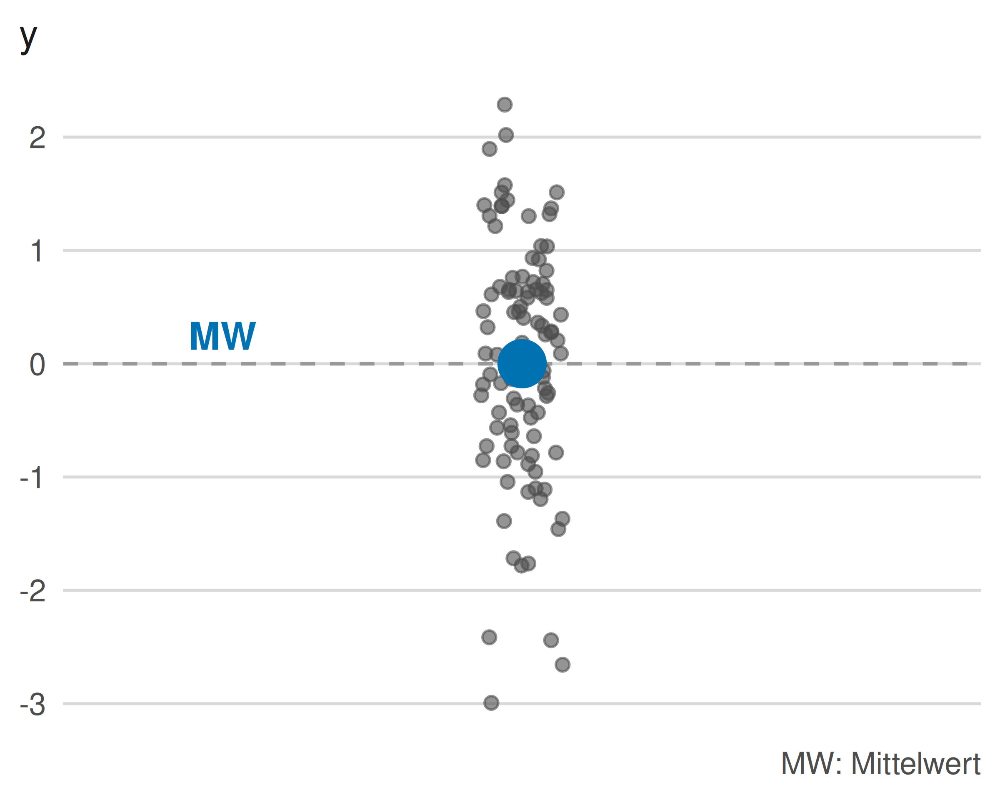{width="40%"} 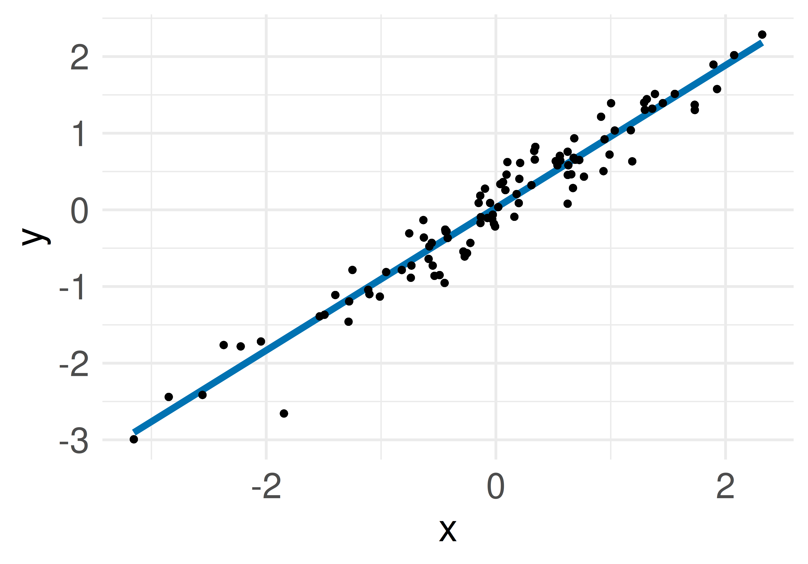{width="40%"}

Eine Zahlenreihe wird zu einer einzelnen, "typischen" Zahl "zusammengedampft" — leichter zu verstehen als viele Einzelwerte.

::: footer
Was ist Statistik und wozu ist sie gut?
:::

## Beispiel: Typischer Durchmesser von Schrauben

Ein Betrieb stellt Schrauben her, die einen mittleren Durchmesser von 5,0 mm haben sollen.

- Regelmäßig werden Stichproben gezogen und die Durchmesser gemessen.
- Die Messwerte werden zum **Mittelwert** (arithmetisches Mittel) zusammengefasst.
- Liegt der Mittelwert nahe bei 5,0 mm, genügt die Produktion der Anforderung.

::: footer
Was ist Statistik und wozu ist sie gut?
:::

## Unterschiedlichkeit quantifizieren

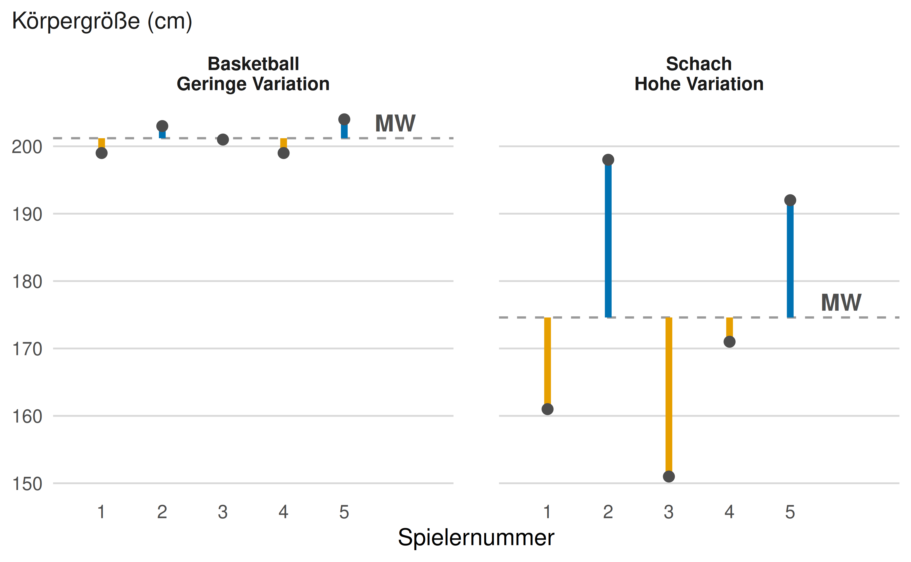{width="60%"}

Nicht alle Menschen sind gleich groß, nicht alle Tage gleich warm. Zentrale Idee: die *Variation zu quantifizieren*.

::: footer
Was ist Statistik und wozu ist sie gut?
:::

## Definition: Residuum

:::{.callout-note title="Definition: Residuum"}
Das Residuum des Merkmals $X$ der $i$-ten Beobachtung ist die Differenz vom Wert $x_i$ und einem Referenzwert, etwa dem Mittelwert ($\bar{x}$): $r_i = x_i - \bar{x}$.
:::

::: footer
Was ist Statistik und wozu ist sie gut?
:::

## Ungewissheit beschreiben: Anna & Berta

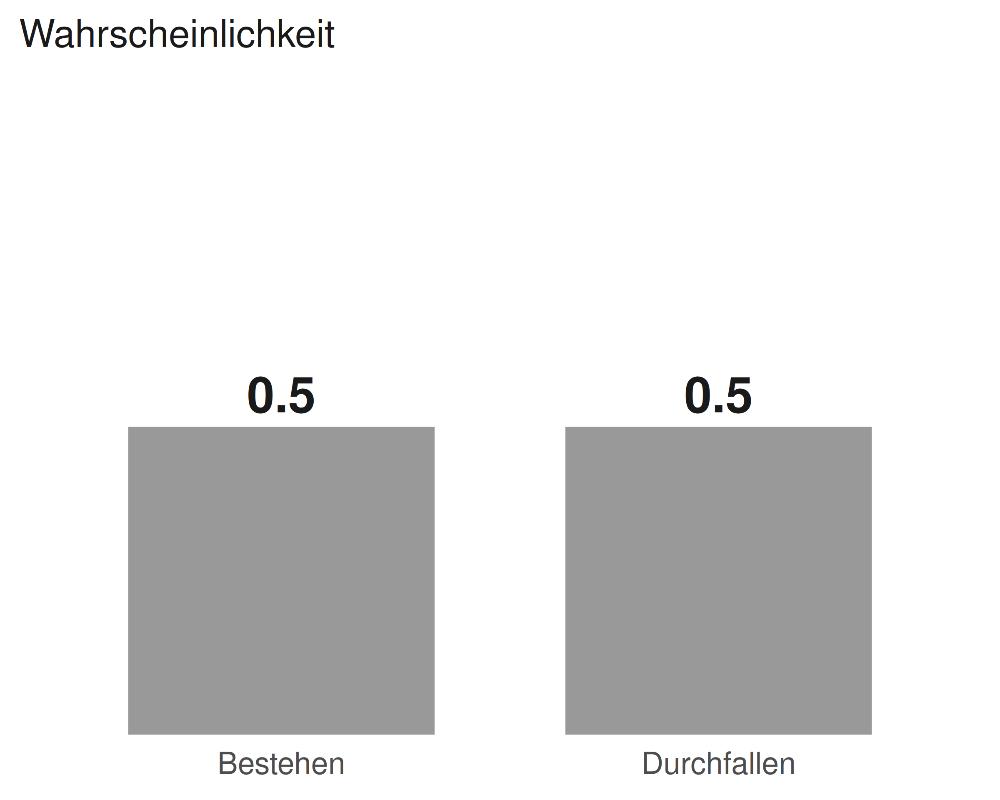{width="37%"} 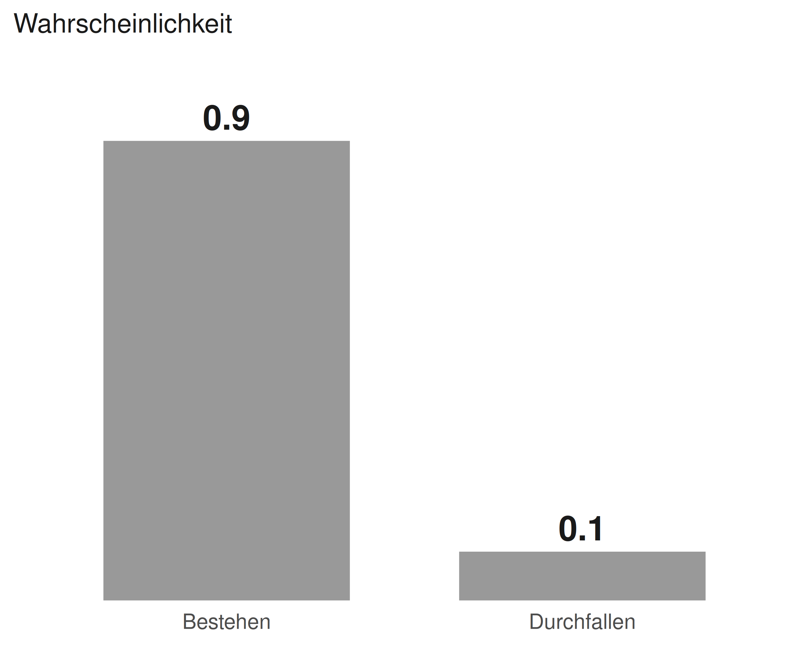{width="37%"}

Anna hat keine Ahnung, ob sie die Klausur bestanden hat. Berta ist sich sehr sicher. Beide unterscheiden sich in ihrer Ungewissheit.

::: footer
Was ist Statistik und wozu ist sie gut?
:::

## Ungewissheit beschreiben: Der zwielichtige Statistiker

Ein Statistiker wirft eine Münze 10 Mal; bei Kopf gewinnt er. Er gewinnt 8 von 10 Mal.

- *Sie* sind sich *ziemlich* sicher, dass er Sie über den Tisch gezogen hat — aber nicht ganz sicher.
- *Der Statistiker* ist sich *ganz sicher*: Er weiß, dass seine Münze gezinkt ist.

::: footer
Was ist Statistik und wozu ist sie gut?
:::

# Was ist das Ziel Ihrer Analyse? {.center footer=false}

## Arten von Zielen

Statistische Analysen können drei Arten von Zielen verfolgen:

- **Beschreiben**: Wie groß ist der Gender-Paygap in der Branche X im Zeitraum Y?
- **Vorhersagen**: Wenn ich 100 Stunden auf die Statistikklausur lerne, welche Note kann ich dann erwarten?
- **Erklären**: Wie viel bringt mir das Lernen auf die Statistikklausur?

::: footer
Was ist das Ziel Ihrer Analyse?
:::

## Forschungsfrage

Die Leitfrage Ihrer Analyse: Was wollen Sie herausfinden? Häufig: "Hat X einen (kausalen) Einfluss auf Y?"

Typische Struktur einer Forschungsfrage:

::: {style="text-align: center; font-size: 1.3em;"}
**Input** bzw. **X** &nbsp;⟶&nbsp; **Output** bzw. **Y**
:::

::: footer
Was ist das Ziel Ihrer Analyse?
:::

## Beispiele für Forschungsfragen

> Hat Lernen (X) einen Einfluss auf den Prüfungserfolg (Y)?

> Verringert Joggen (X) die Menge des Hüftgolds (Y)?

> Um welchen Betrag erhöht sich der Umsatz (Y), wenn wir 1000 Euro mehr für Werbung ausgeben (X)?

> Verringert intensive Handynutzung (X) die Konzentrationsfähigkeit (Y)?

::: footer
Was ist das Ziel Ihrer Analyse?
:::

## Forschungsfrage: Produktmerkmale und Verkaufserlös

Nach dem Studium heuern Sie bei einem großen Online-Auktionshaus an — Abteilung Forschung und Entwicklung. Ihre Aufgabe: Auktionen zum Spiel Mariokart für die Spielekonsole Wii analysieren.

> Welche Produktmerkmale stehen mit einem hohen Verkaufserlös in Zusammenhang?

::: footer
Was ist das Ziel Ihrer Analyse?
:::

## Aus der Forschung: Smartphone-Brain-Drain

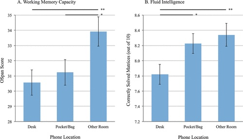{width="40%"}

Hypothese von @ward_brain_2017: Die bloße Gegenwart des eigenen Smartphones reduziert die verfügbare kognitive Kapazität. Ergebnis: Arbeitsgedächtnis und fluide Intelligenz sind am besten, wenn das Handy nicht im Raum ist.

::: footer
Was ist das Ziel Ihrer Analyse?
:::

## Der Prozess der Datenanalyse: PPDAC {.smaller}

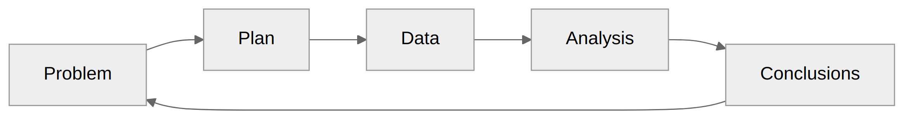{width="80%"}

Datenanalyse ist Problemlösen — nicht gleich wild drauflos analysieren:

- **P**roblem: Problem, Ziel und Sachgegenstand verstehen
- **P**lan: Vorgehen planen
- **D**ata: Daten erheben und aufbereiten
- **A**nalysis: Daten analysieren
- **C**onclusions: Schlussfolgerungen ziehen, auch Schwächen kritisch beleuchten [@mackay_scientific_2000]

::: footer
Was ist das Ziel Ihrer Analyse?
:::

## Die sieben Schritte der Datenanalyse

Aus praktischer Perspektive: die Abfolge der "sieben Schritte der Datenanalyse".

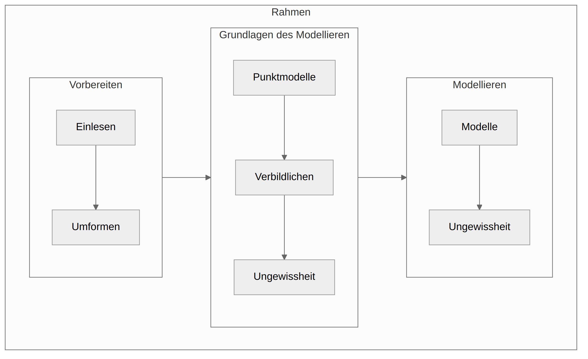{width="68%"}

::: footer
Was ist das Ziel Ihrer Analyse?
:::

# Was sind Daten? {.center footer=false}

## Daten als Tabelle {.smaller}

:::{.callout-note title="Definition: Daten"}
Daten sind eine geordnete Folge von Zeichen.
:::

| id | name  | note |
|----|-------|------|
| 1  | Anna  | 1.3  |
| 2  | Berta | 2.3  |
| 3  | Carla | 3    |

Die erste Spalte `id` ist nur eine laufende Nummer zur Identifikation der Beobachtungen — sie birgt sonst keine Information (vgl. Matrikelnummer, Personalausweisnummer, Bestellnummer).

::: footer
Was sind Daten?
:::

## Beispiel: Der Datensatz `mariokart` {.smaller}

Auszug aus den Auktionsdaten zur Forschungsfrage "Produktmerkmale und Verkaufserlös":

| n_bids | start_pr | total_pr | wheels |
|-------:|---------:|---------:|-------:|
| 20 | 0.99 | 51.55 | 1 |
| 13 | 0.99 | 37.04 | 1 |
| 16 | 0.99 | 45.50 | 1 |
| 18 | 0.99 | 44.00 | 1 |
| 20 | 0.01 | 71.00 | 2 |
| 19 | 0.99 | 45.00 | 0 |

Startpreis (`start_pr`) und Verkaufspreis (`total_pr`) in Dollar.

:::{.callout-note title="Definition: Data-Dictionary"}
Eine Erklärung, was die Variablen (Spalten) einer Datentabelle bedeuten, nennt man *Codebook* oder *Data-Dictionary*.
:::

::: footer
Was sind Daten?
:::

## Variable & Beobachtungseinheit

:::{.callout-note title="Definition: Variable"}
Eine Variable ist ein Platzhalter für ein Merkmal, das verschiedene Ausprägungen annehmen kann.
:::

:::{.callout-note title="Definition: Beobachtungseinheit"}
Beobachtungseinheiten sind die Dinge, die wir untersuchen (beobachten). Sie sind die Träger von Variablen.
:::

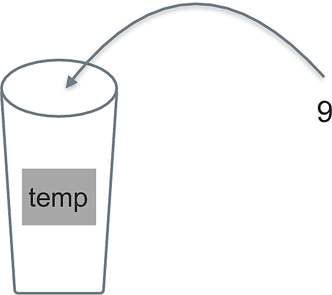{width="20%"}

::: footer
Was sind Daten?
:::

## Wert & Ausprägung {.smaller}

:::{.callout-note title="Definition: Wert"}
Ein *Wert* ist der Inhalt einer Variablen.
:::

:::{.callout-note title="Definition: Ausprägung"}
Als *Ausprägungen* bezeichnet man die *verschiedenen* Werte einer Variablen.
:::

Beispiel: Die Variable `geschlecht` bei zehn Probanden — Werte: Mann, Frau, Frau, Frau, Mann, Frau, Mann, Mann, divers, Frau. Sie enthält drei Ausprägungen: divers, Frau, Mann.

::: footer
Was sind Daten?
:::

## Tidy Data

:::{.callout-note title="Definition: Tidy Data"}
Eine Tabelle, in der jede Zeile eine Beobachtungseinheit darstellt, jede Spalte eine Variable und jede Zelle einen Wert (plus eine Kopfzeile mit den Variablennamen).
:::

![Tidy-Data-Sinnbild [@wickham_tidy-data-sinnbild_2023]](../img/tidy-1.png){width="55%"}

::: footer
Was sind Daten?
:::

## Warum Tidy Data?

![Immer schön Ordnung halten … [@horst_tidy_2023]](../img/tidydata_3.jpg){width="55%"}

Man weiß, wie die Daten aufgebaut sind — und Statistikprogramme kommen mit diesem Format am besten zurecht.

::: footer
Was sind Daten?
:::

## Beispiel: Breit- vs. Langformat {.smaller}

Umsatz einer Firma mit Hämmern und Nägeln — gleiche Information, zwei Formate:

:::: {.columns}
::: {.column width="50%"}
**Breitformat (nicht tidy)**

| Produkt | Umsatz_2021 | Umsatz_2022 | Umsatz_2023 |
|---------|------|------|------|
| Hämmer  | 10   | 11   | 12   |
| Nägel   | 15   | 10   | 5    |
:::
::: {.column width="50%"}
**Langformat (tidy)**

| Produkt | Jahr | Umsatz |
|---------|------|--------|
| Hämmer  | 2021 | 10     |
| Hämmer  | 2022 | 11     |
| …       | …    | …      |
:::
::::

::: footer
Was sind Daten?
:::

## Visualisierung dank Tidy Data

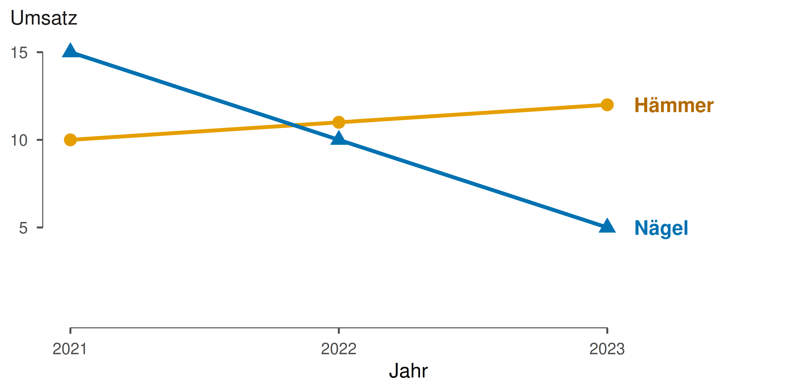{width="55%"}

Software weist der X- bzw. Y-Achse je eine Spalte zu: Für den Umsatzverlauf braucht es die Spalten `Jahr` und `Umsatz` — also das Tidy-Format.

::: footer
Was sind Daten?
:::

## Je mehr, desto besser (?)

"Viel hilft viel" — aber nur unter sonst gleichen Umständen. Viel Datenmüll ist nicht besser als ein paar knappe, wasserdichte Fakten!

:::{.callout-important}
Mehr Daten = genauere Ergebnisse (unter sonst gleichen Umständen)
:::

::: footer
Was sind Daten?
:::

## Stichprobengröße und Genauigkeit

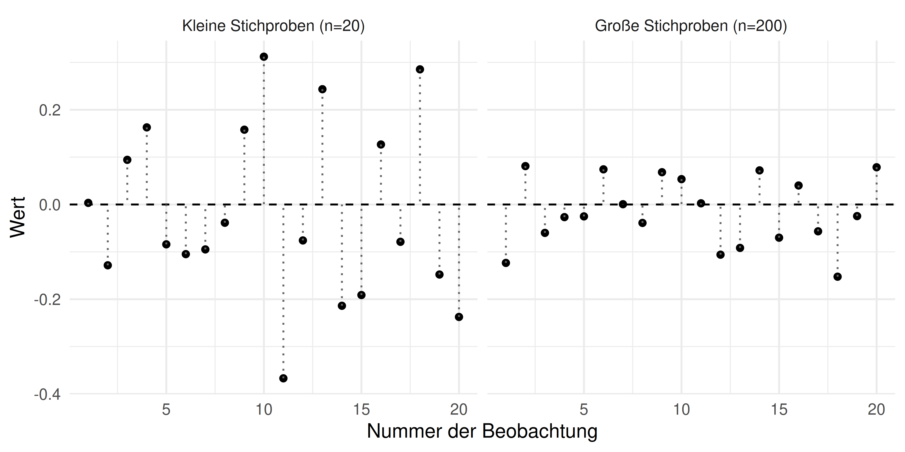{width="65%"}

Kleine Stichproben ($n=20$) streuen stärker um den wahren Mittelwert als große Stichproben ($n=200$). Nur die zwei Sitznachbarn nach ihrer Lernzeit zu fragen, liefert also eine sehr ungenaue Schätzung.

::: footer
Was sind Daten?
:::

## Dorfschulen machen die schlauesten Schüler?!

Eine (fiktive) Pressemitteilung: Die besten Notendurchschnitte haben die kleinen Dorfschulen. Macht die Landluft schlau?

- Ein genauerer Blick zeigt: Auch die *schlechtesten* Durchschnitte kommen von den Dorfschulen!
- Statistische Erklärung: Dorfschulen haben wenige Kinder — die Stichproben sind **klein**.
- Kleine Stichproben streuen stark um den Mittelwert, nach oben *und* nach unten.

::: footer
Was sind Daten?
:::

# Arten von Variablen {.center footer=false}

## Nach Position in der Forschungsfrage

> Hat Lernen einen Einfluss auf den Prüfungserfolg?

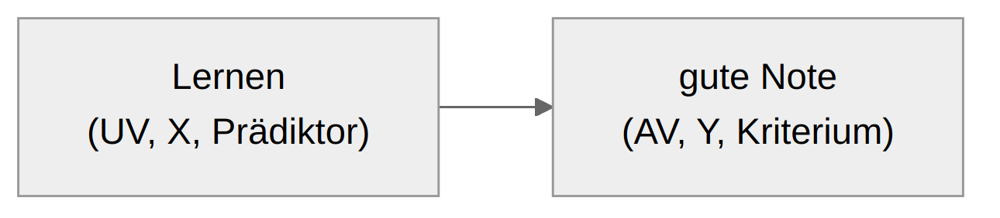{width="60%"}

*Lernen* ist die Input-Variable (X, Ursache, UV). *Prüfungserfolg* ist die Output-Variable (Y, Wirkung, AV).

::: footer
Arten von Variablen
:::

## Definition: Skalenniveau {.smaller}

:::{.callout-note title="Definition: Skalenniveau"}
Der Begriff bezeichnet Art und Menge der Information in Variablen — basierend auf den Eigenschaften der Daten und den mathematischen Operationen, die sinnvoll darauf angewendet werden können.
:::

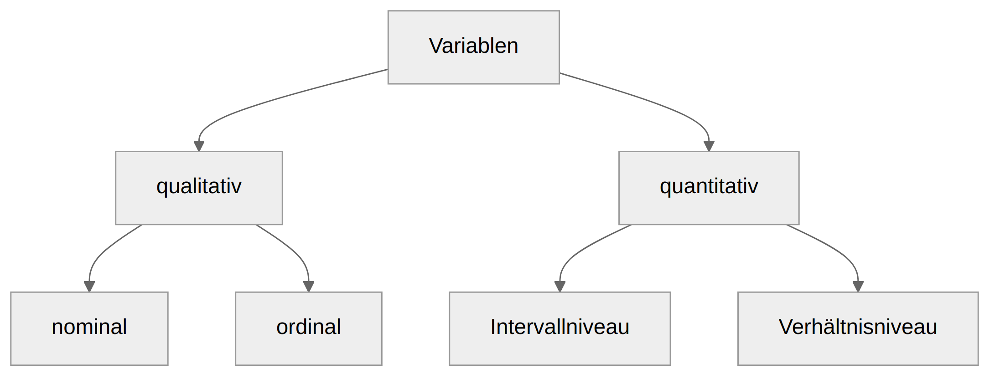{width="75%"}

::: footer
Arten von Variablen
:::

## Beispiele für Skalenniveaus {.smaller}

| Skalenniveau | Beispiele |
|---|---|
| Nominalskala | Haarfarbe, Augenfarbe, Geschlecht, Automarke, Partei, Lieblingsessen |
| Ordinalskala | Medaillen beim 100-Meter-Lauf, Uniranking |
| Intervallskala | IQ, Extraversion, Temperatur in Celsius, Temperatur in Fahrenheit |
| Verhältnisskala | Temperatur in Kelvin, Körpergröße, Geschwindigkeit, Länge |

::: footer
Arten von Variablen
:::

## Erlaubte Rechenoperationen {.smaller}

| Skalenniveau | Quantitativ | $=$ | $\preceq$ | $+$ | $\cdot$ |
|---|---|---|---|---|---|
| Nominalniveau | nein | ✅ | ❌ | ❌ | ❌ |
| Ordinalniveau | nein | ✅ | ✅ | ❌ | ❌ |
| Intervallniveau | ja | ✅ | ✅ | ✅ | ❌ |
| Verhältnisniveau | ja | ✅ | ✅ | ✅ | ✅ |

Gleichheit prüfen ($=$), der Größe nach ordnen ($\preceq$), addieren/subtrahieren ($+$), multiplizieren/dividieren ($\cdot$).

::: footer
Arten von Variablen
:::

## Nominal- & Ordinalskala

**Nominalskala** (z. B. Geschlecht): Nur *Gleichheit* prüfbar. 👩 ≠ 👨, 👩 = 👩. Codierung (1 = Frau, 2 = Mann) darf nicht verrechnet werden!

**Ordinalskala** (z. B. Rangfolge der Leibgerichte): Objekte lassen sich *ordnen* (🍕 ≻ 🍝 ≻ 🥩), aber die Abstände zwischen den Rängen sind nicht quantifizierbar — "Pizza mag ich 42 % mehr als Spaghetti" geht nicht.

::: footer
Arten von Variablen
:::

## Intervallskala {.smaller}

:::: {.columns}
::: {.column width="45%"}
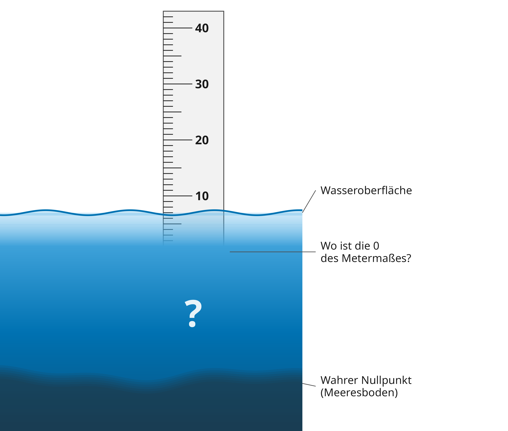{width="90%"}
:::
::: {.column width="55%"}
z. B. Temperatur in Celsius:

- 10 °C ist *nicht* doppelt so warm wie 5 °C.
- 0 °C ist kein echter, physikalischer Nullpunkt (sondern der Gefrierpunkt von Wasser).
- Erlaubt: Differenzen (5 °C Unterschied) und Mittelwerte (7,5 °C).
- Nicht erlaubt: Verhältnisse.
:::
::::

::: footer
Arten von Variablen
:::

## Verhältnisskala; stetig vs. diskret

**Verhältnisskala** (z. B. Länge, Kelvin): Was man sich gemeinhin unter einer metrischen Variable vorstellt — alle Rechenoperationen erlaubt, inklusive Verhältnisbildung (Multiplizieren, Dividieren).

Quantitative Variablen lassen sich weiter unterteilen:

- **stetig**: Zwischen zwei Ausprägungen passt immer noch eine weitere (Körpergröße: zwischen 1,60 m und 1,61 m liegt 1,605 m …).
- **diskret**: nur bestimmte Ausprägungen, häufig $0, 1, 2, \ldots$ (z. B. Anzahl der Kinder in einer Familie).

::: footer
Arten von Variablen
:::

# Modelle {.center footer=false}

## Definition: Modelle

:::{.callout-note title="Definition: Modelle"}
Modelle sind ein vereinfachtes Abbild der Realität, eine *Repräsentation* [@kaplan_statistical_2009].
:::

![Matchbox-Autos sind Modelle für Autos, [@spurzem2017]](../img/matchbox.jpg){width="20%"}

::: footer
Modelle
:::

## Beispiele für Modelle {.smaller}

Puppen sind Modelle für Babys, Landkarten für Landstriche, das Bohrsche Atommodell für Atome.

Auch in der Statistik nutzen wir Modelle — Prof. Weiss-Ois blickt nicht durch:

> 🧑‍🏫 12, 8, 10, 11, 10, 9, 13, 9, 14, 9, 12, 14, 7, 9, 9, 11, 9, 4, 5, 12, 9, 6, 9, 12, 13, 9, 9, 6, 10 … Oh je, so viele Zahlen! Wie viel lernen denn jetzt meine Studis?!

Geben Sie ihm ein Modell — den *Mittelwert* der Lernzeiten:

> 🧑‍🏫 Ah, 9,6 Stunden! Jetzt weiß ich, wie viel die Studis typischerweise lernen. Viel zu wenig natürlich!

::: footer
Modelle
:::

## Wozu Modelle?

Modelle vereinfachen komplexe Sachverhalte und machen sie dem Verständnis zugänglich. In der Statistik fassen Modelle oft viele Daten prägnant zusammen, z. B. zu einer einzelnen Kennzahl.

Das Verrückte: Man wirft Informationen weg, um eine (hoffentlich nützlichere) Information zu bekommen [@stigler_seven_2016]. Weniger ist mehr?!

::: footer
Modelle
:::

# Praxisbezug {.center footer=false}

## Daten im Berufsleben

Wir leben im Datenzeitalter — Daten durchdringen alle Bereiche des beruflichen, gesellschaftlichen und privaten Lebens.

Datenmengen und -methoden erleben einen Boom — manche sehen das (Stichwort künstliche Intelligenz) mit Sorge.

Egal ob man Daten als Segen oder Fluch betrachtet: Mit Daten umgehen zu können, wird immer wichtiger. Denn Daten ohne Sinn sind nutzlos. Datenanalyse gehört zu den stark nachgefragten Jobs.

::: footer
Praxisbezug
:::

# Wie man mit Statistik lügt {.center footer=false}

## Das File-Drawer-Problem

Von 20 untersuchten Variablen (als AV) zeigt nur 1 einen interessanten Effekt. Die Versuchung: die anderen 19 in der Schublade verschwinden lassen und nur den einen schönen Befund präsentieren.

Wer missliebige Ergebnisse verschweigt, erzeugt ein verzerrtes Bild der Ergebnislage — man spricht von *Publikationsbias* [@marksanglin_historical_2020; @rothstein_publication_2014]. Ein Fall von wissenschaftlichem Fehlverhalten.

::: footer
Wie man mit Statistik lügt
:::

## Zusammenfassung {.smaller}

- **Statistik**: zur zentralen Tendenz zusammenfassen, Unterschiedlichkeit quantifizieren, Ungewissheit beschreiben
- Drei Ziele der Analyse: beschreiben, vorhersagen, erklären; Prozess: PPDAC
- **Daten**: geordnete Folge von Zeichen — im *Tidy*-Format am besten nutzbar; mehr Daten = genauere Ergebnisse
- **Variablen**: Position (UV/AV) und Skalenniveau (nominal, ordinal, Intervall, Verhältnis); stetig vs. diskret
- **Modelle**: vereinfachte Repräsentationen der Realität

## Literaturhinweise

- @stigler_seven_2016 — Fundamente statistischer Analyse
- @cetinkaya-rundel_introduction_2021 — Kapitel 1, "Hello data"
- @downey_probably_2023 — statistische Überraschungsmomente, unterhaltsam

## Referenzen {.smaller}
