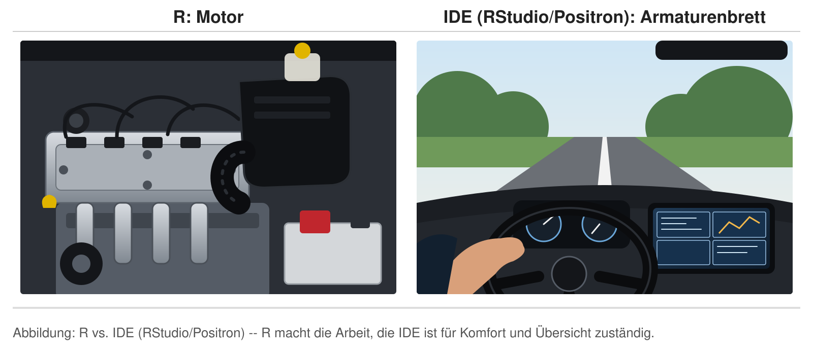
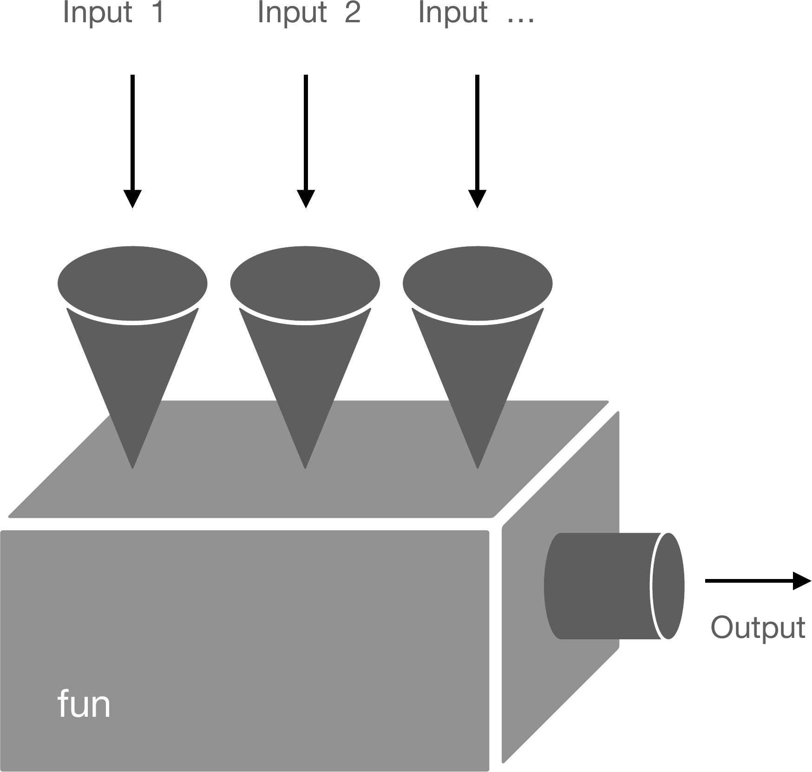
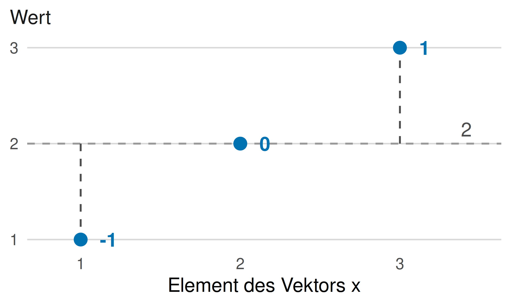
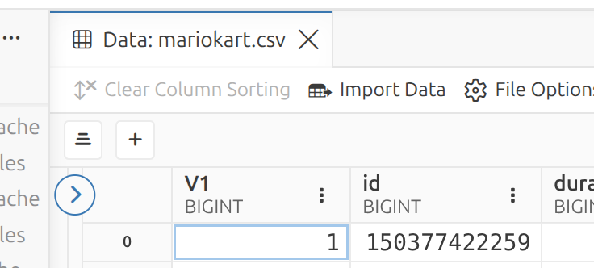
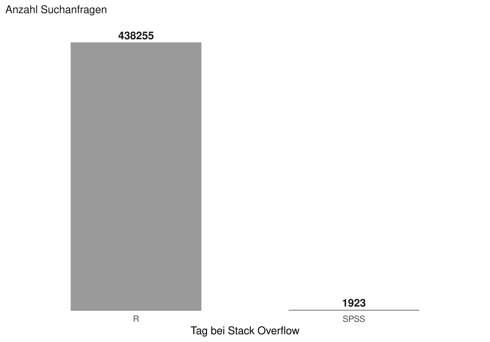

# Einstieg {.center footer=false}

## Lernziele {.smaller}

- Sie können R und eine IDE (RStudio oder Positron) starten.
- Sie können R-Pakete installieren und starten.
- Sie können Variablen in R zuweisen und auslesen.
- Sie können Daten in R importieren.
- Sie können den Begriff *Reproduzierbarkeit* definieren.

::: footer
Einstieg
:::

## Lernverlauf: Höhen und Tiefen {.smaller}

![Life is a roller-coaster. You just have to ride it [@horst_statistics_2024]](../img/r_rollercoaster.png){width="50%"}

Höhen und Tiefen beim Lernen von R sind normal — mit etwas Übung geht bald alles leichter von der Hand.

Ab diesem Kapitel benötigen Sie R. Lernhilfe: die [YouTube-Sammlung "R"](https://www.youtube.com/playlist?list=PLRR4REmBgpIEaIyeNBgNGPgmhQJ_T1y8_).

::: footer
Einstieg
:::

# Erstkontakt {.center footer=false}

## Warum R? {.smaller}

:::: {.columns}
::: {.column width="60%"}
1. R ist *kostenlos* — andere Softwarepakete für Datenanalyse sind teuer.
2. R ist *quelloffen* — jeder kann die Befehle einsehen und beitragen.
3. R hat die *neuesten* statistischen Methoden.
4. R hat eine große *Community*.
5. R ist *maßgeschneidert* für Datenanalyse.
:::
::: {.column width="40%"}
Allerdings gibt es auch abweichende Meinungen …

![Manche finden Excel cooler als R [@imgflip_gates]](../img/bill-gates-excel.jpg){width="100%"}
:::
::::

::: footer
Erstkontakt
:::

## Definition: Reproduzierbarkeit

:::{.callout-note title="Definition: Reproduzierbarkeit"}
Ein (wissenschaftlicher) Befund ist reproduzierbar, wenn andere Personen mit der Analysemethodik zum gleichen Ergebnis kommen wie in der ursprünglichen Analyse [@plesser_reproducibility_2018].
:::

**Daten** + **Syntax** + **genaue Messbeschreibung** = **reproduzierbar**

::: footer
Erstkontakt
:::

## Aus der Forschung: Reproduzierbarkeit in der Psychologie {.smaller}

@obels_analysis_2020 untersuchten die Reproduzierbarkeit von Registered Reports (2014–2018):

> Von 62 Artikeln hatten 41 Daten verfügbar, 37 Analyseskripte. Für 36 Artikel waren beides verfügbar. Reproduziert werden konnten die Hauptergebnisse von 21 Artikeln.

Insgesamt war also etwa **jede dritte Studie** reproduzierbar — da gibt es noch viel Luft nach oben.

::: footer
Erstkontakt
:::

## R & IDE: Arbeitsteilung {.smaller}

{width="55%"}

- R erledigt die eigentliche Rechenarbeit, eine **IDE** (integrierte Entwicklungsumgebung) sorgt für Komfort.
- Zwei gleichwertige, kostenlose IDEs zur Wahl: **RStudio** und **Positron** (beide von Posit); alle Buchinhalte funktionieren mit beiden.

::: {.callout-tip}
Erst mal ausprobieren, ohne etwas zu installieren? Mit [webR](https://webr.r-wasm.org/latest/) läuft R direkt im Browser.
:::

::: footer
Erstkontakt
:::

# Installation von R und einer IDE {.center footer=false}

## R und eine IDE installieren {.smaller}

1. **R installieren**: <https://cloud.r-project.org> (Windows/MacOS/Linux)
2. **Eine IDE installieren** — Ihre Wahl:
   - RStudio: <https://posit.co/download/rstudio-desktop/>
   - Positron: <https://positron.posit.co/download.html>

   - Positron ist neuer und unterstützt neben R auch Python.
3. **Ohne Installation**: Posit Cloud / RStudio Cloud (<https://rstudio.cloud/>) — *RStudio online*, auch auf Tablets; teils kostenpflichtig, Konto nötig. Für Positron gibt es keine Cloud-Version.

::: {.callout-note}
Starten Sie nur Ihre IDE, nicht R direkt — RStudio bzw. Positron findet R selbständig und öffnet es "heimlich".
:::

::: footer
Installation von R und einer IDE
:::

# R-Pakete {.center footer=false}

## Was sind R-Pakete? {.smaller}

- R hat einen *modularen Aufbau*: Erweiterungen ("Pakete") bringen zusätzliche Befehle und Daten mit.
- Stellen Sie sich ein Paket wie ein Buch vor: Erst installieren ("kaufen"), dann laden ("lesen").
- Auf CRAN, dem offiziellen "Web-Store", gibt es ca. 20.000 Pakete [@RJ-2023-4-cran].

::: footer
R-Pakete
:::

## Pakete installieren & starten {.smaller}

- Installieren (einmalig): per Klick (RStudio) oder Code:
  ```r
  install.packages("tidyverse")
  ```
- Starten (bei jedem Neustart von R neu):
  ```r
  library(tidyverse)
  ```
- Vor dem Installieren/Updaten: R-Session neu starten (RStudio: `Session > Restart R`; Positron: Neustart-Button in der Konsole).
- Für dieses Buch benötigt: `tidyverse` [@wickham2019a] und `easystats` [@ludecke2022] — beides "Sammelpakete", die mehrere Pakete auf einmal bereitstellen.

::: footer
R-Pakete
:::

# Mit R arbeiten {.center footer=false}

## Projekte

- Ein *Projekt* (RStudio) bzw. ein *Workspace* (Positron, `File > Open Folder…`) ist letztlich ein Ordner, der als Basis für zusammengehörige Dateien dient.
- Vorteil: Dateien lassen sich ohne vollständigen Pfad ansprechen, z. B. `"daten.csv"` statt eines langen Pfads.
- Nutzen Sie Projekte — das erspart Ärger mit Pfaden.

::: footer
Mit R arbeiten
:::

## Skriptdateien & Quarto-Dokumente

- Eine *Skriptdatei* sammelt R-Befehle ("Syntax") in einer Textdatei.
- Neue Skriptdatei: `File > New File > R Script` · Speichern: `Strg+S` · Öffnen: `Strg+O`
- [Quarto](https://quarto.org/) (in RStudio und Positron integriert) erlaubt es, R-Syntax direkt in Dokumente (HTML, PDF, …) einzubetten — Ausgaben landen automatisch im fertigen Dokument.
- Sie sind nicht verpflichtet, Quarto zu nutzen — Skriptdateien reichen auch.

::: footer
Mit R arbeiten
:::

# Errisch für Einsteiger {.center footer=false}

## Variablen {.smaller}

```r
richtige_antwort <- 42
falsche_antwort <- 43
typ <- "Antwort"
ist_korrekt <- TRUE
```

- Zuweisungspfeil `<-` (bevorzugt) oder `=` — beides funktioniert.
- Eine Variable ist wie ein Becher mit Wert und Beschriftung.
- Wert auslesen: Namen der Variable eingeben. Fehlender Wert: `alter <- NA` (*not available*).

{width="25%"}

::: footer
Errisch für Einsteiger
:::

## Definition: Funktion {.smaller}

:::{.callout-note title="Definition: Funktion"}
Eine Funktion ist eine Regel, die jedem Eingabewert (Argument) einen Ausgabewert zuordnet — eine "Maschine", die Eingabedaten in Ausgabedaten umwandelt.
:::

{width="32%"}

::: footer
Errisch für Einsteiger
:::

## Definition: Vektor

:::{.callout-note title="Definition: Vektor"}
Ein *Vektor* ist eine geordnete Folge von Werten ("Elementen"), erstellt mit der Funktion `c()`.
:::

```r
x <- c(1, 2, 3)
namen <- c("Anni", "Bert", "Charlie")  # Text-Vektor
```

::: footer
Errisch für Einsteiger
:::

## Unsere erste statistische Funktion

```r
Antworten <- c(42, 43)
mean(Antworten)
```

R arbeitet verschachtelte Befehle *von innen nach außen* ab:

`mean(Antworten)` → `mean(c(42, 43))` → `42.5`

::: footer
Errisch für Einsteiger
:::

## Funktionsargumente {.smaller}

```r
mean(x, trim = 0, na.rm = FALSE, ...)
```

- `x`: der Vektor, für den der Mittelwert berechnet wird
- `trim`: sollen Extremwerte "abgeschnitten" werden?
- `na.rm`: sollen fehlende Werte (`NA`) entfernt werden?
- Argumente mit *Voreinstellung* (default) müssen nicht befüllt werden.
- Ohne Argumentnamen zählt die Reihenfolge: `mean(Antworten, 0, FALSE)` ✅, aber `mean(Antworten, FALSE, 0)` ❌ (Fehler).
- Mit Argumentnamen ist die Reihenfolge egal: `mean(na.rm = TRUE, x = Antworten)`.

::: footer
Errisch für Einsteiger
:::

## Vorsicht bei fehlenden Werten

```r
Antworten <- c(42, 43, NA)
mean(Antworten)          # ergibt NA
mean(Antworten, na.rm = TRUE)  # entfernt NA, rechnet trotzdem
```

`NA` steht für *not available* — R macht damit auf fehlende Werte aufmerksam, statt sie stillschweigend zu ignorieren.

::: footer
Errisch für Einsteiger
:::

## Vektorielles Rechnen

{width="55%"}

```r
x <- c(1, 2, 3)
x - mean(x)
```

Eine Operation wird automatisch auf *jedes* Element angewandt — kein Loop nötig.

::: footer
Errisch für Einsteiger
:::

## Ich brauche R-Hilfe! {.smaller}

- Hilfe zu einer Funktion: `help(fun)` oder Help-Panel der IDE
- In welchem Paket wohnt eine Funktion? *RDocumentation* durchsuchen
- Fehler nicht klar? Meist hat schon jemand das Problem gelöst — stackoverflow.com
- R hängt oder spinnt? Konsole/Session neu starten (AEG-Prinzip: Aus-Ein-Gut)
- `WARNING` ist meist harmlos, `Error` bedeutet: Syntax läuft nicht durch
- Stundenlang Fehler gesucht? Pause machen — mit Abstand findet man ihn leichter.

::: {.callout-caution}
R unterscheidet Groß- und Kleinschreibung: `name` und `Name` sind zwei verschiedene Variablen.
:::

::: footer
Errisch für Einsteiger
:::

# Mit Daten arbeiten {.center footer=false}

## Wo sind meine Daten?

Eine Datei liegt entweder

1. irgendwo im Internet, oder
2. irgendwo auf Ihrem Computer (z. B. im Projektordner).

In beiden Fällen definieren *Pfad* und *Dateiname* den Aufenthaltsort.

Gebräuchlichste Tabellenformate: **CSV** (einfache Textdatei, mit jedem Texteditor lesbar) und **XLSX** (Excel).

Unser Beispieldatensatz im Kurs: `mariokart` (eBay-Auktionen des Spiels Mario Kart, Preise in Dollar).

::: footer
Mit Daten arbeiten
:::

## Daten importieren {.smaller}

```r
# aus einem R-Paket:
data("mariokart", package = "openintro")

# von einer Webseite (read_csv aus dem tidyverse):
mariokart <- read_csv("https://vincentarelbundock.github.io/Rdatasets/csv/openintro/mariokart.csv")

# vom eigenen Computer (Datei im Projektordner):
d <- read_csv("mariokart.csv")
```

- Ein R-Paket muss vor der Nutzung installiert sein (häufig vergessen!).
- Alternativen: `read.csv` (Standard-R, kein Extra-Paket) und `data_read` (`easystats`, liest viele Formate automatisch).

::: footer
Mit Daten arbeiten
:::

## Daten per Klick importieren {.smaller}

- **RStudio:** Import-Assistent (`From Text (readr) …` für CSV, auch Excel und SPSS) mit Vorschau und Optionen zu Trennzeichen, Kopfzeile, Spaltentypen.
- **Positron** (seit Version 2026.09): Datei öffnen, auf `Import Data` klicken — der Dialog zeigt den passenden R-Code (`readr`, `readxl`, `nanoparquet`) und führt ihn per `Import` in der Konsole aus; keine Tabellenvorschau mit Optionen.

{width="50%"}

::: footer
Mit Daten arbeiten
:::

## Definition: Dataframe {.smaller}

:::{.callout-note title="Definition: Dataframe"}
Ein Dataframe (auch "Tibble") ist ein Datenobjekt zur Darstellung von Tabellen: eine oder mehrere gleich lange, benannte Spalten. Jede Spalte ist selbst ein Vektor.
:::

Tabellen ansehen: Namen eingeben (nur anschauen, nicht ändern), `View(mariokart)` oder Klick auf das Tabellen-Icon im *Environment* (RStudio) bzw. unter `Session > Variables` (Positron).

{width="45%"}

::: footer
Mit Daten arbeiten
:::

# Logikprüfung {.center footer=false}

## Logische Prüfungen in R {.smaller}

```r
x <- 42
x == 42   # Gleichheit prüfen (doppeltes Gleichheitszeichen!)
```

| Prüfung auf | R-Syntax |
|---|---|
| Gleichheit | `x == Wert` |
| Ungleichheit | `x != Wert` |
| Größer / kleiner | `x > Wert` / `x < Wert` |
| Größer gleich / kleiner gleich | `x >= Wert` / `x <= Wert` |
| Logisches UND | `(x < Wert1) & (x > Wert2)` |
| Logisches ODER | `(x < Wert1) \| (x > Wert2)` |

:::{.callout-caution}
`x = 73` prüft **nicht** auf Gleichheit, sondern weist zu!
:::

::: footer
Logikprüfung
:::

# Praxisbezug {.center footer=false}

## Wird R wirklich genutzt? {.smaller}

{width="35%"}

Faktor ~200 (438.255 vs. 1.923 Anfragen) zwischen R und SPSS — ein Indiz, dass R in der Praxis stark gefragt ist.
Berufe mit Datenbezug zählen zu den stark wachsenden Berufsfeldern [@berger_jobs_2019.].

::: footer
Praxisbezug
:::

# Wie man mit Statistik lügt {.center footer=false}

## Die zufriedenen Kunden {.smaller}

10 Kunden sollen ihre Zufriedenheit angeben (1 bis 10) -- nicht alle antworten:

```r
Zufriedenheit <- c(9, 8, 10, 9, NA, 8, NA, NA, 9, NA)
mean(Zufriedenheit, na.rm = TRUE)   # 8.8 -- "Unsere Kunden lieben uns!"
sum(is.na(Zufriedenheit))           # 4 -- fast die Hälfte fehlt
```

- `is.na()` prüft jedes Element auf `NA`; `sum()` zählt die `TRUE`s (`TRUE` = 1)
- Wer antwortet nicht? Vermutlich eher die verärgerten Kunden.
- Gedankenexperiment: Hätten die 4 Fehlenden je eine 2 vergeben, sinkt der Mittelwert auf 6.1.
- `na.rm = TRUE` ist keine neutrale Einstellung, sondern eine stille *Annahme*: Die Fehlenden hätten im Schnitt so geantwortet wie die Vorhandenen.

::: footer
Wie man mit Statistik lügt
:::

## Kritisch nachgefragt

:::{.callout-important title="Kritisch nachgefragt"}
- Wie viele Werte fehlen? Wird das berichtet?
- *Warum* fehlen sie? Unterscheiden sich die Fehlenden systematisch von den Vorhandenen?
- Wie stark ändert sich das Ergebnis, wenn man plausible Werte für die Fehlenden annimmt?
:::

::: footer
Wie man mit Statistik lügt
:::

## Zusammenfassung

- R ist kostenlos, quelloffen, aktuell und community-getragen
- R + IDE (RStudio oder Positron) arbeiten Hand in Hand
- R-Pakete: einmalig installieren, bei jeder Sitzung neu starten
- Variablen (`<-`), Funktionen (`fun(x)`) und Vektoren (`c()`) sind die Grundbausteine
- Daten importieren: aus Paketen, per URL oder vom eigenen Computer (`read_csv`), auch per Klick
- Logikprüfungen: `==` prüft, `=` weist zu

## Literaturhinweise {.smaller}

- "Warum R? Warum, R?" in @sauer_moderne_2019 — Pro und Contra, Starten, Grundlagen von "Errisch"
- @ismay_statistical_2020, [Kapitel 1](https://moderndive.com/1-getting-started.html) — anwenderfreundlich, frei online
- @cetinkaya-rundel_introduction_2021 — etwas formaler, passendes Niveau für angewandte Bachelor-Statistik

## Referenzen {.smaller}
