# Einstieg {.center footer=false}

## Lernziele {.smaller}

- Sie können erläutern, wann und wozu das Visualisieren statistischer Inhalte sinnvoll ist.
- Sie kennen typische Arten von Datendiagrammen.
- Sie können typische Datendiagramme mit R visualisieren.
- Sie können zentrale Ergebnisse aus Datendiagrammen herauslesen.

::: footer
Einstieg
:::

## Benötigte R-Pakete und Daten {.smaller}

Neben `tidyverse` und `easystats` benötigen wir in diesem Kapitel `ggpubr` [@kassambara2023] und optional `ggstatsplot` [@patil2021]:

```r
library(tidyverse)
library(easystats)
library(ggpubr)       # Datenvisualisierung
library(ggstatsplot)  # optional, Datenvisualisierung
```

Wir arbeiten wieder mit dem Datensatz `mariokart` (Geldbeträge in Dollar).

::: footer
Einstieg
:::

## Wozu das alles?

Ein Bild sagt mehr als 1000 Worte — Datendiagramme helfen, Erkenntnisse aus Daten zu ziehen, ohne mühsam einzelne Zahlen zu vergleichen.

Unser visueller Cortex ist sehr leistungsfähig: Wir können ohne Mühe viele visuelle Informationen parallel aufnehmen und verarbeiten.

::: footer
Einstieg
:::

# Ein Dino sagt mehr als 1000 Worte {.center footer=false}

## Gleiche Kennwerte, ganz andere Bilder {.smaller}

![Dinosaurier, Kreis & Co.: gleiche statistische Kennwerte [@fitzmaurice_same_2017]](../040-verbildlichen_files/figure-html/fig-dino1-1.png){width="42%"}

- Verschiedene Datensätze können (nahezu) identische Kennwerte (Mittelwert, Streuung, Korrelation) haben — und trotzdem völlig verschieden aussehen.
- Fazit: Eine Visualisierung enthüllt oft, was eine Kennzahl verhüllt.

::: footer
Ein Dino sagt mehr als 1000 Worte
:::

## Anscombes Quartett {.smaller}

![Anscombes Quartett: gleiche statistische Kennwerte in vier Datensätzen [@Anscombe_1973]](../img/anscombe.png){width="55%"}

Vier Datensätze mit fast identischen Mittelwerten, Streuungen und Korrelationen — aber grundverschiedenen Streudiagrammen.

::: footer
Ein Dino sagt mehr als 1000 Worte
:::

## Definition: Datendiagramm

:::{.callout-note title="Definition: Datendiagramm"}
Ein *Datendiagramm* (kurz: Diagramm) ist ein Diagramm, das Daten und Statistiken zeigt, mit dem Zweck, Erkenntnisse daraus zu ziehen.
:::

::: footer
Ein Dino sagt mehr als 1000 Worte
:::

## Aus der Forschung: ein aufwändiges Datendiagramm {.smaller}

![Der Zusammenhang von Entwicklungsindex und Korruption [@wilke_wilkelabpracticalgg_2024]](../img/develop-corrupt.png){width="55%"}

Entwicklungsindex (Lebenserwartung, Bildung, Einkommen) und Korruption auf Landesebene — handwerklich meisterhaft, erstellt mit R.

::: footer
Ein Dino sagt mehr als 1000 Worte
:::

## Grenzen der Dimensionalität {.smaller}

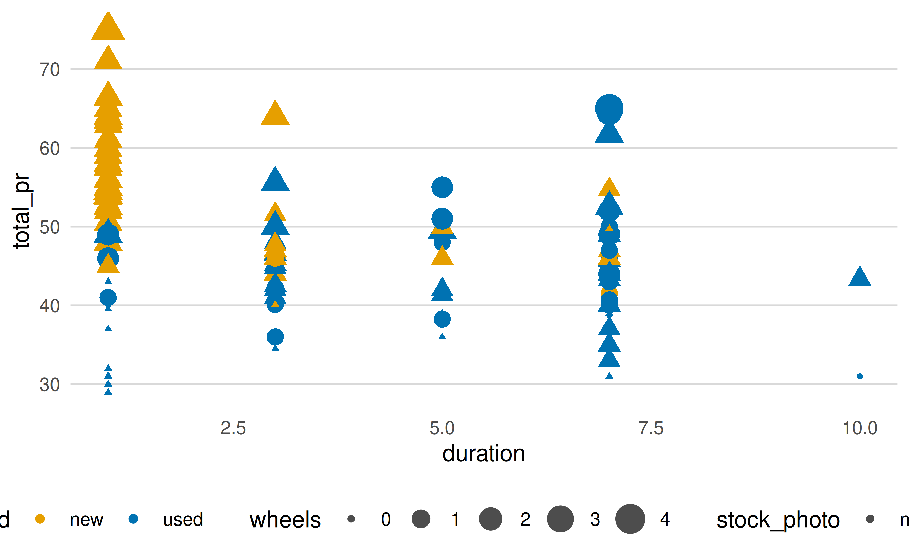{width="50%"}

Ein Bild kann nur eine begrenzte Anzahl an Variablen sinnvoll zeigen — vielleicht vier bis sechs. Bei mehr Variablen brauchen wir Statistik statt (nur) Bilder.

::: footer
Ein Dino sagt mehr als 1000 Worte
:::

# Nomenklatur von Datendiagrammen {.center footer=false}

## Eine kleine Nomenklatur

| Erkenntnisziel | qualitativ | quantitativ |
|---|---|---|
| Verteilung | Balkendiagramm | Histogramm und Dichtediagramm |
| Zusammenhang | gefülltes Balkendiagramm | Streudiagramm |
| Unterschied | gefülltes Balkendiagramm | Boxplot |

Einen ausführlicheren Überblick über Diagrammtypen bietet <https://www.data-to-viz.com/>.

::: footer
Nomenklatur von Datendiagrammen
:::

# Verteilungen verbildlichen {.center footer=false}

## Definition: Verteilung

:::{.callout-note title="Definition: Verteilung"}
Eine (Häufigkeits-)Verteilung einer Variablen $X$ schlüsselt auf, wie häufig jede Ausprägung von $X$ ist.
:::

Beispiel: Die Variable `cond` (Zustand des Artikels) hat 2 Ausprägungen; die Ausprägung `new` kommt 59-mal vor.

::: footer
Verteilungen verbildlichen
:::

## Verteilung einer nominalen Variable: Balkendiagramm {.smaller}

{width="40%"} {width="40%"}

:::{.callout-note title="Definition: Balkendiagramm"}
Grafische Darstellung von Werten, meist Häufigkeiten von Kategorien (Ausprägungen nominaler Variablen), mit rechteckigen Balken; die Länge eines Balkens ist proportional zur dargestellten Häufigkeit.
:::

Die Ausrichtung (horizontal/vertikal) ist Geschmackssache.

::: footer
Verteilungen verbildlichen
:::

## Syntax: Balkendiagramm mit `ggpubr` {.smaller}

:::: {.columns}
::: {.column width="50%"}
```r
mariokart |>
  count(cond) |>
  ggbarplot(x = "cond", y = "n")
```

Auf Deutsch:

> Nimm `mariokart` *und dann* zähle die Ausprägungen von `cond` *und dann* zeichne ein Balkendiagramm daraus.

`ggbarplot` erwartet fertige Balkenhöhen — daher zuerst mit `count` zählen.
:::
::: {.column width="50%"}
{width="100%"}
:::
::::

::: footer
Verteilungen verbildlichen
:::

## Verteilung einer quantitativen Variable {.smaller}

{width="45%"} {width="45%"}

Bei vielen Ausprägungen ist ein Balkendiagramm unübersichtlich (links). Lösung: Werte in Gruppen (Klassen) zusammenfassen, z. B. 0–5 Dollar, 6–10 Dollar, … — das ergibt ein **Histogramm** (rechts; Punkte = Einzelwerte).

::: footer
Verteilungen verbildlichen
:::

## Definition: Histogramm

:::{.callout-note title="Definition: Histogramm"}
Ein Histogramm ist ein Diagramm zur Darstellung der Häufigkeitsverteilung einer quantitativen Variablen. Die Daten werden in Gruppen (Klassen) eingeteilt, die durch je einen Balken dargestellt werden; die Balkenhöhe zeigt die Häufigkeit pro Klasse (bei konstanter Balkenbreite).
:::

::: footer
Verteilungen verbildlichen
:::

## Wie viele Balken? Nicht zu viele, nicht zu wenige {.smaller}

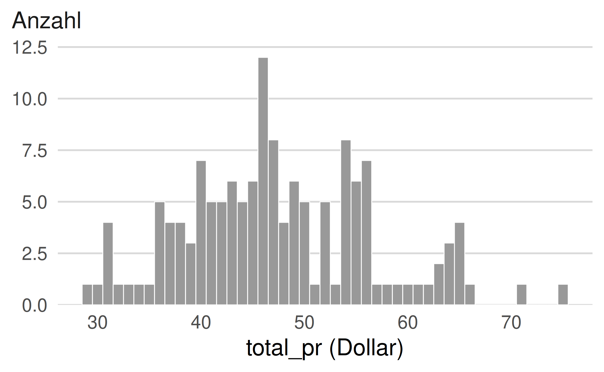{width="45%"} 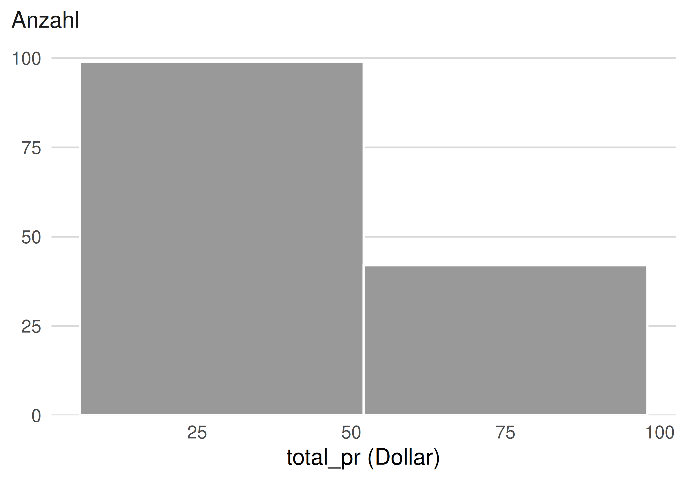{width="45%"}

Es gibt keine feste Regel für die Balkenanzahl — nur: nicht zu grob, nicht zu fein.

::: footer
Verteilungen verbildlichen
:::

## Histogramm vs. Dichtediagramm {.smaller}

```r
mariokart |>
  filter(total_pr < 100) |>  # ohne Extremwerte
  gghistogram(x = "total_pr")  # bzw. ggdensity(x = "total_pr")
```

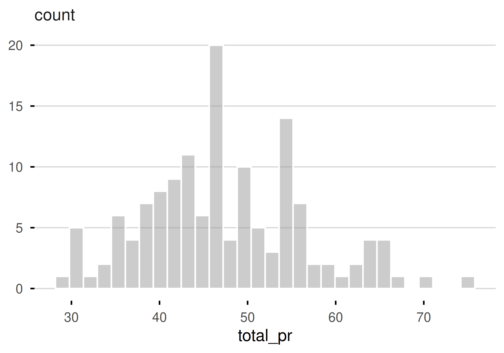{width="38%"} 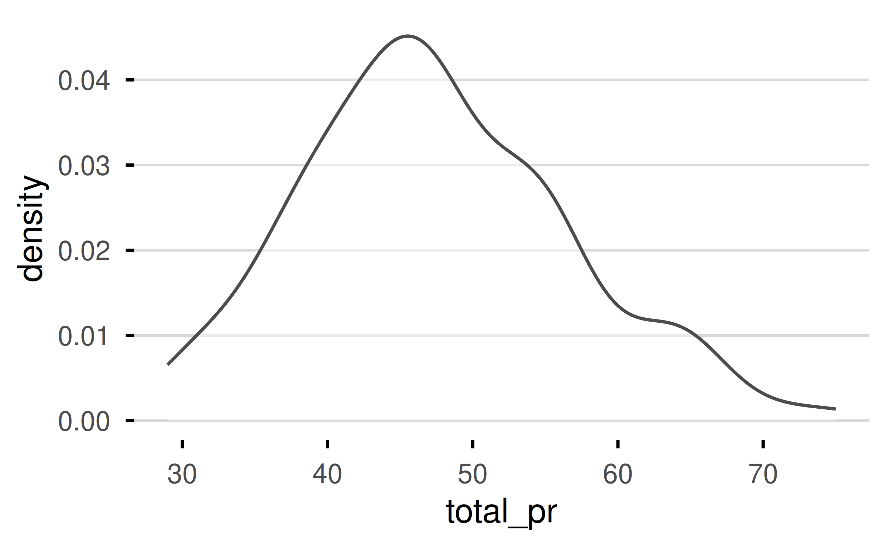{width="38%"}

::: footer
Verteilungen verbildlichen
:::

## Definition: Dichtediagramm {.smaller}

:::{.callout-note title="Definition: Dichtediagramm"}
Ein Dichtediagramm visualisiert die Verteilung einer stetigen Variablen. Im Gegensatz zum Histogramm wird der Verlauf geglättet, so kann Rauschen (Zufallsschwankung) besser ausgeblendet werden. (*Dichte*: relative Anzahl der Beobachtungen pro Einheit der X-Variablen.)
:::

{width="50%"}

::: footer
Verteilungen verbildlichen
:::

## Verteilungsformen {.smaller}

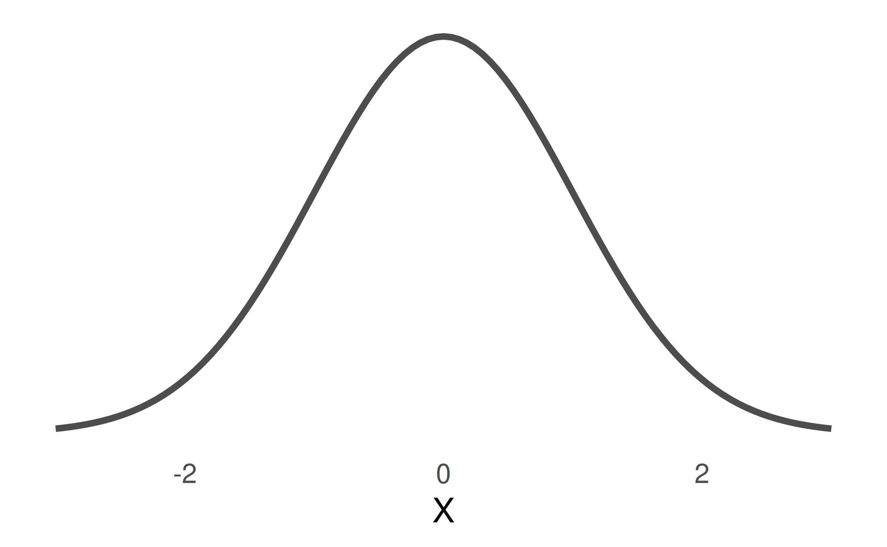{width="22%"} 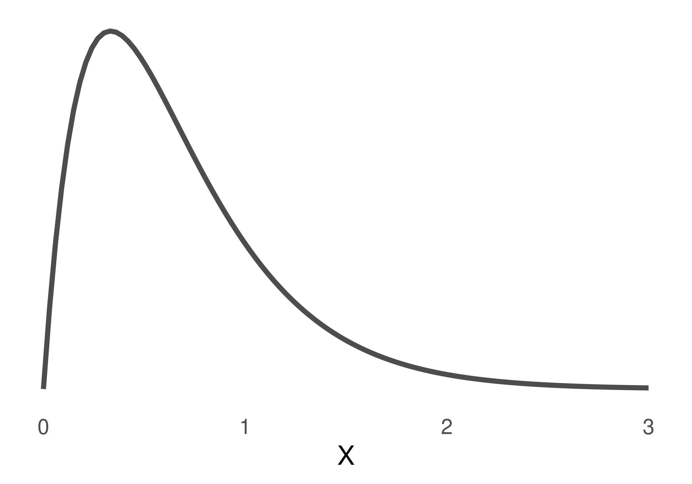{width="22%"}

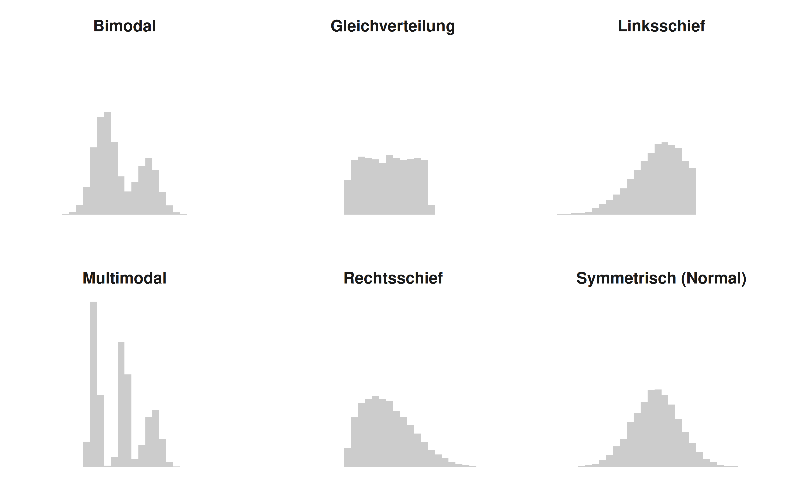{width="34%"}

Verteilungen unterscheiden sich in Lage ("typischer" Wert), Streuung und Form (symmetrisch vs. schief).

::: footer
Verteilungen verbildlichen
:::

# Spezialfall Normalverteilung {.center footer=false}

## Definition: Normalverteilung {.smaller}

:::{.callout-note title="Definition: Normalverteilung"}
Normalverteilungen haben eine charakteristische, symmetrische Glockenform. Sie unterscheiden sich in Mittelwert $\mu$ und Streuung $\sigma$ — diese beiden Parameter bestimmen den Graphen vollständig.
:::

Kurzschreibweise: $X \sim \mathcal{N}(\mu, \sigma)$

![Normalverteilungen mit verschiedenen Mittelwerten und Streuungen [@inductiveload2008]](../img/normals.png){width="40%"}

::: footer
Spezialfall Normalverteilung
:::

## Eigenschaften und Beispiele

Eine Normalverteilung ist

- symmetrisch, glockenförmig, stetig, unimodal,
- Mittelwert, Median und Modus sind identisch,
- vollständig beschrieben durch $\mu$ und $\sigma$.

Beispiele: Körpergröße (von Männern bzw. Frauen), IQ-Werte, einige Prüfungsergebnisse, Messfehler, Lebensdauer von Glühbirnen, Gewicht von Brotlaiben, Brustumfang schottischer Soldaten [@lyon_why_2014] …

::: footer
Spezialfall Normalverteilung
:::

## 68-95-99.7-Prozentregel {.smaller}

![Flächeninhalte (Wahrscheinlichkeitsmasse) einer Normalverteilung [@ainali_standard_2007]](../img/Standard_deviation_diagram_micro.svg.png){width="45%"}

Kennt man $\mu$ und $\sigma$, weiß man, welcher Anteil der Fläche unter der Kurve in einem Bereich liegt:

- $68\,\%$ im Bereich $\mu\pm 1 \cdot \sigma$
- $95\,\%$ im Bereich $\mu\pm 2 \cdot \sigma$
- $99{.}7\,\%$ im Bereich $\mu\pm 3 \cdot \sigma$

::: footer
Spezialfall Normalverteilung
:::

## Beispiel: IQ-Verteilung

$IQ \sim \mathcal{N}(100,15)$

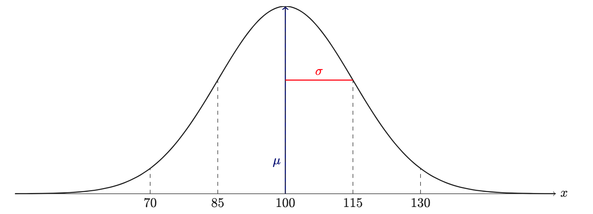{width="45%"}

Welcher IQ-Wert wird von 75 %, 50 %, 25 %, 5 %, 1 % der Leute nicht überschritten?

::: footer
Spezialfall Normalverteilung
:::

## Entstehung einer Normalverteilung {.smaller}

:::{.callout-note title="Definition: Entstehung einer Normalverteilung"}
Wenn sich eine Variable $X$ als Summe mehrerer, unabhängiger, etwa gleich starker Summanden ergibt, kann man erwarten, dass $X$ tendenziell normalverteilt ist.
:::

Anschaulich zeigt das [Galton-Brett](https://www.youtube.com/watch?v=3m4bxse2JEQ), wie aus vielen kleinen Zufallsereignissen eine Glockenkurve entsteht.

::: footer
Spezialfall Normalverteilung
:::

# Zusammenhänge verbildlichen {.center footer=false}

## Zusammenhang nominaler Variablen: Beispiele {.smaller}

- Hängt Berufserfolg (Führungskraft ja/nein) mit dem Geschlecht zusammen?
- Hängt der Beruf des Vaters mit dem Schulabschluss des Kindes zusammen?
- Gibt es einen Zusammenhang zwischen bevorzugter Automarke und Parteipräferenz?

Im Online-Auktionshaus fragen wir: Liegt ein Produktfoto (`stock_photo`) eher bei neuen als bei gebrauchten Spielen bei?

::: footer
Zusammenhänge verbildlichen
:::

## Zusammenhang nominaler Variablen {.smaller}

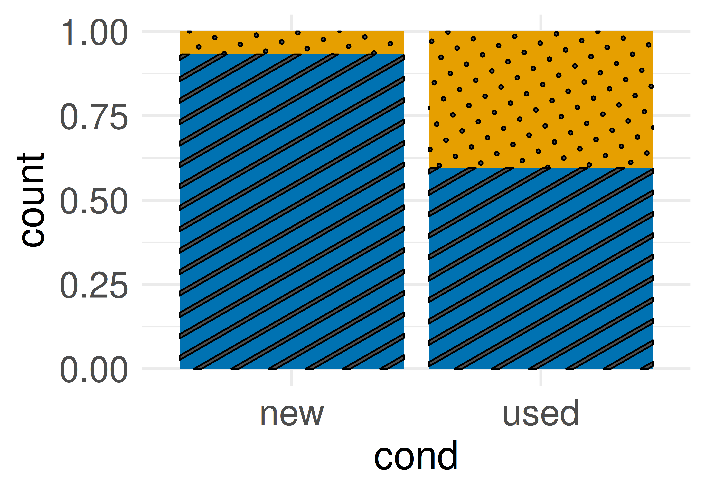{width="40%"} 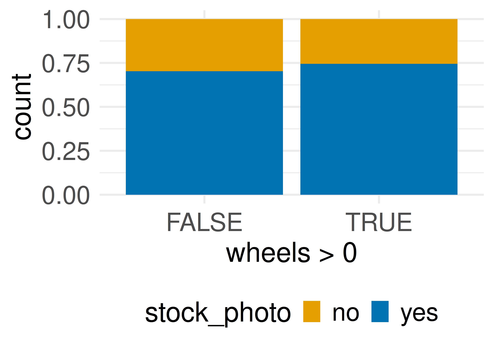{width="40%"}

- Links: Bei neuen Spielen ist fast immer (ca. 90 %) ein Foto dabei, bei gebrauchten nur bei gut der Hälfte — `cond` und `stock_photo` hängen zusammen.
- Rechts: Mit oder ohne Lenkrad (`wheels > 0`) — der Fotoanteil liegt jeweils bei ca. 70–75 %: (fast) kein Zusammenhang.
- Faustregel: Unterscheiden sich die "Füllhöhen", gibt es einen Zusammenhang.

::: footer
Zusammenhänge verbildlichen
:::

## Gefüllte Balkendiagramme {.smaller}

:::: {.columns}
::: {.column width="55%"}
```r
mariokart |>
  count(stock_photo, cond) |>
  ggbarplot(x = "stock_photo", y = "n",
            fill = "cond",
            position = position_fill())
```

- Geeignet, wenn (mindestens) eine der beiden Variablen nur zwei Ausprägungen hat.
- Die Balken sollten auf gleiche Länge (100 %) ausgerichtet sein.
:::
::: {.column width="45%"}
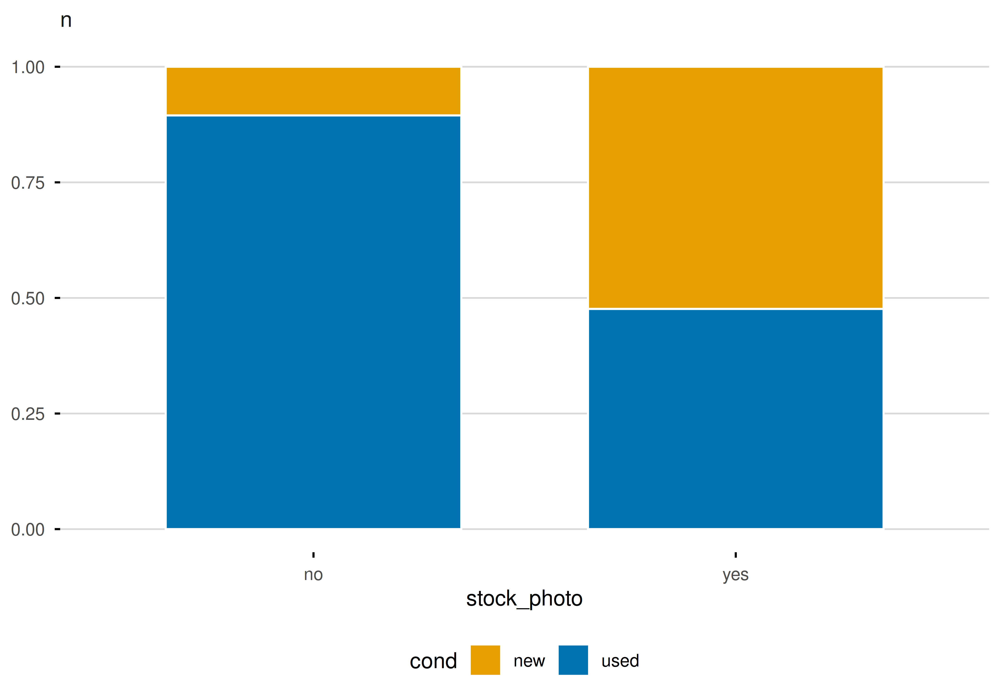{width="100%"}
:::
::::

::: footer
Zusammenhänge verbildlichen
:::

## Zusammenhang bei metrischen Variablen: Streudiagramm {.smaller}

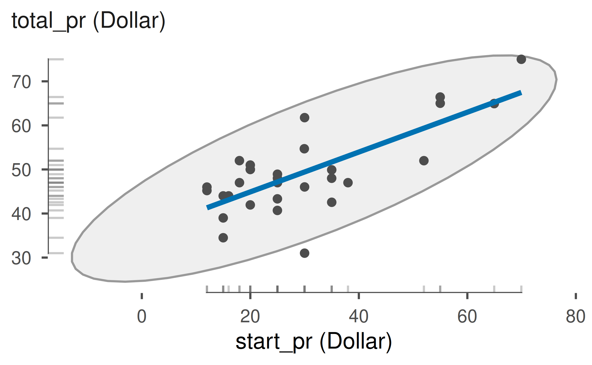{width="36%"} 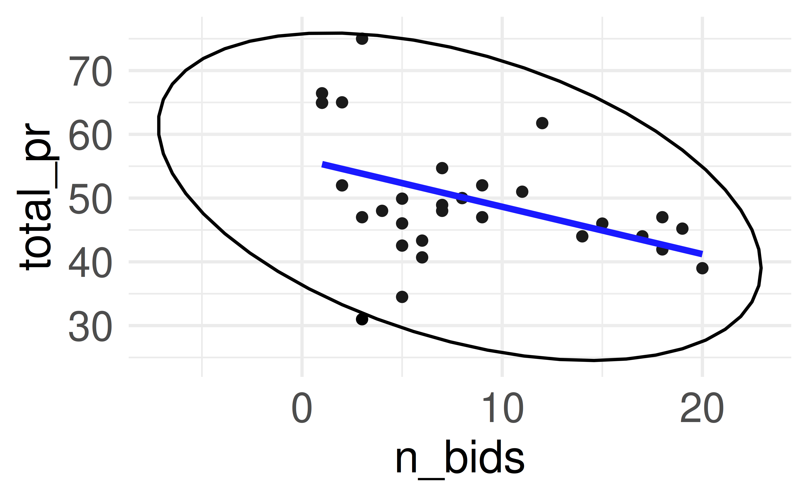{width="36%"}

- Links: Je höher der Startpreis (`start_pr`), desto höher tendenziell der Abschlusspreis (`total_pr`).
- Rechts: Je mehr Gebote (`n_bids`), desto geringer tendenziell der Abschlusspreis.
- Die Trendgerade (Regressionsgerade) zeigt die Richtung; die Ellipse zeigt, wie eng die Daten um sie streuen.

::: footer
Zusammenhänge verbildlichen
:::

## Definition: Linearer Zusammenhang

:::{.callout-note title="Definition: Linearer Zusammenhang"}
Lässt sich die Beziehung zweier Variablen gut mit einer Geraden beschreiben, spricht man von einem linearen Zusammenhang. Ändert man eine Variable um einen bestimmten Wert, ändert sich die andere um einen proportionalen Wert. *Gleichsinnige* (positive) Zusammenhänge zeigen aufsteigende Trendgeraden $\nearrow$; *gegensinnige* (negative) zeigen absteigende Trendgeraden $\searrow$.
:::

::: footer
Zusammenhänge verbildlichen
:::

## Auch nicht-lineare Zusammenhänge gibt es

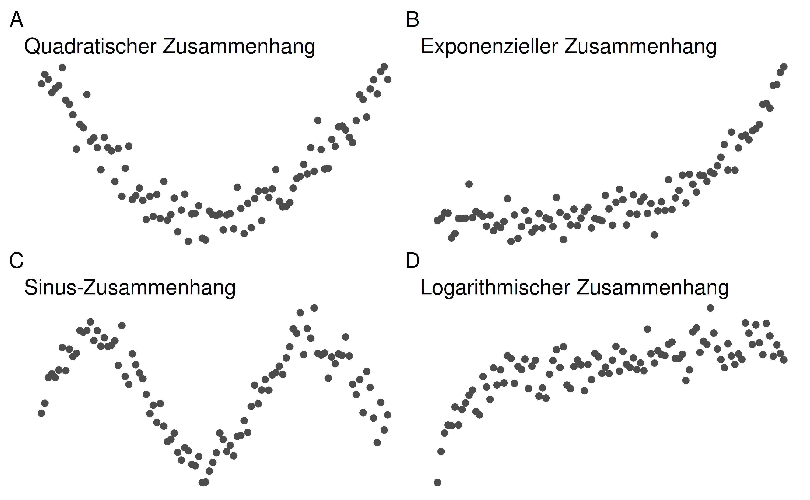{width="48%"}

Der Einfachheit halber konzentrieren wir uns auf lineare Zusammenhänge.

::: footer
Zusammenhänge verbildlichen
:::

## Stärke und Richtung von Zusammenhängen {.smaller}

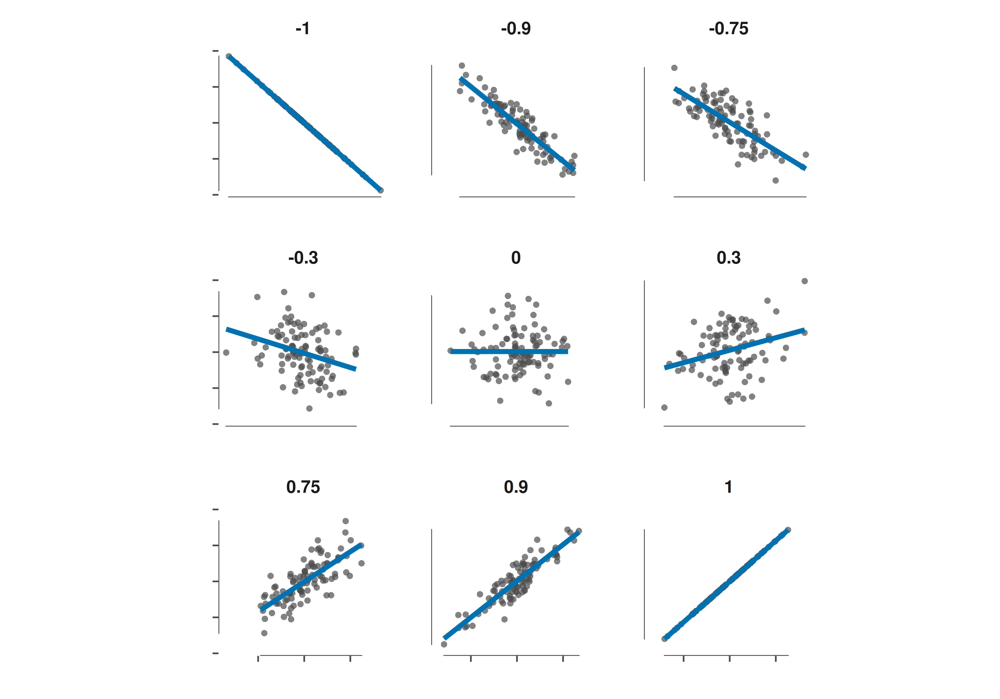{width="48%"}

Schmale Ellipsen ("Baguette") = starker Zusammenhang; breite Ellipsen ("Torte") = schwacher Zusammenhang. Die Zahl je Teildiagramm ist der *Korrelationskoeffizient* $r$: Vorzeichen = Richtung, Betrag = Stärke.

::: footer
Zusammenhänge verbildlichen
:::

## Faustregeln für den Korrelationskoeffizienten {.smaller}

:::: {.columns}
::: {.column width="40%"}
Nach @cohen_power_1992:

- $r\approx 0$: kein Zusammenhang
- $r \pm .1$: schwacher Zusammenhang
- $r \pm .3$: mittlerer Zusammenhang
- $r \pm .5$: starker Zusammenhang
- $r = 1$: perfekter Zusammenhang
:::
::: {.column width="60%"}
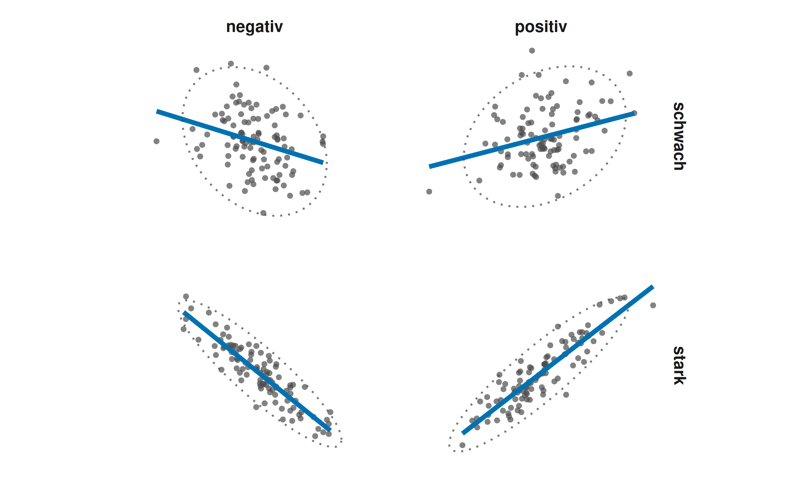{width="85%"}
:::
::::

::: footer
Zusammenhänge verbildlichen
:::

## Mehrere Zusammenhänge auf einen Blick {.smaller}

:::: {.columns}
::: {.column width="45%"}
```r
mariokart_no_extreme <-
  mariokart |>
  filter(total_pr < 100)

c("duration", "n_bids", "start_pr",
  "ship_pr", "seller_rate", "wheels") |>
  map(~ ggscatter(mariokart_no_extreme,
                  x = .x, y = "total_pr")) |>
  ggarrange(plotlist = _)
```

Erst ohne Extremwerte schält sich ein klares Bild heraus: `start_pr` und `wheels` hängen am stärksten mit `total_pr` zusammen.
:::
::: {.column width="55%"}
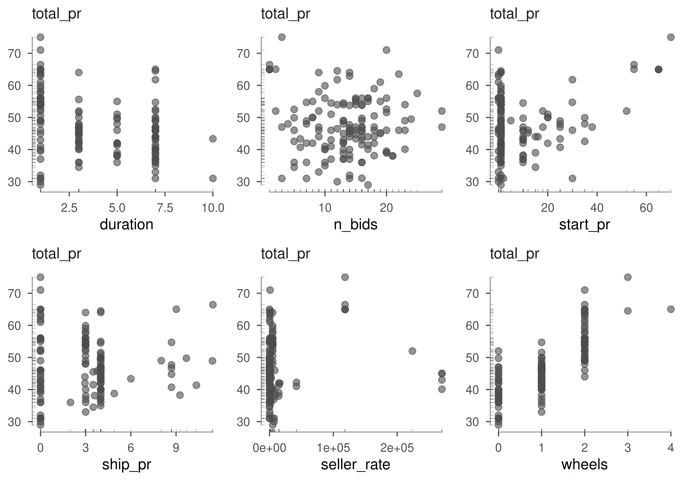{width="100%"}
:::
::::

::: footer
Zusammenhänge verbildlichen
:::

# Unterschiede verbildlichen {.center footer=false}

## Unterschiede bei nominalen Variablen

Für nominale Variablen eignen sich Balkendiagramme sowohl für Zusammenhänge als auch für Unterschiede: Das gefüllte Balkendiagramm zu `cond` und `stock_photo` zeigt genau genommen den *Unterschied* im Fotoanteil zwischen neuen und gebrauchten Spielen.

Tortendiagramme sind dagegen ungeeignet: Flächenvergleiche sind für das Auge schwer.

::: footer
Unterschiede verbildlichen
:::

## Unterschiede bei quantitativen Variablen {.smaller}

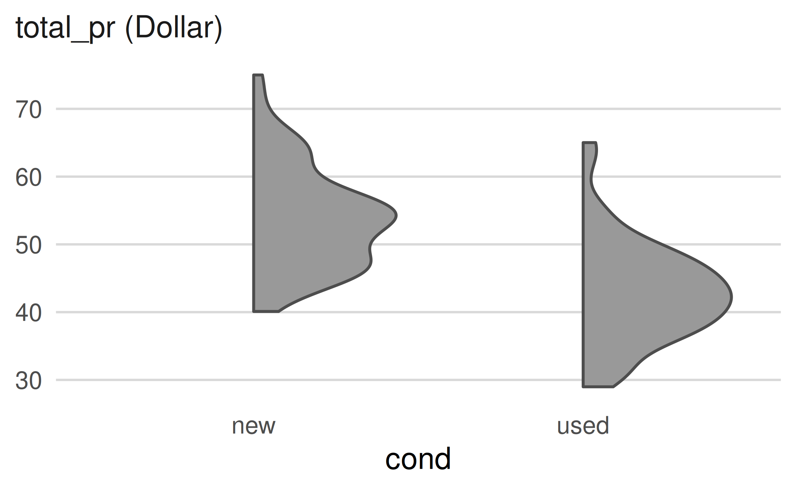{width="34%"} 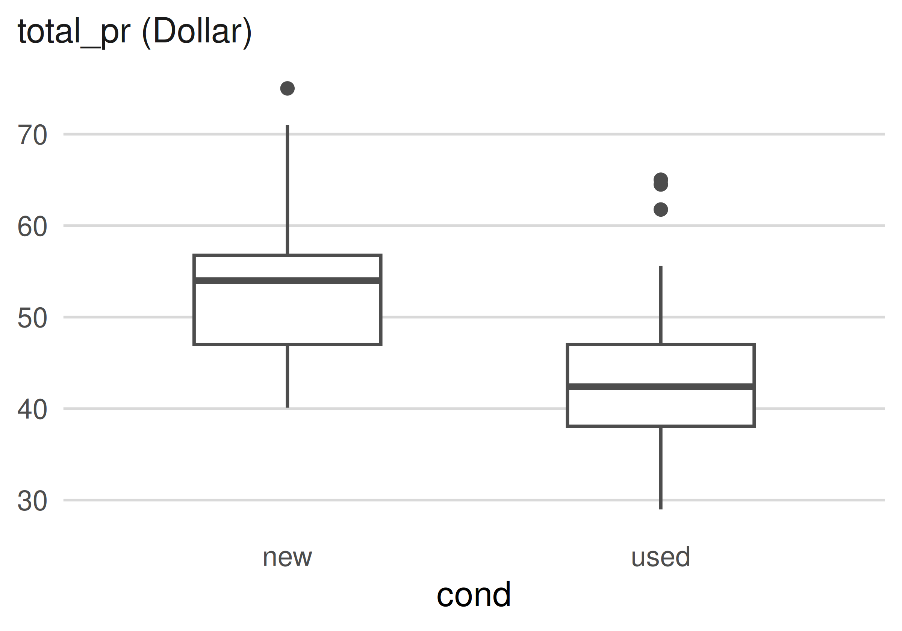{width="34%"}

- Unterscheiden sich zwei Gruppen (neu vs. gebraucht) deutlich in der Zielvariablen (`total_pr`)?
- Der Boxplot (rechts) zeigt die gleichen Verteilungen wie links — vereinfacht und gröber.
- Was ein "deutlicher" Unterschied ist, ist keine statistische, sondern eine inhaltliche Frage.

::: footer
Unterschiede verbildlichen
:::

## Definition: Boxplot {.smaller}

:::{.callout-note title="Definition: Boxplot"}
Der Boxplot ist eine Vereinfachung bzw. Zusammenfassung eines Histogramms. Damit stellt er ebenfalls eine Verteilung (einer metrischen Variablen) dar.
:::

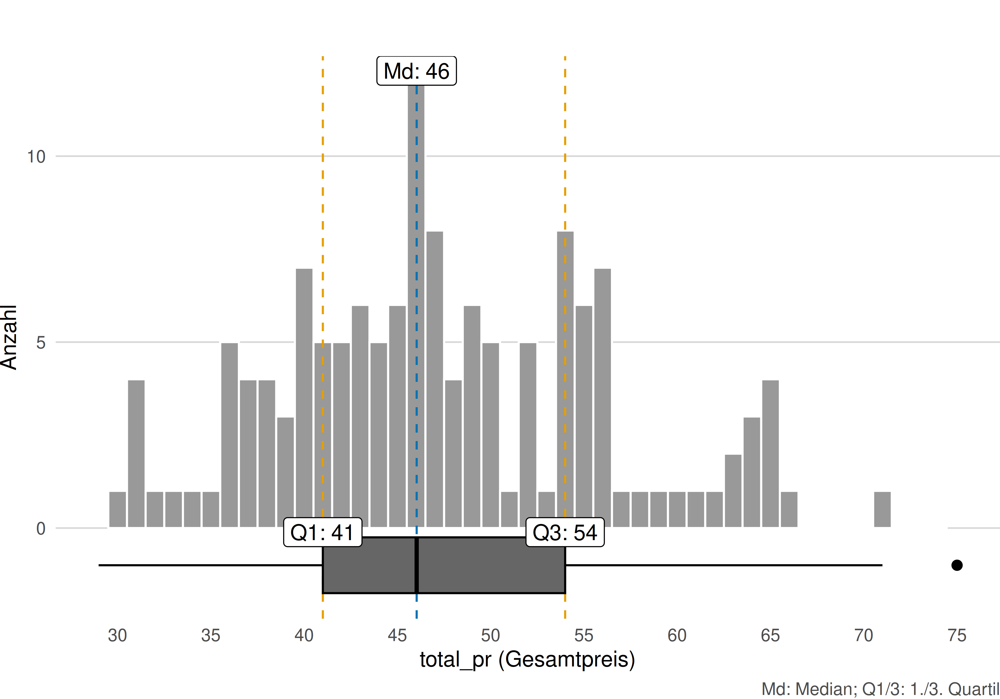{width="50%"}

::: footer
Unterschiede verbildlichen
:::

## Anatomie des Boxplots {.smaller}

1. **Dicker Strich**: Median der Verteilung.
2. **Enden der Box**: 1. Quartil (hier 41) und 3. Quartil (hier 54) — die Breite der Box ist der *Interquartilsabstand* (IQR), die Streuung der inneren 50 %.
3. **Antennen**: Streuung der kleinsten bzw. größten 25 % der Werte, begrenzt auf das 1,5-fache der Boxlänge.
4. **Einzelne Punkte**: Extremwerte außerhalb der Antennen.
5. Median mittig in der Box und gleich lange Antennen → Verteilung symmetrisch; sonst schief.

::: footer
Unterschiede verbildlichen
:::

## Boxplot: Preis nach Anzahl Lenkräder {.smaller}

:::: {.columns}
::: {.column width="50%"}
```r
mariokart_no_extreme |>
  mutate(wheels = factor(wheels)) |>
  ggboxplot(x = "wheels", y = "total_pr")
```

- `ggboxplot` gruppiert `wheels` ohnehin nach jedem Wert (0–4).
- `factor(wheels)` ist trotzdem guter Stil: dokumentiert die Absicht und verhindert, dass spätere Analysen `wheels` als stetig behandeln.
- Lenkräder und Preis hängen positiv zusammen — aber für 3 und 4 Lenkräder gibt es nur wenige Daten: Vorsicht bei der Interpretation!
:::
::: {.column width="50%"}
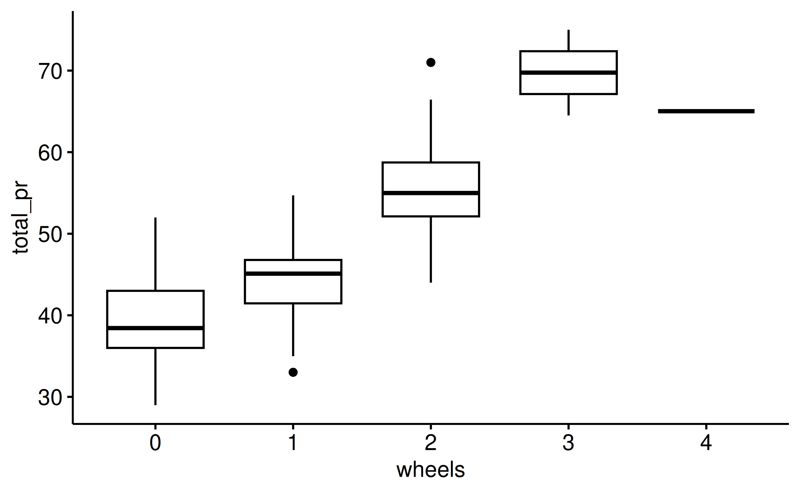{width="100%"}
:::
::::

::: footer
Unterschiede verbildlichen
:::

# So lügt man mit Statistik {.center footer=false}

## Achsen stauchen und strecken {.smaller}

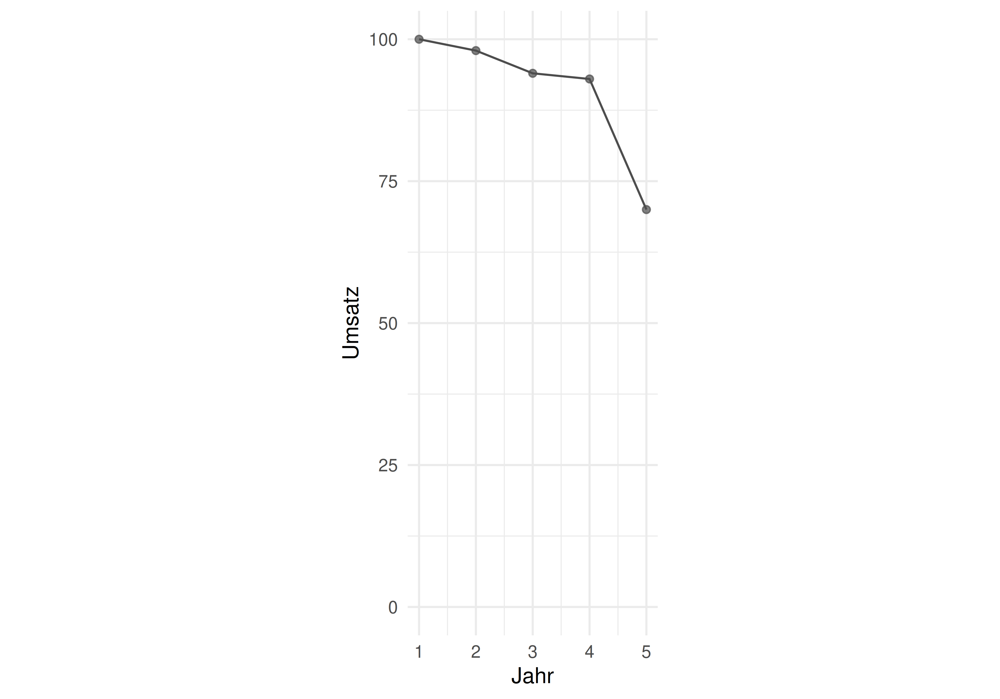{width="45%"} 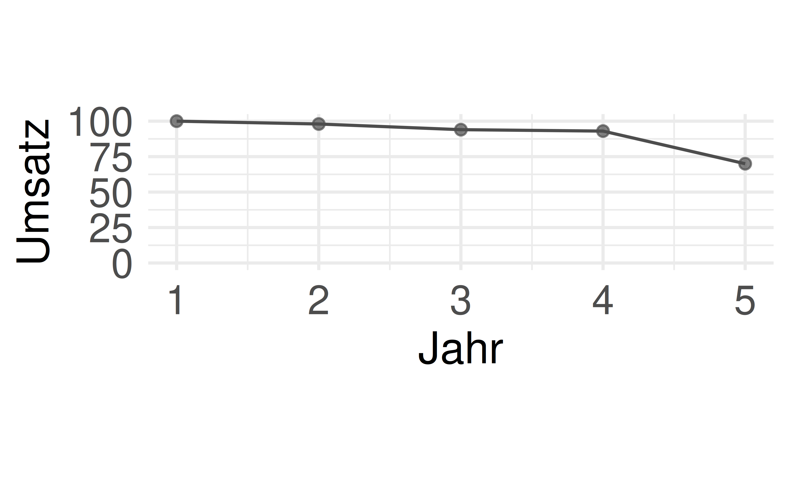{width="45%"}

Gleiche Daten, ganz anderer Eindruck.

::: footer
So lügt man mit Statistik
:::

## Die Y-Achse abschneiden {.smaller}

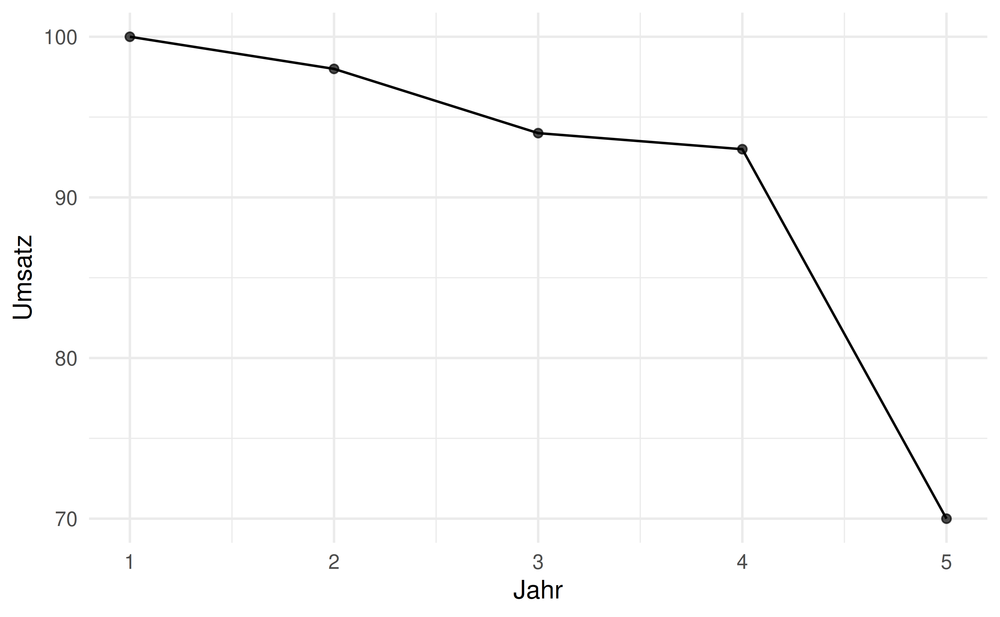{width="45%"} 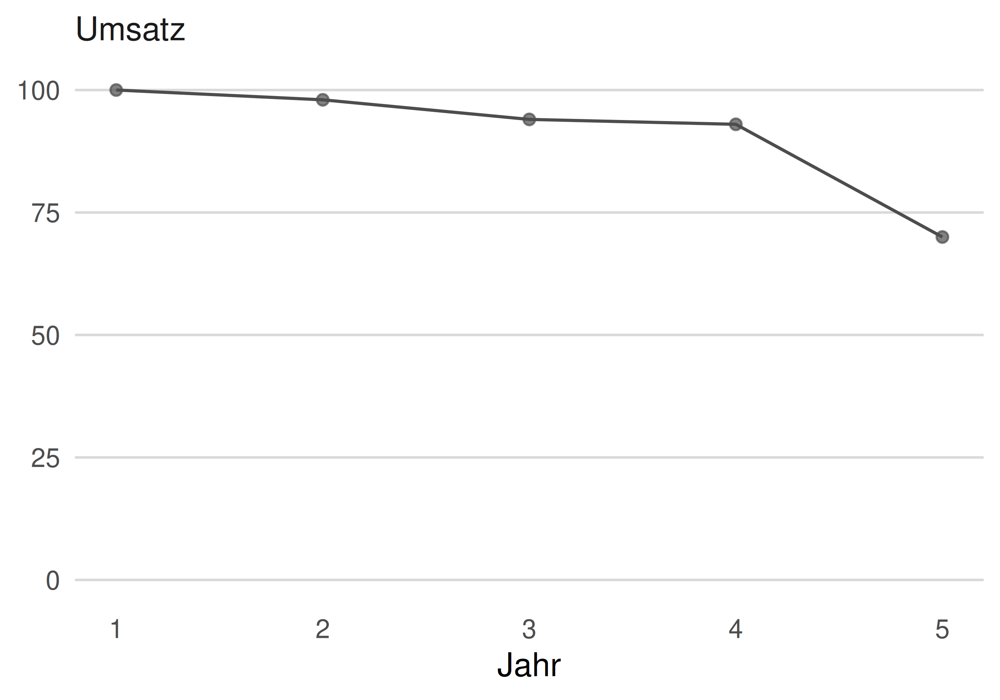{width="45%"}

Eine abgeschnittene Y-Achse dramatisiert kleine Unterschiede.

::: footer
So lügt man mit Statistik
:::

## Scheinkorrelationen als Kausalität verkaufen {.smaller}

![Schokoladenkonsum und Nobelpreise [@messerli_chocolate_2012]](../img/choc.jpeg){width="40%"}

Schokoladenkonsum hängt mit der Anzahl der Nobelpreise (pro Land) zusammen — aber nicht ursächlich. Eine Drittvariable (z. B. allgemeiner Entwicklungsstand) erklärt vermutlich beides gleichzeitig.

::: footer
So lügt man mit Statistik
:::

# Praxisbezug {.center footer=false}

## Die Stärke von Datendiagrammen {.smaller}

![Häufigkeit von Masern und Impfung in den USA [@moore_recreating_2015]](../img/vaccine.jpg){width="45%"}

Das Diagramm zeigt die Häufigkeit von Masern vor und nach Einführung der Impfung [@debold_battling_2015; Daten: @van_panhuis_contagious_2013] — eine Botschaft auf einen Blick, eindrücklicher als jede Tabelle.

Tortendiagramme sind zwar beliebt, aber meist eine schlechte Wahl: Tortenstücke lassen sich schwer vergleichen.

::: footer
Praxisbezug
:::

## Zusammenfassung {.smaller}

- Datendiagramme decken auf, was reine Kennzahlen verbergen (Dino-Datensatz, Anscombes Quartett)
- **Verteilung**: Balkendiagramm (nominal), Histogramm/Dichtediagramm (quantitativ) — bei Normalverteilung bestimmen $\mu$ und $\sigma$ alles
- **Zusammenhang**: gefülltes Balkendiagramm (nominal), Streudiagramm (metrisch) — Stärke via Ellipsenform/Korrelation
- **Unterschied**: Boxplot fasst eine Verteilung kompakt zusammen (Median, Quartile, Antennen, Extremwerte)
- Vorsicht: Diagramme lassen sich manipulieren (gestauchte Achsen, abgeschnittene Y-Achse, Scheinkorrelationen)

## Literaturhinweise {.smaller}

- @wickham2016d — das Standardwerk zu `ggplot2`, kostenfrei online
- @wilke_fundamentals_2019 — hervorragender, praxisnaher Überblick über Datenvisualisierung mit R
- @fisher_making_2018 — verwandte Perspektive auf gutes Visualisieren

## Referenzen {.smaller}
