# Einstieg {.center footer=false}

## Lernziele {.smaller}

- Sie können gängige Arten von Lagemaßen definieren.
- Sie können erläutern, inwiefern man ein Lagemaß als ein Modell verstehen kann.
- Sie können Lagemaße mit R berechnen.
- Sie können die Größe eines Gruppenunterschieds mit Cohens *d* und der Common Language Effect Size (CLES) beschreiben und interpretieren.

::: footer
Einstieg
:::

# Mittelwert als Modell {.center footer=false}

## Beispiel: Notendurchschnitt

Ein Statistikkurs besteht aus drei Studentinnen: Anna, Berta und Carla. Anna hat eine 1, Berta eine 2, Carla eine 3.

Die Rechenregel zum Mittelwert lautet:

1. Addiere alle Werte.
2. Teile durch die Anzahl der Werte.
3. Fertig!

Der Durchschnitt (das arithmetische Mittel) beträgt: **2**.

::: footer
Mittelwert als Modell
:::

## Der Mittelwert als "typischer Vertreter"

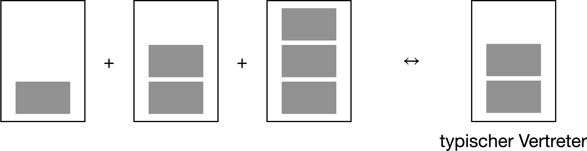{width="60%"}

Alle Werte fließen in gleichem Maße ein — der Mittelwert gibt uns eine Vorstellung (ein Modell!) der Datenreihe.

::: footer
Mittelwert als Modell
:::

## Der Mittelwert als ausbalancierte Wippe

![Der Mittelwert der Zahlenreihe (1, 2, 6) als ausbalancierte Wippe mit Mittelwert 3 [@maphry_seesaw_2009]](../img/1280px-Seesaw_with_mean.svg.png){width="50%"}

::: footer
Mittelwert als Modell
:::

## Definition: Mittelwert

:::{.callout-note title="Definition: Mittelwert"}
Der Mittelwert (MW, mean) von $X$ ist definiert als die Summe der Elemente von $X$ geteilt durch deren Anzahl $n$. Man bezeichnet ihn auch mit $\bar{x}$.
:::

$$\bar{x} := \frac{1}{n} \sum_{i=1}^{n}{x_{i}} = \frac{x_{1}+x_{2}+\dotsb +x_{n}}{n}$$

::: footer
Mittelwert als Modell
:::

## Mittelwert und Residuum

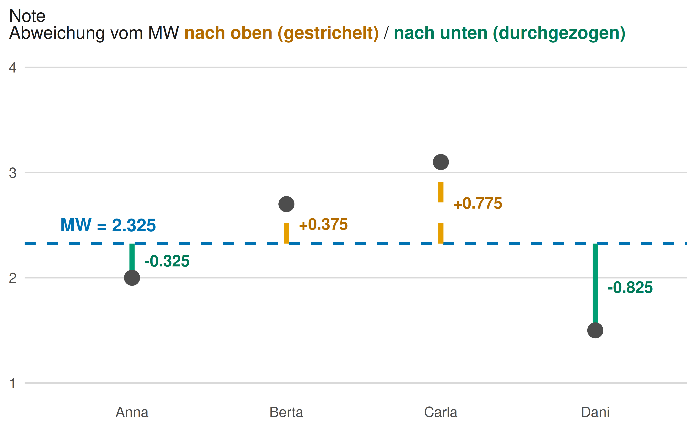{width="46%"}

Die Abweichung ("Fehler", "Rest", "Residuum") $e_i$ einer Beobachtung zum Mittelwert:

**Daten = Modell + Rest**, formal: $y_i = \bar{x} + e_i$

::: footer
Mittelwert als Modell
:::

## Modellgleichungen {.smaller}

- Beobachteter Wert = Modellwert + Fehler: $y = m + e$ (statt $m$ auch $\hat{y}$, "y-Dach")
- Ist das Modell der Mittelwert: $y = \bar{x} + e$
- Die Tilde "~" heißt "ist eine Funktion von": $\hat{y} \sim x$
- Ohne erklärende Variable (nur der Mittelwert): $\bar{y} \sim 1$

Die $1$ zeigt nur an, dass *keine* andere Variable zur Erklärung von $y$ herangezogen wird. In späteren Kapiteln kommen solche Variablen hinzu.

::: footer
Mittelwert als Modell
:::

## Summe der Abweichungen ist Null

$$\begin{aligned}
\sum_{i=1}^n (x_i-\bar{x}) &= \sum_{i=1}^n x_i - \sum_{i=1}^n \bar{x} \\
&= n\cdot \bar{x} - n\cdot \bar{x} = 0
\end{aligned}$$

Die nach oben ragenden Abweichungen gleichen die nach unten ragenden exakt aus.

::: footer
Mittelwert als Modell
:::

## Mittelwert als lineares Modell

:::{.callout-note title="Definition: Lineares Modell"}
Ein lineares Modell beschreibt die Daten durch eine Gerade.
:::

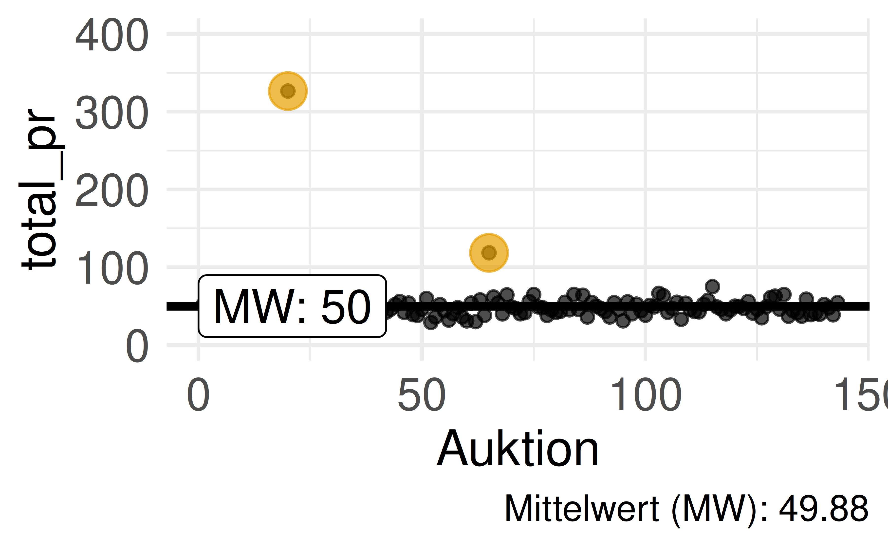{width="45%"} 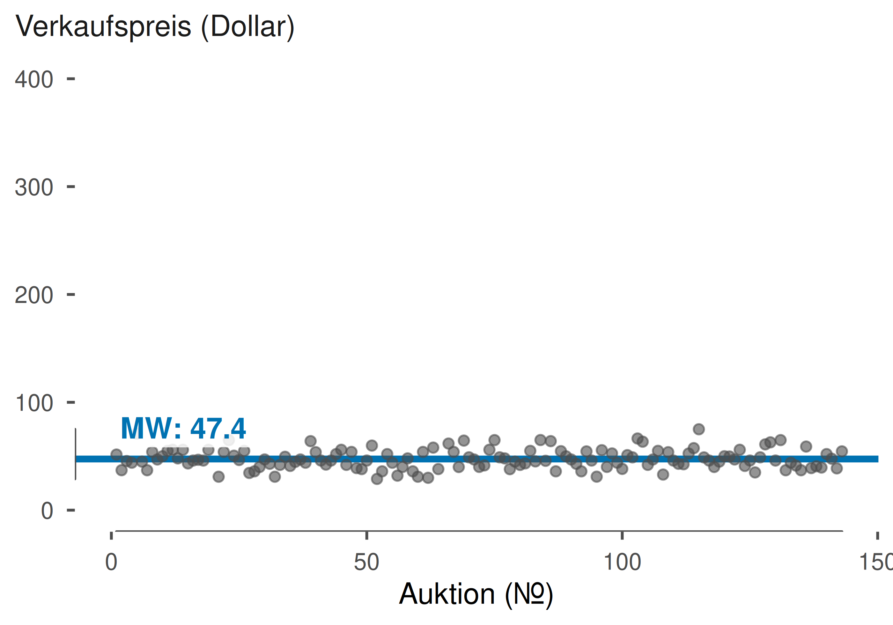{width="45%"}

::: footer
Mittelwert als Modell
:::

## Definition: Extremwert

:::{.callout-note title="Definition: Extremwert"}
Ein Extremwert (Ausreißer; *outlier*) ist eine Beobachtung, deren Wert deutlich vom Großteil der anderen Beobachtungen im Datensatz abweicht, z. B. viel größer ist.
:::

Im Mariokart-Datensatz wurden einige wenige Spiele für einen vergleichsweise hohen Preis verkauft — sie verschieben den Mittelwert des Verkaufspreises.

::: footer
Mittelwert als Modell
:::

## In R: der Befehl `lm()` {.smaller}

```r
lm(einkommen ~ 1)  # lm wie "lineares Modell"
```

- `lm()` gibt als `Coefficient` (Koeffizient) den Mittelwert zurück — den Achsenabschnitt (*intercept*).
- Die Gerade des Mittelwerts schneidet die Y-Achse genau an diesem Punkt.
- Mehr zur `lm()`-Syntax folgt in einem späteren Kapitel.

::: footer
Mittelwert als Modell
:::

## Der wertvollste Fußballer im Hörsaal {.smaller}

Kommt Kylian Mbappé (Jahreseinkommen ca. 120 Mio. Euro) in einen Hörsaal mit 100 Studis, die je 1000 Euro/Jahr verdienen:

```r
einkommen_studis <- rep(x = 1000, times = 100)
einkommen <- c(einkommen_studis, 120*1e6)
mean(einkommen)
```

Der Mittelwert liegt bei über einer Million Euro — kein gutes Modell für das typische Einkommen im Hörsaal: weder für die Studis noch für Mbappé!

::: footer
Mittelwert als Modell
:::

# Der Median als Modell {.center footer=false}

## Einkommensverteilung im Hörsaal

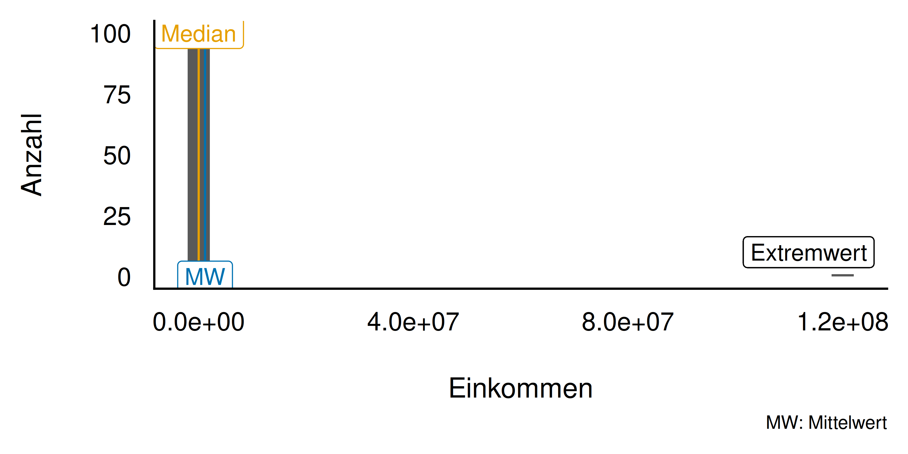{width="65%"}

Der Mittelwert ist anfällig für Extremwerte — man sagt, er ist nicht *robust*.

::: footer
Der Median als Modell
:::

## Beispiel: Das Median-Einkommen einiger Studentinnen

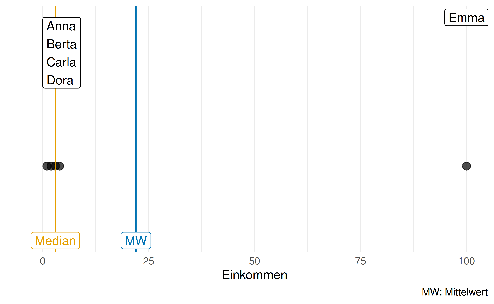{width="55%"}

Carla (3) hat das "typische" Einkommen: Gleich viele verdienen mehr wie weniger.

::: footer
Der Median als Modell
:::

## Definition: Median

:::{.callout-note title="Definition: Median"}
Die Merkmalsausprägung, die bei aufsteigend sortierten Beobachtungen in der Mitte liegt, nennt man Median.
:::

Bei geradem $n$ wird das arithmetische Mittel der beiden mittleren Werte gebildet:

- $\operatorname{Median}(1,2,3) = 2$
- $\operatorname{Median}(1,2) = \frac{1+2}{2} = 1.5$

::: footer
Der Median als Modell
:::

## Median: der mittlere Wert einer sortierten Reihe

::: {layout-ncol="3" fig-align="bottom"}
{width="15%"}

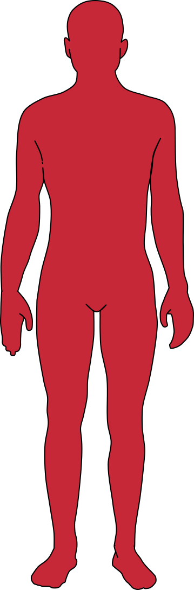{width="21%"}

{width="27%"}
:::

Der Median (1,79 m, rot) als Wert des "mittleren" Objekts bei aufsteigend sortierten Objekten: gleich viele Personen sind kleiner wie größer.

::: footer
Der Median als Modell
:::

## Der Median ist robust {.smaller}

Durch ein geniales Patent erhöht sich Emmas Einkommen um das Hundertfache — der Median bleibt gleich (3).

Fügt man Extremwerte zu einer Verteilung hinzu, ändert sich der Median zumeist (deutlich) weniger als der Mittelwert.

:::{.callout-important}
Bei (sehr) schiefen Verteilungen ist der Mittelwert wenig aussagekräftig, da er nicht mehr den "typischen" Wert widerspiegelt.
:::

::: footer
Der Median als Modell
:::

## Beispiel: Mariokart — Median vs. Mittelwert {.smaller}

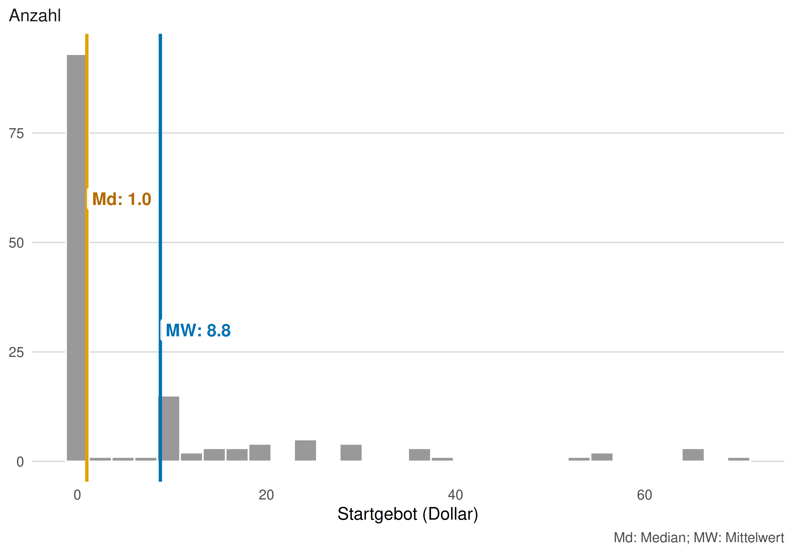{width="40%"}

- Klaffen Mittelwert und Median auseinander, liegt eine **schiefe** Verteilung vor.
- Ist der Mittelwert größer als der Median: **rechtsschief**.
- Bei schiefen Verteilungen ist der Median als Modell für den "typischen Wert" vorzuziehen.

::: footer
Der Median als Modell
:::

# Quantile {.center footer=false}

## Quantile als Verallgemeinerung des Medians {.smaller}

Der Median teilt eine Verteilung in eine untere und eine obere Hälfte — eine "50-Prozent-Marke".

Beispiel: Mariokart-Spiele unter 100 Dollar (`total_pr`)

- Median: ca. 46 Dollar — die Hälfte wurde billiger, die Hälfte teurer verkauft.
- Median der billigeren Hälfte (ca. 41 Dollar) → trennt das billigste Viertel vom Rest ab.
- Median der teureren Hälfte (ca. 54 Dollar) → trennt das teuerste Viertel vom Rest ab.

Warum nur in 25-%-Schritten aufteilen? Man kann genauso gut in 10-%- oder 1-%-Schritten aufteilen.

::: footer
Quantile
:::

## Definition: Quartile

:::{.callout-note title="Definition: Quartile"}
Sortiert man die Daten aufsteigend, trennt das *erste Quartil* (Q1, 25 %) das Viertel der kleinsten Werte vom Rest ab. Den Median nennt man das *zweite Quartil* (Q2, 50 %). Das *dritte Quartil* (Q3, 75 %) trennt die drei Viertel kleinsten Werte vom obersten Viertel ab.
:::

::: footer
Quantile
:::

## Definition: Dezile & Quantile {.smaller}

:::{.callout-note title="Definition: Dezile"}
Die neun Quantile $p = 0.1, 0.2, \ldots, 1$, die eine Verteilung in 10 gleich große Teile unterteilen, nennt man Dezile. "Gleich groß" heißt: In jedem Dezil liegen gleich viele Werte (10 %).
:::

:::{.callout-note title="Definition: Quantile"}
Ein $p$-Quantil ist der Wert, der von $p$ Prozent der Werte nicht überschritten wird. Quantil ist der Oberbegriff für Quartile, Dezile etc.
:::

::: footer
Quantile
:::

## Quartile für Mariokart-Verkaufsgebote

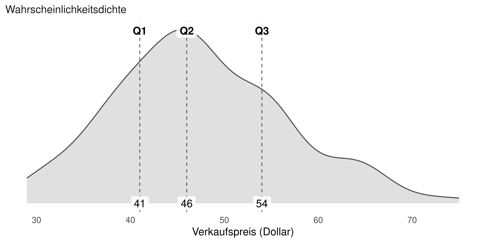{width="60%"}

Q1 ≈ 41, Median ≈ 46, Q3 ≈ 54 Dollar.

::: footer
Quantile
:::

## Quantile animiert

::: {layout-ncol="2"}
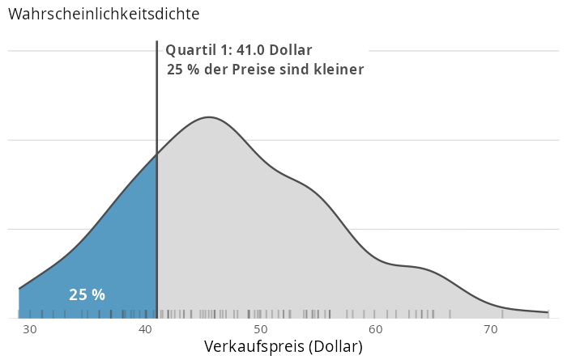

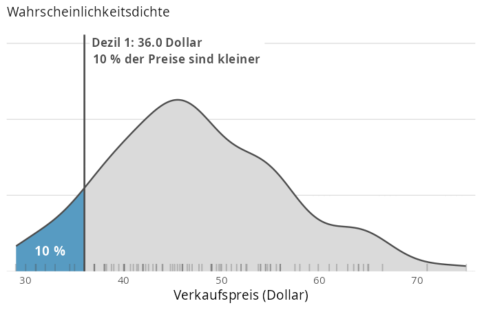
:::

Das p-Quantil teilt die Verteilung der Verkaufspreise: Der Anteil p liegt links davon (blau).

::: footer
Quantile
:::

## Quantile visualisiert

::: {.show-caption layout-ncol="2"}
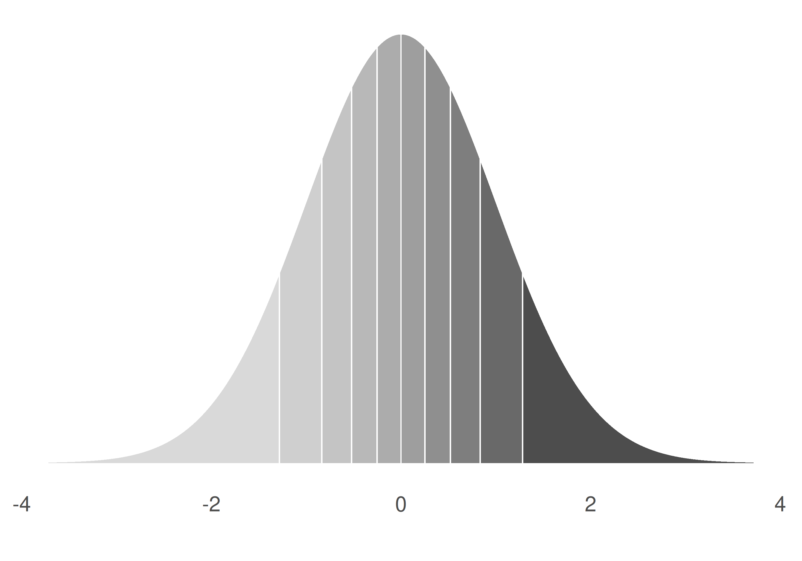{width="90%"}

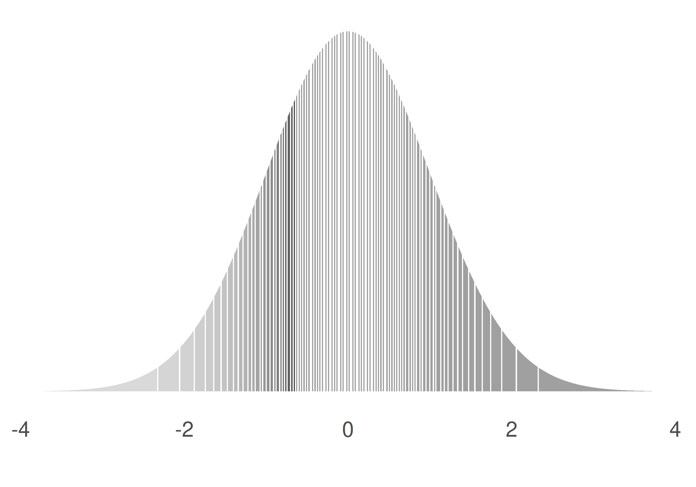{width="90%"}
:::

Alle Flächen sind gleich groß.

::: footer
Quantile
:::

## Quantile berechnen mit R

```r
mariokart |>
  filter(total_pr < 100) |>
  summarise(
    q25 = quantile(total_pr, .25),  # 1. Quartil
    q50 = quantile(total_pr, .50),  # 2. Quartil
    q75 = quantile(total_pr, .75))  # 3. Quartil
```

::: footer
Quantile
:::

## Quantile als sortierte Ordnung {.smaller}

Welcher Verkaufspreis wird von 90 % der Spiele nicht überschritten?

1. Sortiere die Werte aufsteigend.
2. Schneide die oberen 10 % ab.
3. Schaue, was der größte verbleibende Wert ist.

```r
mariokart |>
  arrange(total_pr) |>             # sortiere aufsteigend
  slice_head(n = 130) |>           # nur die ersten ca. 90%
  summarise(p90 = max(total_pr))   # größter verbleibender Wert
```

Das (annähernd) gleiche Ergebnis liefert `quantile(total_pr, .9)`.

::: footer
Quantile
:::

## Beispiel: Körpergröße von Studierenden {.smaller}

Das 25 %-, 50 %- und 75 %-Quantil entspricht Q1, Median und Q3 (Daten: @openintro).
Vorgehen: Inch in cm umrechnen, ins *Langformat* umformen (beide Einheiten in einer Spalte), nach Einheit gruppieren, Quantile berechnen.

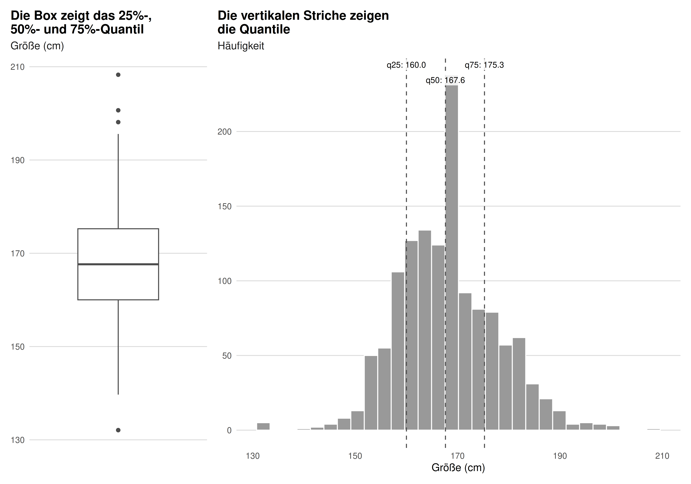{width="52%"}

::: footer
Quantile
:::

## Beispiel: Quantile der IQ-Verteilung {.smaller}

Der IQ wird üblicherweise als normalverteilt mit Mittelwert 100 und Streuung 15 angenommen.

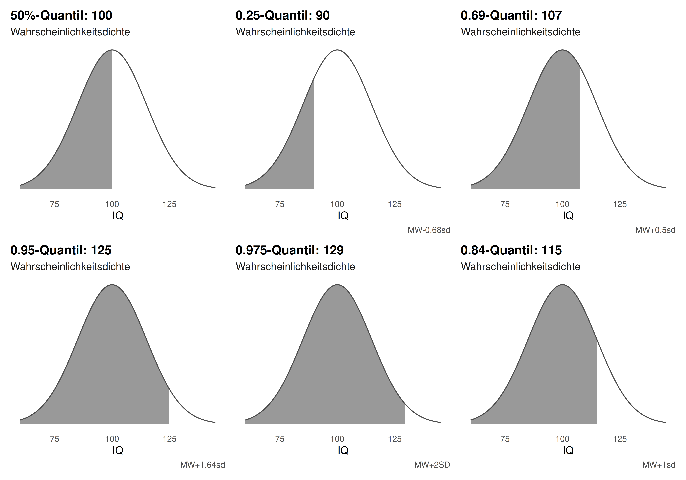{width="65%"}

::: footer
Quantile
:::

# Lagemaße {.center footer=false}

## Definition: Lagemaß

:::{.callout-note title="Definition: Lagemaß"}
Ein *Lagemaß* (synonym: Maß der zentralen Tendenz) gibt einen Vorschlag, welchen Wert einer Verteilung wir als typisch, normal, erwartbar oder "mittel" ansehen sollten.
:::

Gebräuchliche Lagemaße: Mittelwert, Median, Quantile (z. B. Quartile), Minimum, Maximum, Modus (häufigster Wert).

```r
describe_distribution(mariokart) |>
  select(-Skewness, -Kurtosis, -n, n_Missing)
```

::: footer
Lagemaße
:::

## Definition: Punktmodell

:::{.callout-note title="Definition: Punktmodell"}
Ein Modell, das für alle Beobachtungen ein und denselben Wert vorhersagt, heißt *Punktmodell*.
:::

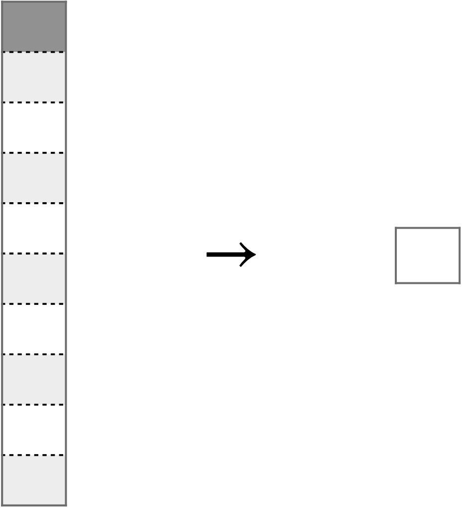{width="20%"}

Mittelwert, Median und Quartile sind Beispiele für Punktmodelle.

::: footer
Lagemaße
:::

## Gruppierte Lagemaße in R {.smaller}

Forschungsfrage z. B.: "Hängt das Geschlecht $G$ mit der Körpergröße $y$ zusammen?" — Modellformel: $y \sim G$.

```r
mariokart |>
  group_by(wheels) |>   # neue Zeile, der Rest ist gleich!
  summarise(mw = mean(total_pr))
```

::: footer
Lagemaße
:::

## Gruppierte Mittelwerte als Modell

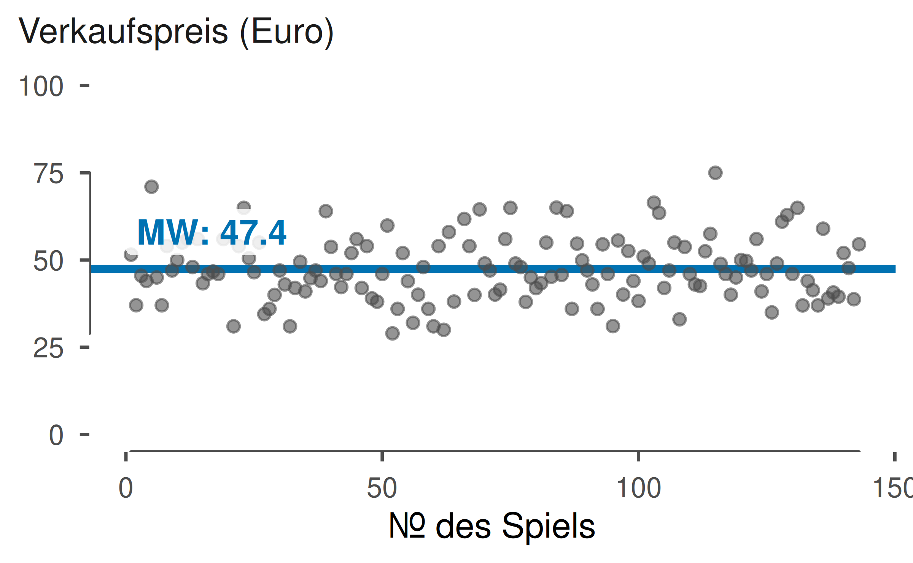{width="45%"} 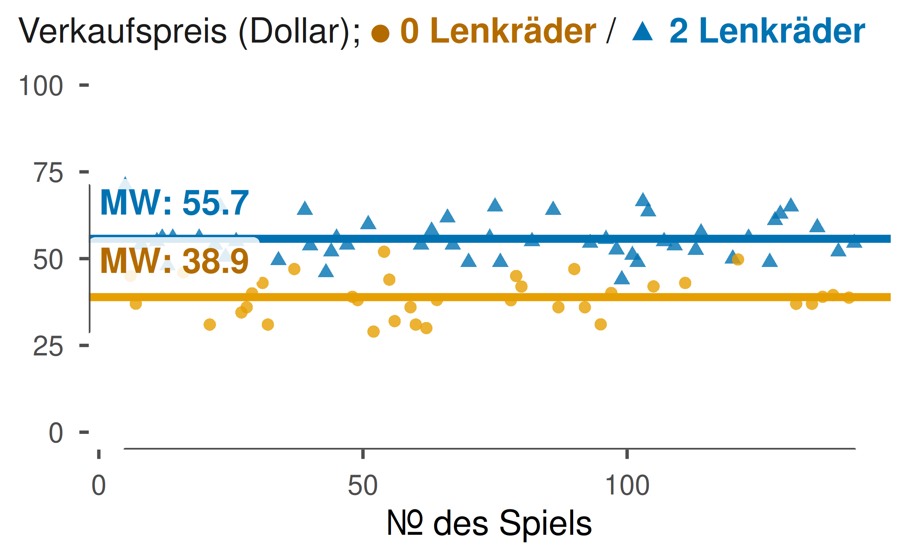{width="45%"}

Innerhalb der Gruppen sind die Abweichungen zum Gruppen-Mittelwert oft geringer als zum ungruppierten Mittelwert — das Residuum wird kleiner.

::: footer
Lagemaße
:::

# Effektstärken {.center footer=false}

## Ist der Unterschied groß? {.smaller}

- Spiele mit 2 Lenkrädern wurden im Mittel teurer verkauft als Spiele ohne Lenkrad (ca. 17 Dollar).
- Aber: Ob 17 Dollar "viel" sind, hängt von der Streuung der Preise ab.
- Und: Dollar lassen sich nicht mit IQ-Punkten oder Zentimetern vergleichen.
- Gesucht: ein Maß für die Größe eines Unterschieds, *unabhängig von der Maßeinheit*.

:::{.callout-note title="Definition: Effektstärke"}
Eine *Effektstärke* beschreibt die Größe eines Effekts (z. B. Gruppenunterschied, Zusammenhang) unabhängig von der Maßeinheit der Daten. Bekanntes Beispiel: die Korrelation $r$.
:::

::: footer
Effektstärken
:::

## Cohens *d*

:::{.callout-note title="Definition: Cohens d"}
Unterschied zweier Gruppenmittelwerte in Einheiten der (gemeinsamen) Standardabweichung $s$ [@cohen_statistical_1988]:

$$d = \frac{\bar{x}_A - \bar{x}_B}{s}$$
:::

- $d = 1$: Die Mittelwerte liegen eine Standardabweichung auseinander; $d = 0.5$: eine halbe.
- Das Vorzeichen zeigt nur, welche Gruppe vorne liegt.
- Faustregeln nach Cohen: $d \approx 0.2$ klein, $0.5$ mittel, $0.8$ groß.

::: footer
Effektstärken
:::

## Cohens *d* in R {.smaller}

```r
mario_lenkrad <-
  mariokart |>
  filter(total_pr < 100, wheels %in% c(0, 2)) |>
  mutate(lenkraeder = factor(wheels, levels = c(2, 0)))  # 2 zuerst: d positiv

cohens_d(total_pr ~ lenkraeder, data = mario_lenkrad)  # Paket effectsize
```

- Mittelwerte: ca. 55.7 vs. 38.9 Dollar, Standardabweichung je ca. 5.8 Dollar
- $d \approx (55.7 - 38.9) / 5.8 \approx 2.9$ — nach Cohens Maßstab riesig
- `cohens_d()` bildet die gemeinsame ("gepoolte") Standardabweichung selbst; `CI` ignorieren wir hier.
- Aber: Wie anschaulich sind "2.9 Standardabweichungen"?

::: footer
Effektstärken
:::

## Common Language Effect Size (CLES) {.smaller}

:::{.callout-note title="Definition: Common Language Effect Size (CLES)"}
Die Wahrscheinlichkeit, dass ein zufällig gezogener Wert aus Gruppe A größer ist als ein zufällig gezogener Wert aus Gruppe B (*Überlegenheitswahrscheinlichkeit*) [@McGraw1992]. Berechnung: jeden Wert aus A mit jedem aus B vergleichen, Anteil der Paare mit A größer; Gleichstände zählen halb.
:::

- CLES = 0.5: kein Unterschied (Münzwurf)
- CLES = 1: Jeder Wert aus A ist größer als jeder aus B (keine Überlappung)

::: footer
Effektstärken
:::

## CLES von Hand ausgezählt {.smaller}

Spielzeugbeispiel, Verkaufspreise in Dollar: A (2 Lenkräder) = 50, 55, 60; B (0 Lenkräder) = 40, 52, 58.

| A \\ B | 40 | 52 | 58 |
|:------:|:--:|:--:|:--:|
| **50** | 1  | 0  | 0  |
| **55** | 1  | 1  | 0  |
| **60** | 1  | 1  | 1  |

: 1 heißt "Preis aus A ist größer"

- In 6 von 9 Paaren ist A teurer: CLES $= 6/9 \approx 0.67$.
- Zieht man je ein Spiel zufällig, ist das mit 2 Lenkrädern in zwei von drei Fällen das teurere.

::: footer
Effektstärken
:::

## CLES in R

```r
p_superiority(total_pr ~ lenkraeder, data = mario_lenkrad,
              parametric = FALSE)  # Paare tatsächlich auszählen
```

- Mariokart: CLES $\approx 0.98$
- In Worten: Zieht man zufällig ein Spiel mit 2 Lenkrädern und eines ohne, ist in 98 von 100 Fällen das Spiel mit Lenkrädern das teurere.
- Diese Aussage versteht man auch ohne Statistik-Kenntnisse.

::: footer
Effektstärken
:::

## *d* und CLES im Vergleich

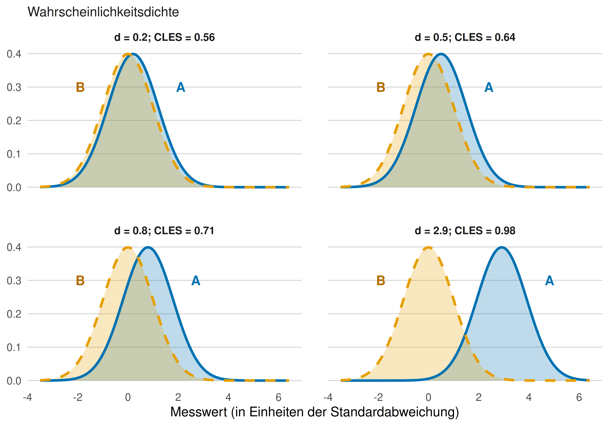{width="55%"}

::: footer
Effektstärken
:::

## *d*, Etikett und CLES {.smaller}

| Cohens *d* | Etikett nach Cohen | CLES |
|:----------:|:------------------:|:----:|
| 0          | kein Effekt        | 0.50 |
| 0.2        | klein              | 0.56 |
| 0.5        | mittel             | 0.64 |
| 0.8        | groß               | 0.71 |
| 2.9 (Mariokart) | sehr groß     | 0.98 |

: Für normalverteilte Gruppen mit gleicher Streuung

- Ein "großer" Effekt ($d = 0.8$): In fast 30 % der Paare liegt trotzdem B vorne!
- Typisch in Sozial- und Wirtschaftswissenschaften: $d \approx 0.2$ bis $0.5$.
- Vertiefung: $\text{CLES} = \Phi(d/\sqrt{2})$, in R `pnorm(d / sqrt(2))`.

::: footer
Effektstärken
:::

## Wie wichtig ist ein Effekt? {.smaller}

:::{.callout-important}
Cohens Etiketten (klein, mittel, groß) sind *grobe Faustregeln*, keine Naturgesetze — gedacht nur für den Fall, dass man sonst keinen Anhaltspunkt hat.
:::

- Ob ein Effekt wichtig ist, hängt vom Kontext ab.
- Ein "kleiner" Effekt eines Medikaments kann bei Millionen Patienten viele Leben retten.
- Ein "großer" Effekt kann belanglos sein, wenn es um Unwichtiges geht.
- Die CLES braucht kein Etikett: Sie sagt direkt, wie oft eine Gruppe vorne liegt.

::: footer
Effektstärken
:::

# Wie man mit Statistik lügt {.center footer=false}

## Checkliste: Transparenz einer Analyse {.smaller}

Statistik lässt Freiheitsgrade — das Gegenmittel ist *Transparenz* [@simmons_false-positive_2011; @wicherts_degrees_2016]:

1. Wurde die Art und Zeitdauer der Datenerhebung vorab festgelegt und berichtet?
2. Wurden ausreichend Daten gesammelt (z. B. mind. 20 Beobachtungen pro Gruppe)?
3. Wurden alle untersuchten Variablen berichtet?
4. Wurden alle durchgeführten Interventionen berichtet?
5. Wurden Daten aus der Analyse entfernt? Wenn ja, gibt es eine stichhaltige Begründung?

:::{.callout-important}
Stellen Sie hohe Anforderungen an die Transparenz einer statistischen Analyse. Nur Nachprüfbarkeit überzeugt von der Stichhaltigkeit der Ergebnisse.
:::

::: footer
Wie man mit Statistik lügt
:::

## Zusammenfassung {.smaller}

- **Mittelwert**: Summe der Werte geteilt durch deren Anzahl — nicht robust gegenüber Extremwerten
- **Median**: mittlerer Wert bei sortierten Daten — robust gegenüber Extremwerten
- **Quantile**: verallgemeinern den Median (Quartile, Dezile, Perzentile)
- **Lagemaße** sind Punktmodelle: Sie fassen eine Verteilung zu einem "typischen" Wert zusammen
- Gruppierte Lagemaße können Residuen verkleinern
- **Effektstärken** (Cohens *d*, CLES) beschreiben die Größe eines Unterschieds unabhängig von der Maßeinheit
- Transparenz ist der Schlüssel gegen Manipulation statistischer Analysen

# Literaturhinweise {.center footer=false}

## Lehrbücher zum Weiterlesen

- @mittag_statistik_2020 und @oestreich_keine_2014 — Einführungen in die Statistik
- @bortz_statistik_2010 — ein Klassiker
- @sauer_moderne_2019 — mit Fokus auf R
- @cetinkaya-rundel_introduction_2021, @poldrack_statistical_2023 — englischsprachig, online verfügbar

::: footer
Literaturhinweise
:::

## Referenzen {.smaller}
