# Einstieg {.center footer=false}

## Lernziele {.smaller}

- Sie können ein Punktmodell von einem Geradenmodell begrifflich unterscheiden.
- Sie können die Bestandteile eines Geradenmodells aufzählen und erläutern.
- Sie können die Güte eines Geradenmodells anhand von Kennzahlen bestimmen.
- Sie können Geradenmodelle sowie ihre Modellgüte in R berechnen.

In diesem Kapitel benötigen Sie die üblichen R-Pakete (`tidyverse`, `easystats`) und die Daten `mariokart` sowie `noten2`.

::: footer
Einstieg
:::

# Vorhersagen {.center footer=false}

## Was macht eine gute Vorhersage aus?

Vorhersagen sind nützlich, unter (mindestens) folgenden Voraussetzungen:

1. Sie sind präzise.
2. Wir wissen, wie präzise.
3. Jemand interessiert sich für die Vorhersage.

Die Methode des Vorhersagens, die wir hier betrachten, nennt man auch *lineare Regression*.

::: footer
Vorhersagen
:::

## Vorhersage ohne UV: Tonis Frage {.smaller}

Toni fragt: "Welche Statistiknote kann ich in der Klausur erwarten?" — wie viel sie gelernt hat, verrät sie nicht.

```r
noten2 <- read_csv("data/noten2.csv")
noten2 |> summarise(mw = mean(y))  # y: Punktwert in der Klausur
```

Beste Antwort ohne Prädiktor: der Mittelwert der letzten Klausur (ca. 91 Punkte) — wir nutzen den Mittelwert als *Punktmodell*.

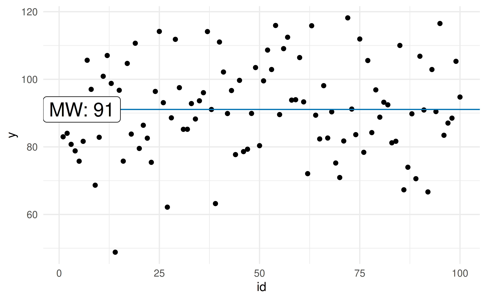{width="42%"}

::: footer
Vorhersagen
:::

## Definition: Nullmodell (Punktmodell)

:::{.callout-note title="Definition: Nullmodell (Punktmodell)"}
Modelle ohne UV, Punktmodelle also, kann man so bezeichnen: `y ~ 1`. Da das Modell null UV hat, nennt man es auch manchmal *Nullmodell*.
:::

```r
lm0 <- lm(y ~ 1, data = noten2)
lm0   # (Intercept): 91
```

`lm` steht für "lineares Modell", die `1` sagt, dass es keine Prädiktoren gibt. Der einzige Koeffizient, `(Intercept)`, ist der Mittelwert — für alle Studierenden wird derselbe Wert vorhergesagt.

::: footer
Vorhersagen
:::

## Toni verrät die Lernzeit

Toni: "Ich hab insgesamt 42 Stunden gelernt." Der Trend im Streudiagramm ist deutlich: Je mehr Lernzeit, desto mehr Klausurpunkte. Laut Trendgerade kann Toni ca. 83 Punkte erwarten.

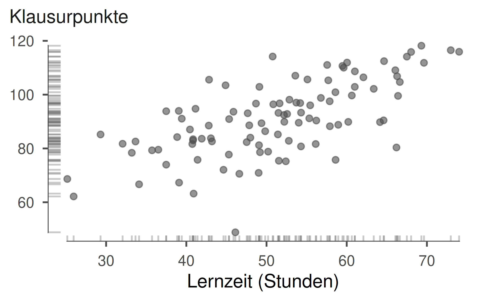{width="45%"} 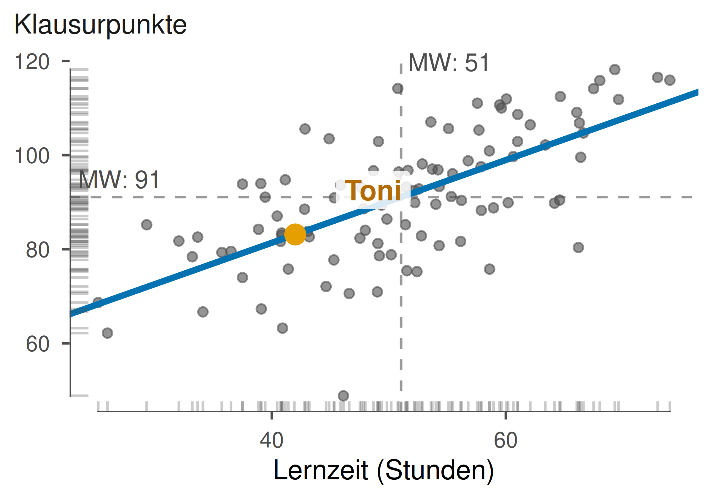{width="45%"}

::: footer
Vorhersagen
:::

# Geradenmodelle {.center footer=false}

## Vom Punktmodell zum Geradenmodell

Wir modellieren die Daten (bzw. deren Zusammenhang) mit einer Geraden.

Ein *Geradenmodell* ist eine Verallgemeinerung des Punktmodells: Ein Punktmodell sagt für alle Beobachtungen den gleichen Wert vorher.

In einem Geradenmodell wird nicht mehr (notwendig) für jede Beobachtung die gleiche Vorhersage $\hat{y}$ gemacht.

::: footer
Geradenmodelle
:::

## Definition: Gerade

:::{.callout-note title="Definition: Gerade"}
Eine Gerade ist das, was man bekommt, wenn man eine lineare Funktion in ein Koordinatensystem einzeichnet. Man kann sie durch zwei *Koeffizienten* festlegen: Achsenabschnitt (engl. *intercept*) und Steigung (engl. *slope*).
:::

::: footer
Geradenmodelle
:::

## Die Geradengleichung {.smaller}

::: {style="position:absolute; width:0; height:0; overflow:hidden;"}
$$
\definecolor{ycol}{RGB}{230,159,0}
\definecolor{modelcol}{RGB}{86,180,233}
\definecolor{errorcol}{RGB}{0,158,115}
\definecolor{beta0col}{RGB}{213,94,0}
\definecolor{beta1col}{RGB}{0,114,178}
\definecolor{xcol}{RGB}{204,121,167}
$$
:::

Im Schulunterricht: $f(\color{xcol}{x})=\color{ycol}{y}={m} \color{xcol}{x} + \color{beta0col}{t}$

In der Statistik: $f(\color{xcol}{x})=\color{ycol}{\hat{y}}=\color{beta0col}{\beta_0} + \color{beta1col}{\beta_1} \color{xcol}{x}$ oder $\color{ycol}{\hat{y}}= \color{beta0col}{b_0} + \color{beta1col}{b_1} \color{xcol}{x}$

- Die Nomenklatur mit $b_0, b_1$ lässt sich einfach erweitern: $b_2, b_3, \ldots$
- Griechische Buchstaben ($\beta$) zeigen meist an, dass man eine Aussage über die Population (nicht nur die Stichprobe) machen möchte.
- Das "Dach" über y, $\color{modelcol}{\hat{y}}$ ("y-Dach"), kennzeichnet den vom Modell vorhergesagten Wert — nicht den beobachteten Wert $\color{ycol}{y}$.

::: footer
Geradenmodelle
:::

## Elemente einer Regressionsgeraden

![Achsenabschnitt ($\beta_0$) und Steigung ($\beta_1$) einer Regressionsgeraden [@menk_linear_2014]](../img/regr.png){width="55%"}

::: footer
Geradenmodelle
:::

## Definition: Das einfache lineare Modell {.smaller}

:::{.callout-note title="Definition: Das einfache lineare Modell"}
Das einfache lineare Modell beschreibt den Wert einer abhängigen metrischen Variablen, $\color{ycol}{y}$, als lineare Funktion von einer (oder mehreren) unabhängigen Variablen, $\color{xcol}{x}$, plus einem Fehlerterm, $\color{errorcol}{\epsilon}$.
:::

$$\begin{aligned}
\color{ycol}{y} &= f(\color{xcol}{x}) + \color{errorcol}{\epsilon} \\
\color{ycol}{y_i} &= \color{beta0col}{\beta_0} + \color{beta1col}{\beta_1} \cdot \color{modelcol}{x_i} + \color{errorcol}{\epsilon_i}
\end{aligned}$$

- $\color{beta0col}{\beta_0}$: geschätzter y-Achsenabschnitt laut Modell (*intercept*)
- $\color{beta1col}{\beta_1}$: geschätzte Steigung (Regressionsgewicht) laut Modell (*slope*)
- $\color{errorcol}{\epsilon}$: Fehler des Modells

Hier steht $\color{ycol}{y}$, nicht $\color{modelcol}{\hat{y}}$: Der *beobachtete* Wert ist die Summe aus Vorhersage und Modellfehler.

::: footer
Geradenmodelle
:::

## Verschiedene Daten, verschiedene Geraden

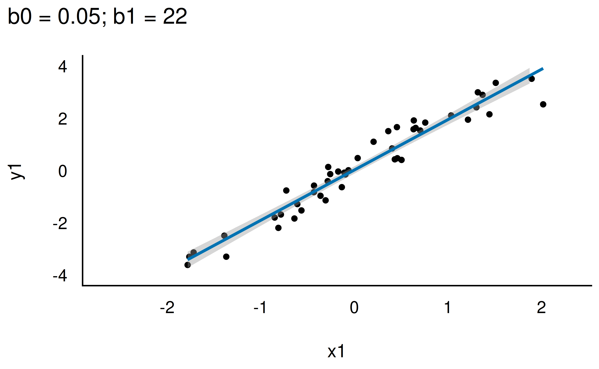{width="45%"} 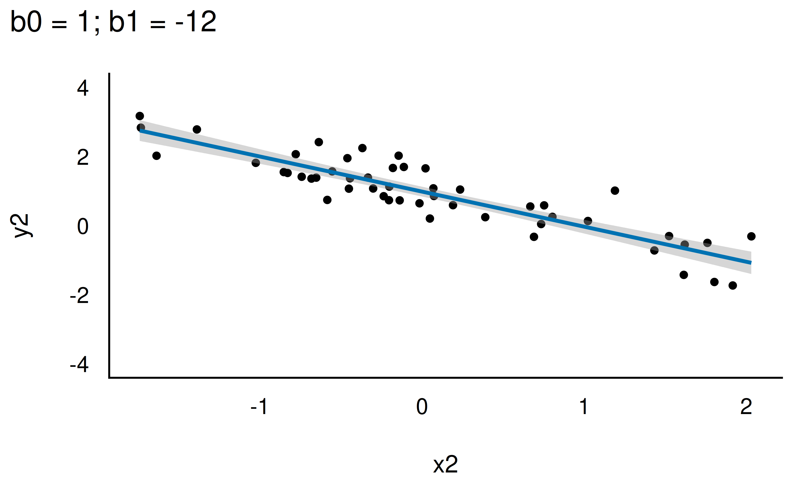{width="45%"}

Je nach Datenlage können sich Regressionsgeraden in Steigung oder Achsenabschnitt unterscheiden.

::: footer
Geradenmodelle
:::

## Toni will es genau wissen

"Wie viele Punkte bekomme ich, wenn ich gar nicht lerne? Und wie viele pro gelernter Stunde?"

Den $\color{ycol}{Y}$-Wert bei $\color{xcol}{x}=0$ gibt der **Achsenabschnitt** zurück:

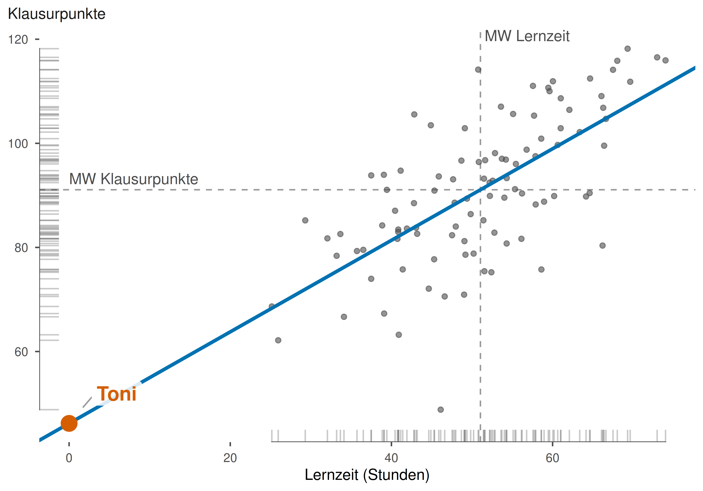{width="45%"}

::: footer
Geradenmodelle
:::

## Spezifikation eines Geradenmodells

$$\color{ycol}{\hat{y}} \sim \color{xcol}{\text{x}}$$

Lies: "Laut meinem Modell ist mein vorhergesagtes $\color{ycol}{\hat{y}}$ irgendeine Funktion von $\color{xcol}{x}$." Wir erinnern uns: $\color{ycol}{AV} \sim \color{xcol}{UV}$.

In Errisch: `lm(y ~ x, data = meine_daten)`. `lm` steht für "lineares Modell" — die Gerade nennt man auch *Regressionsgerade* (unscharf auch "Trendgerade").

::: footer
Geradenmodelle
:::

## Zahlen für Toni: Koeffizienten in R {.smaller}

"Hör auf, mit dem Lineal herumzumalen — sag mir präzise Zahlen!"

```r
lm_toni <- lm(y ~ x, data = noten2)
lm_toni
#> (Intercept)            x
#>       46.19         0.88
```

Die Regressionsgleichung lautet demnach: `y_pred = 46 + 0.88*x`.

- `46` ist der Achsenabschnitt: der vorhergesagte Wert von $y$ bei $x=0$ Lernstunden.
- `0.88` ist das Regressionsgewicht (Steigung): Für jede Stunde Lernzeit steigt der vorhergesagte Klausurerfolg um `0.88` Punkte.
- Mit beiden Koeffizienten kann man für beliebige $x$-Werte $\hat{y}$ ausrechnen, z. B. 73 Stunden: $46 + 0.88 \cdot 73 \approx 110$ Punkte.

::: footer
Geradenmodelle
:::

## Vorhersagen mit `predict` {.smaller}

> Hey R, predicte mir mal auf Basis vom Modell `lm_toni` den Lernerfolg für Toni, wenn sie 73 Stunden lernt.

```r
tonis_lernzeit2 <- tibble(x = 73)   # Tabelle mit 1 Zeile, 1 Spalte
predict(lm_toni, newdata = tonis_lernzeit2)
#>   1
#> 110
```

Allgemeine Syntax:

```r
predict(modell, newdata = tabelle_mit_prädiktorwerten)
```

`newdata` muss ein Dataframe sein, der die Werte der UV enthält (hier die Spalte `x`).

::: footer
Geradenmodelle
:::

## Vorhersagefehler (Residuum)

Die Differenz zwischen tatsächlichem Wert und vorhergesagtem Wert nennt man Vorhersagefehler (*error*) oder *Residuum*:

$$\color{errorcol}{e_i} = \color{ycol}{y_i} - \color{modelcol}{\hat{y}_i}$$

::: footer
Geradenmodelle
:::

## Vorhersagefehler im Vergleich {.smaller}

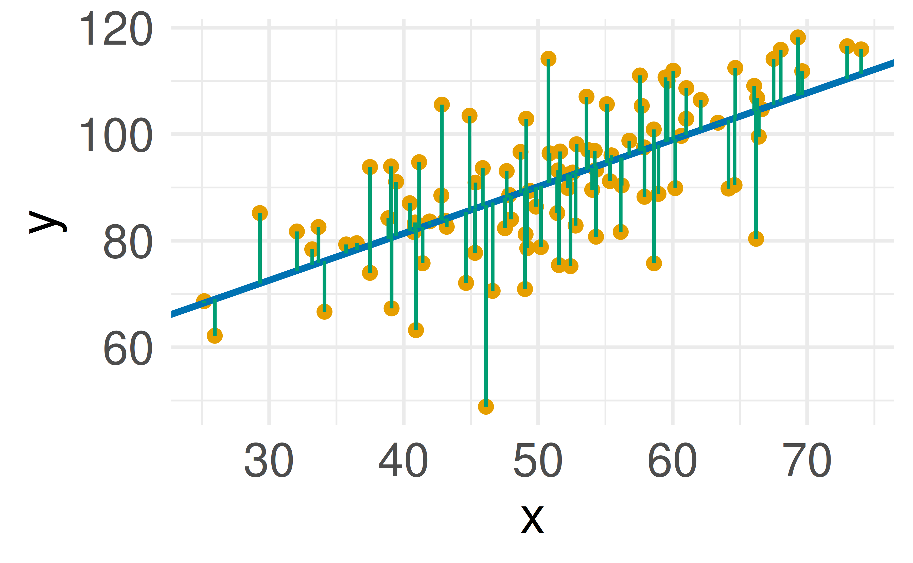{width="42%"} 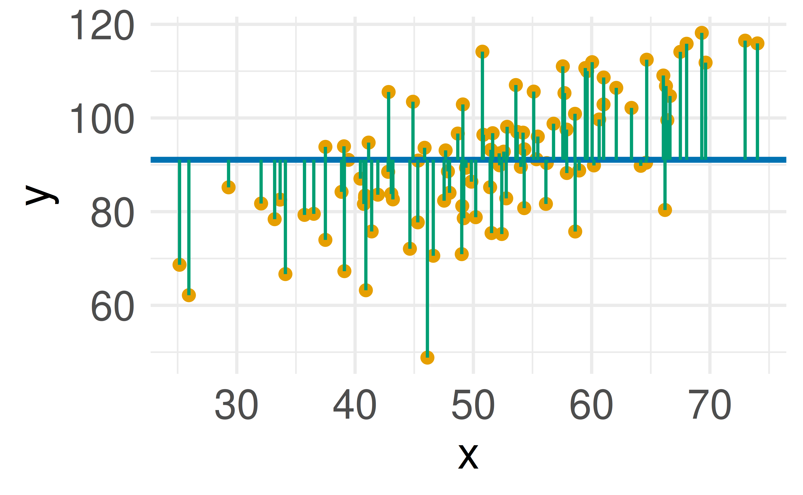{width="42%"}

```r
mae(lm0)                  # 11.2
mae(lm_toni)              #  8.0
mae(lm_toni) / mae(lm0)   #  0.71
```

Das Geradenmodell ist viel besser: Die mittlere Länge der Fehlerbalken sinkt auf 71 % des Nullmodells.

::: footer
Geradenmodelle
:::

## Definition: Fehlerstreuung {.smaller}

:::{.callout-note title="Definition: Fehlerstreuung"}
Als Fehlerstreuung bezeichnen wir die Verteilung der Abweichungen der beobachteten Werte ($y_i$) vom vorhergesagten Wert ($\hat{y}_i$).
:::

- Kenngrößen dafür: MAE oder — in Analogie zur Varianz — der mittlere Quadratfehler (MSE).
- Ein Geradenmodell ist immer besser als ein Punktmodell, solange X mit Y korreliert ist.

```r
mse(lm0)                  # 193
mse(lm_toni)              # 106
mse(lm_toni) / mse(lm0)   # 0.55
```

::: footer
Geradenmodelle
:::

## Berechnung der Modellkoeffizienten {.smaller}

Wie legt man die Regressionsgerade in das Streudiagramm? Die Koeffizienten $\beta_0$ und $\beta_1$ wählt man so, dass die Residuen *minimal* sind — genauer: die Summe der quadrierten Residuen wird minimiert.

$$\text{min}\sum_i \color{errorcol}{e_i}^2$$

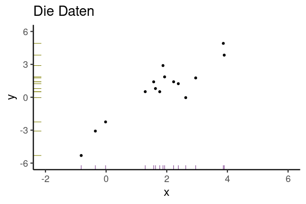{width="32%"} 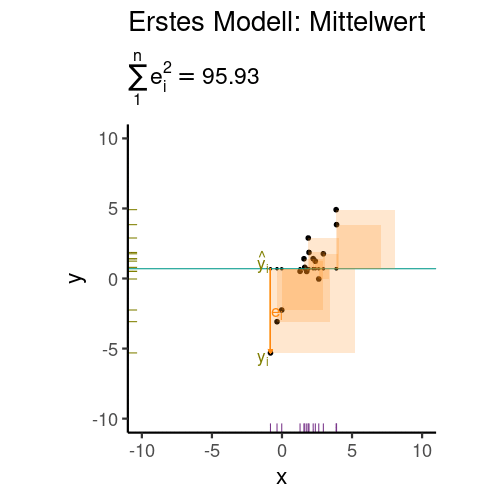{width="32%"}

::: footer
Geradenmodelle
:::

# $R^2$ als Maß der Modellgüte {.center footer=false}

## Verringerung der Fehlerstreuung

`lm_toni` weist noch 55 % der Fehlerstreuung (MSE) des Nullmodells auf — das Modell hat sich also um $1 - 0{,}55 = 0{,}45$ verbessert.

Wir vergleichen die Fehlerstreuung (MSE) des Modells mit der des Nullmodells:

$$R^2 = 1 - \frac{\text{MSE}_{m}}{\text{MSE}_{m0}}$$

```r
r2(lm_toni)   # R2: 0.45
```

::: footer
$R^2$ als Maß der Modellgüte
:::

## Definition: R-Quadrat {.smaller}

:::{.callout-note title="Definition: R-Quadrat"}
Der Anteil der Verringerung der Fehlerstreuung der Zielvariablen zwischen `lm0` und dem gerade untersuchten Modell nennt man *R-Quadrat* ($R^2$). $R^2$ ist ein Maß der *Modellgüte*: Je größer $R^2$, desto besser die Vorhersage. Da es ein Anteilsmaß ist, liegt der Wertebereich zwischen 0 und 1. Im Nullmodell beträgt $R^2$ per Definition Null. Für Modelle des Typs $y \sim x$ gilt: $R^2 = r_{xy}^2$.
:::

Einfach gesagt: $R^2$ gibt an, wie gut (zu welchem Anteil) ein Modell die Zielvariable $y$ erklärt.

::: footer
$R^2$ als Maß der Modellgüte
:::

## Extremfälle von R² {.smaller}

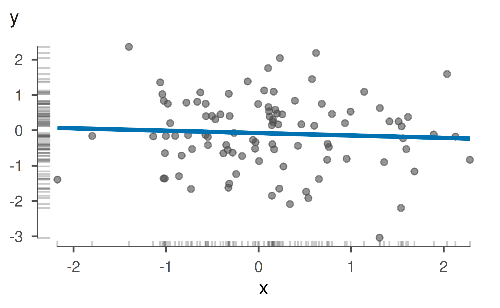{width="40%"} 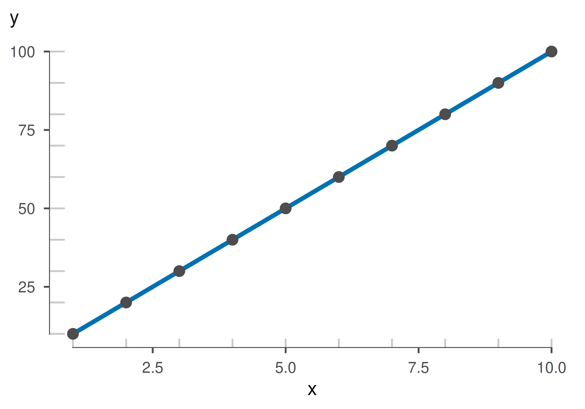{width="40%"}

- $R^2=1$: Alle Punkte liegen auf der Geraden; die Prognose ist gleich dem beobachteten Wert.
- $R^2=0$: Die Vorhersage ist so gut, als würde man für jedes $y$ den Mittelwert $\bar{y}$ vorhersagen.
- Je größer $R^2$, desto besser passt das Modell zu den Daten ("Fit").

::: footer
$R^2$ als Maß der Modellgüte
:::

# Interpretation eines Regressionsmodells {.center footer=false}

## Modellgüte

Die Residuen (Vorhersagefehler) bestimmen die Modellgüte: Sind die Residuen im Schnitt groß, ist die Modellgüte gering, und umgekehrt.

Verschiedene Koeffizienten stehen zur Verfügung: $R^2$, $r$ (Korrelation von tatsächlichem $y$ und vorhergesagtem $\hat{y}$), MSE, RMSE, MAE, …

::: footer
Interpretation eines Regressionsmodells
:::

## Koeffizienten interpretieren {.smaller}

- Achsenabschnitt ($\beta_0$) und Steigung ($\beta_1$) sind nur eingeschränkt zu interpretieren, wenn man die zugrundeliegenden kausalen Abhängigkeiten nicht kennt.
- Allein aufgrund eines statistischen Zusammenhangs darf man keine kausalen Abhängigkeiten annehmen. Ohne Theorie kann man nur *deskriptiv* argumentieren — oder sich mit Modellgüte und Vorhersagen begnügen.
- In `lm_toni` liegt der Achsenabschnitt bei $y \approx 46$: Beobachtungen mit $x=0$ können laut Modell diesen Wert erwarten.
- Oft sind UV-Werte von 0 unrealistisch, z. B. bei einer Regression von Gewicht auf Körpergröße — es gibt keine Menschen der Größe 0.

::: footer
Interpretation eines Regressionsmodells
:::

## Die Steigung interpretieren

"Im Modell `lm_toni` beträgt der Regressionskoeffizient $\beta_1 = 0{,}88$. Zwei Studentinnen, deren Lernzeit sich um eine Stunde unterscheidet, unterscheiden sich *laut Modell* um den Wert von $\beta_1$."

:::{.callout-caution}
"Effekt" klingt kausal. Ohne weitere Absicherung darf man Regressionskoeffizienten *nicht* kausal verstehen — besser: *statistischer* Effekt.
:::

::: footer
Interpretation eines Regressionsmodells
:::

# Wie man mit Statistik lügt {.center footer=false}

## r vs. R²: eine nichtlineare Beziehung {.smaller}

Der Unterschied in Modellgüte zwischen $r=.1$ und $r=.2$ ist *viel kleiner* als zwischen $r=.7$ und $r=.8$ — da $r = \sqrt{R^2}$, dürfen Unterschiede in $r$ nicht wie Unterschiede in $R^2$ interpretiert werden.

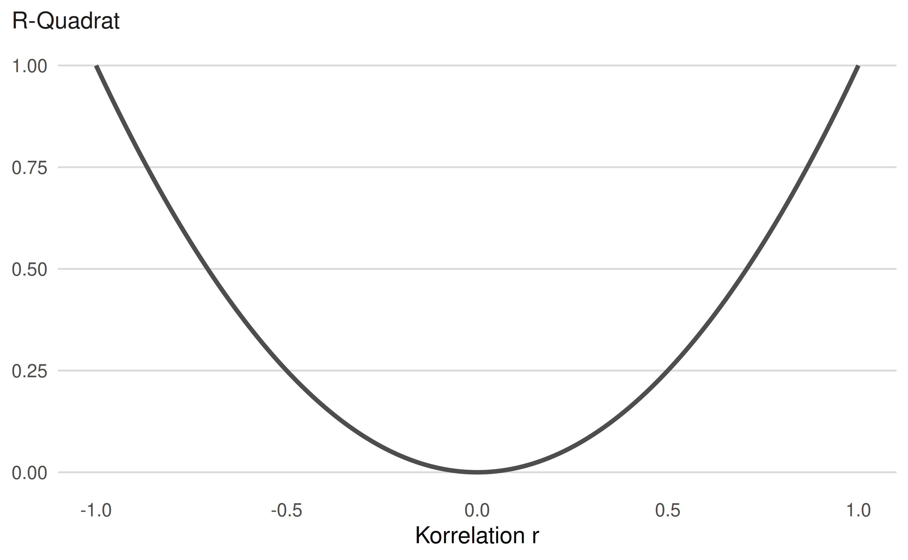{width="42%"}

:::{.callout-caution}
Unterschiede zwischen Korrelationsdifferenzen dürfen nicht linear interpretiert werden.
:::

::: footer
Wie man mit Statistik lügt
:::

# Fallbeispiel Mariokart {.center footer=false}

## Der Datenwahrsager legt los

Ziel: eine genaue Vorhersage der Verkaufspreise (`total_pr`) von Mariokart-Auktionen — betriebswirtschaftlich hoch relevant.

```r
lm2 <- lm(total_pr ~ start_pr, data = mariokart)
r2(lm2)   # R2: 0.005
```

Oh nein! Unterirdisch schlecht. Anstelle von bloßem Rumprobieren: Welche Variable korreliert am stärksten mit `total_pr`?

::: footer
Fallbeispiel Mariokart
:::

## Ein besseres Modell: `ship_pr` {.smaller}

```r
lm3 <- lm(total_pr ~ ship_pr, data = mariokart)
parameters(lm3)   # (Intercept): 36; ship_pr: 4
```

- Achsenabschnitt: ca. 36 Dollar erwarteter Verkaufspreis bei 0 Dollar Versandkosten ("Sockelbetrag").
- Steigung: *Pro Dollar* Versandkosten steigt der erwartete Verkaufspreis um ca. 4 Dollar.
- Die Koeffizienten sind Schätzwerte aus einer Stichprobe ($n = 143$); die Spalte `95 CI` gibt einen Schätzbereich an.

Regressionsgleichung: `total_pr_pred = 36 + 4*ship_pr`

> Der vorhergesagte Gesamtpreis eines Spiels liegt bei 36 Dollar "Sockelbetrag" plus 4 mal die Versandkosten.

::: footer
Fallbeispiel Mariokart
:::

## Erwartete Werte und Vorhersagen {.smaller}

:::: {.columns}
::: {.column width="50%"}
```r
neue_daten <- tibble(ship_pr = c(1, 4))
predict(lm3, newdata = neue_daten)
#>  1  2
#> 41 54
```

Bei 4 Dollar Versandkosten sind laut Modell knapp 54 Dollar Verkaufspreis zu erwarten.

`estimate_expectation(lm3)` liefert für jede Beobachtung den vorhergesagten Wert (`Predicted`) und das Residuum.
:::

::: {.column width="50%"}
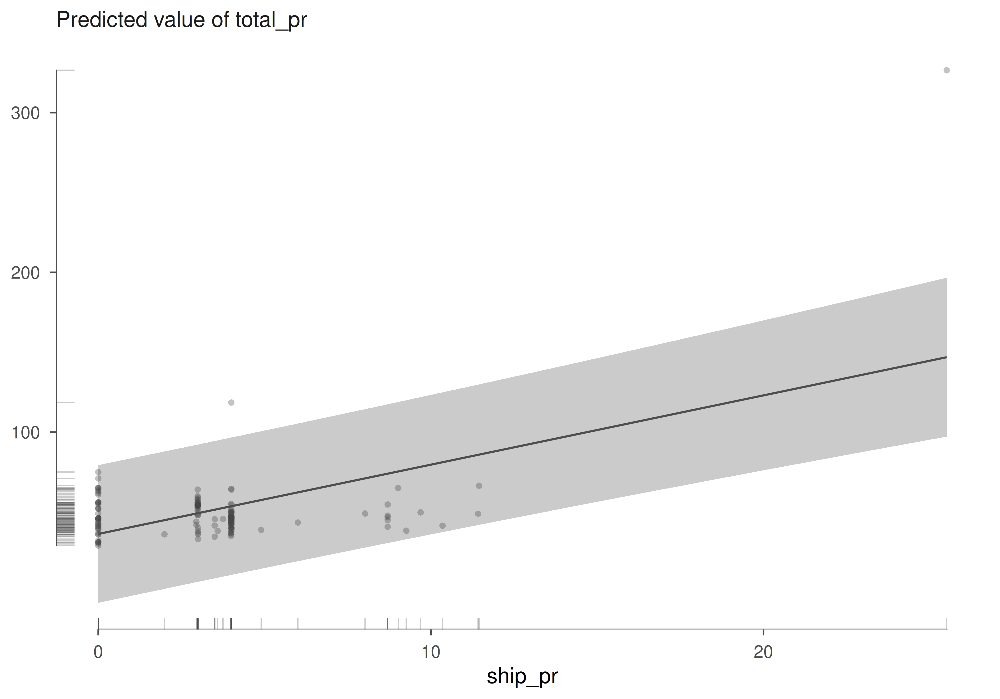{width="100%"}
:::
::::

::: footer
Fallbeispiel Mariokart
:::

## Wie gut ist `lm3`?

```r
mae(lm3)   # 13
r2(lm3)    # R2: 0.29
```

- Das Modell erklärt einen Anteil von ca. 0,29 der Gesamtstreuung.
- "Ich kann den Verkaufspreis von Mariokart-Spielen im Schnitt auf 13 Dollar genau vorhersagen!"
- Die Chefin hätte es gerne genauer. Kann man da noch was machen?

::: footer
Fallbeispiel Mariokart
:::

# Fallstudie Immobilienpreise {.center footer=false}

## Hintergrund: ein Prognosewettbewerb {.smaller}

Ziel: Immobilienpreise vorhersagen und die Vorhersagen als CSV bei [kaggle.com](https://www.kaggle.com/) einreichen — Kaggle-Competition "House Prices – Advanced Regression Techniques".

:::{.callout-caution}
Diese Fallstudie führt in die Prüfungsleistung "Prognosewettbewerb" ein.
:::

- `d_train` (*train.csv*): Häuser mit bekanntem Preis (`SalePrice`) — zum Modellbau
- `d_test` (*test.csv*): Häuser, deren Preis vorhergesagt werden soll
- *data_description.txt*: Codebook; *sample_submission.csv*: Beispiel einer Prognosedatei

::: footer
Fallstudie Immobilienpreise
:::

## Ein erstes Vorhersagemodell {.smaller}

Welche UV eignen sich? Einfache Antwort: Korrelation aller UV mit der AV berechnen.

```r
d_train |>
  select(-Id) |>
  correlation() |>
  filter(Parameter2 == "SalePrice") |>
  arrange(-abs(r)) |>
  filter(abs(r) > .3)   # nur |r| > .3
```

`OverallQual` (Zustand der Immobilie) korreliert am stärksten mit `SalePrice`:

```r
lm_immo1 <- lm(SalePrice ~ OverallQual, data = d_train)
rmse(lm_immo1)   # ca. 48600 Dollar
r2(lm_immo1)     # R2: 0.63
```

::: footer
Fallstudie Immobilienpreise
:::

## Mehrere Prädiktoren in einem Modell

```r
mein_modell <- lm(av ~ uv1 + uv2 + ... + uv_n, data = meine_daten)
```

Das Pluszeichen ist hier kein arithmetischer Operator, sondern bedeutet: "nimm UV1 *und* UV2 *und* … als Prädiktoren."

```r
lm_immo2 <- lm(SalePrice ~ OverallQual + GrLivArea + GarageCars,
               data = d_train)
```

::: footer
Fallstudie Immobilienpreise
:::

## Modellvergleich per RMSE {.smaller}

| Modell | Prädiktoren | RMSE (Dollar) | $R^2$ |
|:-------|:------------|--------------:|------:|
| `m0` | keine (Nullmodell, nur Mittelwert) | ca. 79 400 | 0 |
| `lm_immo1` | `OverallQual` | ca. 48 600 | 0,63 |
| `lm_immo2` | `OverallQual + GrLivArea + GarageCars` | ca. 40 600 | 0,74 |

Ob die Modellgüte "gut" ist, beurteilt man am besten *relativ* — im Vergleich zu anderen Modellen, mindestens zum Nullmodell.

::: footer
Fallstudie Immobilienpreise
:::

## Vom Modell zur eingereichten Prognose {.smaller}

```r
lm_immo2_pred <- predict(lm_immo2, newdata = d_test)

lm_immo2_subm <- d_test |>
  mutate(SalePrice = lm_immo2_pred) |>
  select(Id, SalePrice)

write_csv(lm_immo2_subm, "data/ames-kaggle/lm_immo2_subm.csv")
```

- Kaggle erwartet exakt zwei Spalten, `Id` und `SalePrice`, und so viele Zeilen wie `d_test`.
- `write_csv` statt `write.csv`: Letzteres fügt ungefragt eine namenlose Zeilennummern-Spalte ein.
- `lm_immo2` erzielte bei Kaggle einen Score von 0,555.

::: footer
Fallstudie Immobilienpreise
:::

## Wie geht es besser?

Diese Fallstudie hat ein einfaches Prognosemodell vorgestellt. Ansatzpunkte zur Verbesserung:

- Welche UV sollte ich in das Modell aufnehmen?
- Wie gehe ich mit fehlenden Werten um?
- Sollte ich eine schiefe UV log-transformieren?
- Sollte man manche UV quadrieren?
- Wie gehe ich mit nominalskalierten Variablen mit vielen Stufen um?

Viel Spielraum für Ihre Kreativität!

::: footer
Fallstudie Immobilienpreise
:::

## Zusammenfassung {.smaller}

- Ein **Geradenmodell** verallgemeinert das Punktmodell (Nullmodell, `y ~ 1`): $\hat{y} = \beta_0 + \beta_1 x$
- Achsenabschnitt ($\beta_0$) und Steigung ($\beta_1$) legen die Regressionsgerade fest; in R: `lm(y ~ x, data = d)`
- Die Koeffizienten werden per *Methode der kleinsten Quadrate* geschätzt — die Summe der quadrierten Residuen wird minimiert
- Vorhersagen für neue Daten: `predict(modell, newdata = ...)`
- **R²** misst die Verringerung der Fehlerstreuung gegenüber dem Nullmodell (Wertebereich 0–1); weitere Gütemaße: MAE, MSE, RMSE
- Regressionskoeffizienten sind ohne zugrundeliegende Theorie *nicht* kausal interpretierbar
- Mehrere Prädiktoren lassen sich mit `+` kombinieren; Modellgüte vergleicht man relativ zu anderen Modellen

## Literaturhinweise

- @gelman_regression_2021 — eine deutlich umfassendere Einführung in die Regressionsanalyse
- @cetinkaya-rundel_introduction_2021 — moderne, R-orientierte Einführung inklusive Regressionsanalyse
- @cohen_applied_2003 — ein Klassiker mit viel Aha-Potenzial

## Referenzen {.smaller}
